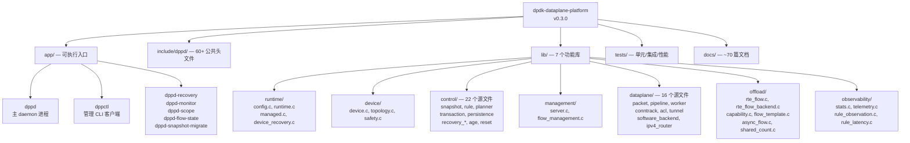
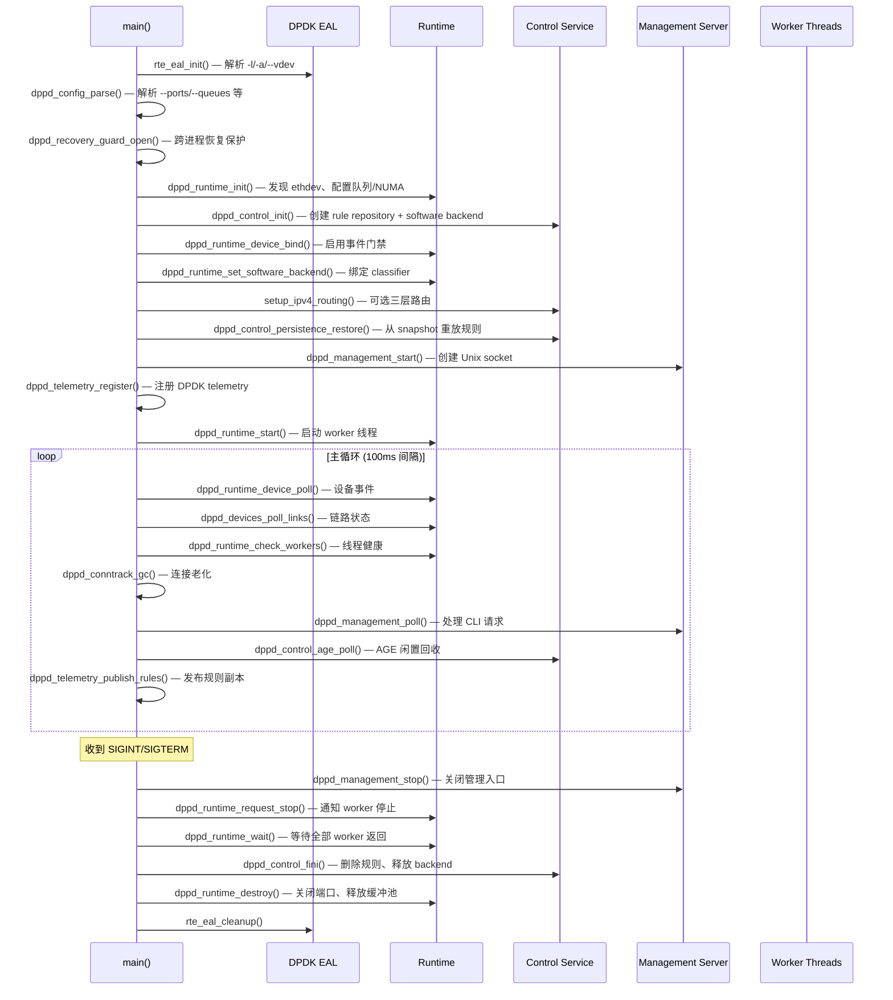
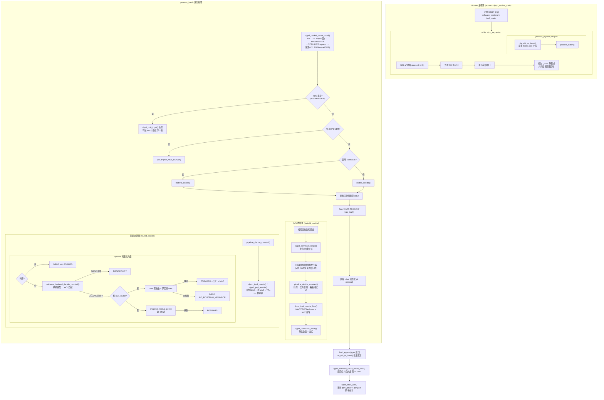
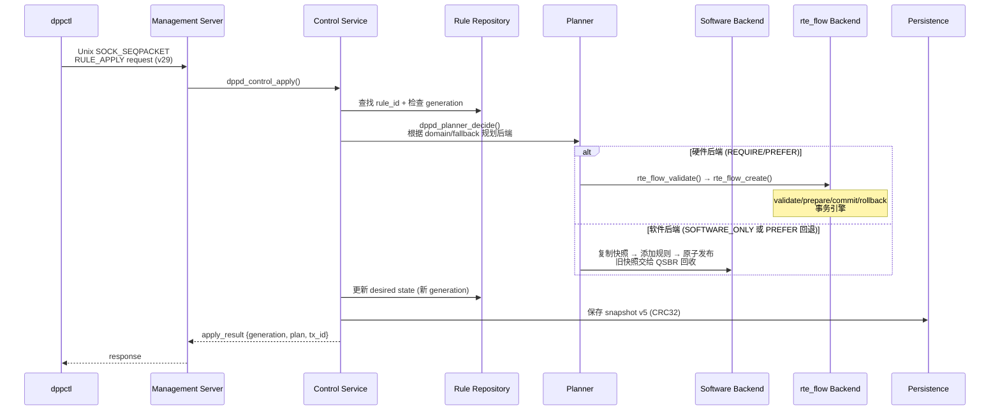
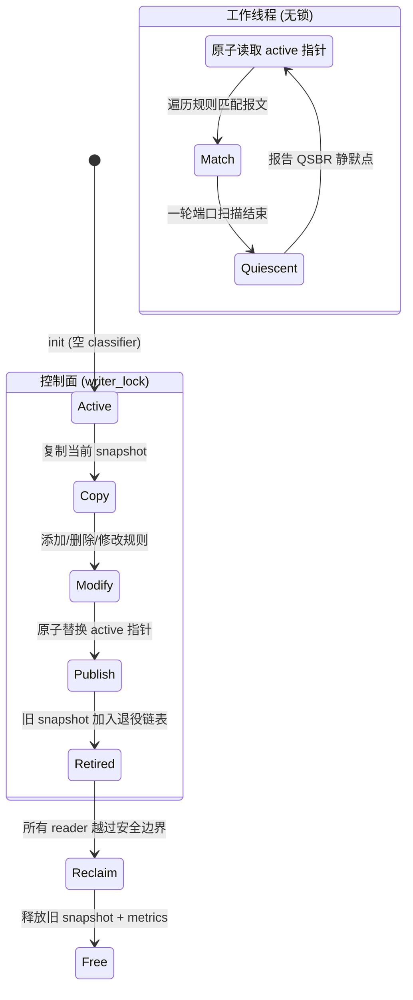
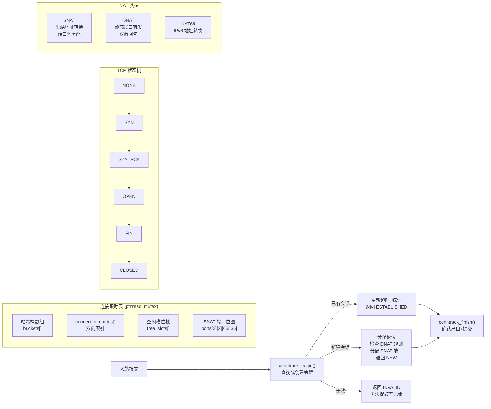
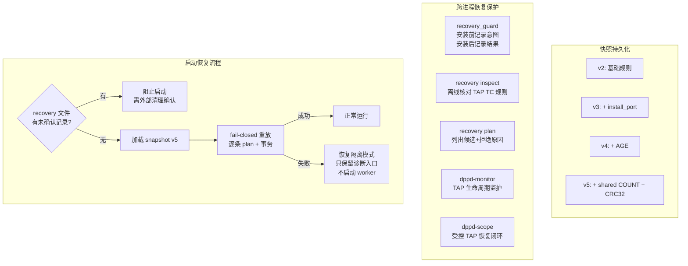

# dpdk-dataplane-platform 深度分析

## 一、项目定位

**一个面向现代 DPDK 21.11+ 的用户态高性能数据面平台**，同时支持 SmartNIC/DPU 的 `rte_flow` 硬件卸载和 representor/embedded-switch transfer 规则。

> [!IMPORTANT]
> 纯 C 语言（GNU C11），Meson 构建，**目标运行在 Linux**。当前 Windows 工作区仅用于代码阅读，不做真实编译或硬件验证。

| 指标 | 数值 |
|------|------|
| 版本 | v0.3.0 |
| C 源码文件 | 256 个 (.c/.h) |
| 代码行数 | ~63,800 行 |
| 文档 | ~70 篇 Markdown |
| 单元测试 | ~60+ 个测试文件 |
| 管理协议版本 | v29 |

---

## 二、仓库目录架构



---

## 三、进程启动生命周期

以下是 [main.c](file:///e:/GitHub-Study/dpdk-dataplane-platform/app/dppd/main.c) 中完整的启动→运行→退出流程：



---

## 四、报文处理完整路径

这是系统的核心——每个报文从网卡 RX 到 TX 的完整旅程：



### 关键数据结构

**[`dppd_packet`](file:///e:/GitHub-Study/dpdk-dataplane-platform/include/dppd/packet.h#L74-L110)** — 从报文头提取的字段副本（不持有报文指针）：

| 字段 | 用途 |
|------|------|
| `l3_type` | ARP / IPv4 / IPv6 |
| `l4_type` | UDP / TCP / Fragment / Other |
| `ipv4_src_be/dst_be` | IPv4 地址 (网络字节序) |
| `ipv6_src/dst[16]` | IPv6 地址 |
| `l4_src_port_be/dst_port_be` | L4 端口 |
| `vlan_tci[2], vlan_depth` | 最多 2 层 VLAN |
| `connection_state` | CT 状态位掩码 |
| `tunnel` | VXLAN/Geneve/GRE 元数据 |

**[`dppd_pipeline_decision`](file:///e:/GitHub-Study/dpdk-dataplane-platform/include/dppd/pipeline.h#L53-L66)** — 单包判定结果：

| 字段 | 用途 |
|------|------|
| `action` | DROP 或 FORWARD |
| `drop_reason` | 19 种丢弃原因 |
| `egress_port` | 出口端口 ID |
| `has_mark / mark_id` | 软件 MARK |
| `routed / ipv4` | 三层路由结果 (出口 MAC + port) |

---

## 五、控制面：规则生命周期



### 规则 IR：[`dppd_rule`](file:///e:/GitHub-Study/dpdk-dataplane-platform/include/dppd/rule.h#L101-L117)

```c
struct dppd_rule {
    uint64_t id;                    // 稳定标识
    uint64_t generation;            // 乐观并发版本号
    uint16_t install_port_id;       // 安装目标 ethdev
    enum dppd_rule_domain domain;   // INGRESS / EGRESS / TRANSFER
    enum dppd_fallback_policy fallback; // REQUIRE_HW / PREFER_HW / SOFTWARE
    uint32_t group, priority;
    struct dppd_match matches[8];   // ETH/IPv4/IPv6/TCP/UDP/RANGE/PROTOCOL/STATE
    struct dppd_action actions[8];  // DROP/QUEUE/MARK/COUNT/ALLOW/AGE/SHARED_COUNT
};
```

### 软件后端 QSBR 无锁发布机制



> [!TIP]
> 逐包路径**完全无锁** — worker 通过原子指针读取当前 classifier snapshot，`writer_lock` 只保护控制面的发布和回收操作。QSBR 确保旧快照在所有 worker 都报告静默点之后才被回收。

---

## 六、连接跟踪与 NAT

[`conntrack.c`](file:///e:/GitHub-Study/dpdk-dataplane-platform/lib/dataplane/conntrack.c) 实现了完整的有状态报文处理：



### 核心字段 [`dppd_conntrack`](file:///e:/GitHub-Study/dpdk-dataplane-platform/lib/dataplane/conntrack.c#L19-L29)

| 字段 | 说明 |
|------|------|
| `entries[]` | 连接条目数组 (哈希链表) |
| `buckets[]` | 哈希桶 (指向 entries 的索引) |
| `free_slots[]` + `free_count` | 空闲槽位栈 |
| `ports[2][2][65536]` | SNAT 端口占用位图 (per 方向, per 协议) |
| `dnat[32]` | 静态 DNAT 规则 |
| `clock_ms` | 单调时钟 |
| `status` | 统计: active/peak/created/expired/flushed |

---

## 七、管理协议 (v29)

[`management.h`](file:///e:/GitHub-Study/dpdk-dataplane-platform/include/dppd/management.h) 定义了 daemon 与 CLI 之间的 IPC：

| 属性 | 值 |
|------|-----|
| 传输 | Unix `SOCK_SEQPACKET` (保留消息边界) |
| 默认路径 | `/tmp/dppd-control.sock` |
| 版本检查 | 严格匹配，不兼容即拒绝 |
| 并发模型 | 主线程串行 poll，无需额外加锁 |

### 支持的 50+ 种操作

````carousel
**规则管理**
- `RULE_APPLY` — 单条创建/更新
- `RULE_CREATE_BATCH` — 2-4 条原子创建
- `RULE_DELETE` / `RULE_DELETE_BATCH` — 精确版本删除
- `RULE_UPDATE_BATCH` — 2-4 条原子替换
- `RULE_GET` / `RULE_LIST` — 查询
- `RULE_COUNT_QUERY` — 硬件/软件计数
- `RULE_STATUS` — 实际后端+安装记录
- `RULE_METRICS` / `RULE_LATENCY` / `RULE_HISTORY`
<!-- slide -->
**网络功能**
- `ROUTING_*` — IPv4 路由/邻居 CRUD + 原子替换
- `ROUTE6_*` / `NEIGHBOR6_*` — IPv6 路由/邻居
- `CONNTRACK_*` — 会话查询/清空
- `NAT_STATUS` / `DNAT_LIST` — NAT 状态
- `ND6_*` — 动态邻居发现管理
- `TRANSFER_PLAN` / `TRANSFER_APPLY` — embedded-switch 规则
- `AGE_STATUS` / `RULE_AGE_QUERY` — AGE 闲置老化
- `SHARED_COUNT_*` — 共享 COUNT 生命周期
<!-- slide -->
**系统运维**
- `PING` — 心跳 (返回 generation + rule count)
- `PORT_GET` — 端口详细信息 (MAC/driver/link/capabilities)
- `STATS_QUERY` — per-port/queue 收发统计
- `HEALTH_GET` — 就绪状态 + 12 种 blocker 位图
- `PERSISTENCE_STATUS/FLUSH` — 快照持久化管理
- `RECOVERY_STATUS/RETRY` — 恢复隔离操作
- `CAPABILITY_GET/PROBE/CLEAR` — 网卡能力画像
- `DEVICE_STATUS/RESET` — 设备事件与复位
- `FLOW_*` — M4 在线配置事务
````

---

## 八、恢复与持久化体系



---

## 九、里程碑状态

| 阶段 | 状态 | 核心交付 |
|------|------|----------|
| **M2** | ✅ 完成 | 软件数据面：解析、port-pair、路由、ACL、ConnTrack、NAT、IPv6、ND6 |
| **M3** | ✅ 完成 | 硬件闭环：rte_flow validate/create、transfer、AGE、共享 COUNT、角色发现 |
| **M4** | ✅ 完成 | Flow Template、有界异步队列、资源配额、背压、性能门禁 (82/82 单测) |
| **M5** | 🔶 进行中 | 配置持久化、进程重启恢复、在线模板事务 |

> [!NOTE]
> 物理网卡卸载、真实复位恢复和实机验收尚未完成。可通过 `python3 scripts/simulate_m3.py demo` 在本地模拟全功能演练。

---

## 十、核心设计亮点

### 1. 逐包路径零锁
Worker 通过原子指针读取不可变 snapshot，QSBR 保障旧版本安全回收，报文处理路径无 mutex/spinlock。

### 2. 统一规则 IR + 可解释 Planner
一份 `dppd_rule` 定义同时支持硬件 (`rte_flow`) 和软件 (classifier snapshot) 两条路径，Planner 给出可审计的后端选择理由。

### 3. 事务引擎 + 乐观并发
每个规则有稳定 ID + monotonic generation，validate → prepare → commit / rollback 四阶段事务，补偿失败进入恢复隔离而非静默丢数据。

### 4. 精细统计体系
[46 种原子统计指标](file:///e:/GitHub-Study/dpdk-dataplane-platform/include/dppd/stats_values.h)，per-worker + per-port 独立累计，19 种丢弃原因精确分类，cache line 对齐避免 false sharing。

### 5. 多层恢复保护
从 fail-closed 启动重放到跨进程安装日志、TAP 原生标识核对、监护进程握手、受控命名空间闭环恢复，构成完整的故障恢复链。
