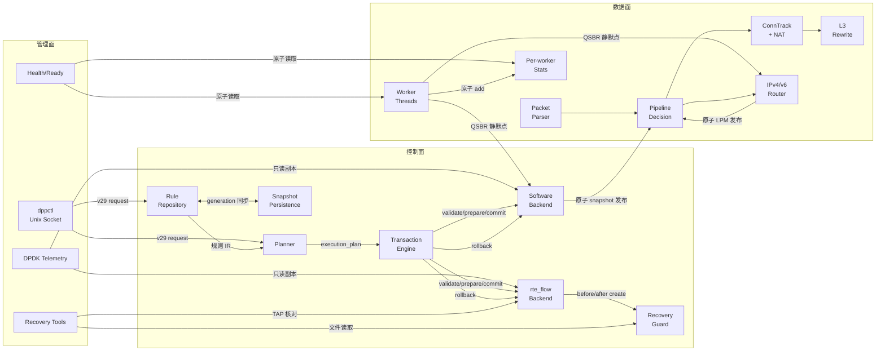

# 三大子系统详细架构图

---

## 一、数据面子系统（Data Plane）

> 负责逐包的高速收发与转发判定。核心原则：**每队列一个 lcore，run-to-completion，报文路径零锁**。

```mermaid
flowchart TB
    subgraph WorkerThread["Worker 线程 (worker.c — 每队列一个 lcore)"]
        direction TB
        REG["<b>线程启动</b><br/>注册 QSBR 读者<br/>software_backend.worker_register()<br/>ipv4_router.reader_register()"]
        REG --> STATE["atomic_store(RUNNING)"]
        STATE --> MAIN_LOOP

        subgraph MAIN_LOOP["主循环 while !worker_io_quiesced"]
            direction TB
            ND_TICK["<b>ND6 定时器</b> (queue_id==0)<br/>dppd_nd6_tick()"] --> ND_WAIT["<b>处理等待包</b><br/>dppd_nd6_take()<br/>→ process_batch(retry=true)"]
            ND_WAIT --> PORT_LOOP

            subgraph PORT_LOOP["遍历全部端口 (process_ingress)"]
                RX["<b>批量收包</b><br/>rte_eth_rx_burst(port, queue, burst_size)"]
                RX --> BATCH["process_batch()"]
            end

            PORT_LOOP --> QSBR_REPORT["<b>QSBR 静默点</b><br/>software_backend_worker_quiescent()<br/>ipv4_router_reader_quiescent()<br/>— 允许旧规则表被回收"]
        end

        MAIN_LOOP --> UNREG["<b>线程退出</b><br/>注销读者 → atomic_store(STOPPED)"]
    end

    subgraph ProcessBatch["process_batch — 逐包处理"]
        direction TB

        subgraph Parsing["① 报文解析 (packet.c / packet_mbuf.c)"]
            direction LR
            MBUF["rte_mbuf"] --> PARSE_ETH["<b>Ethernet</b><br/>dst/src MAC, EtherType"]
            PARSE_ETH --> PARSE_VLAN["<b>VLAN</b> (0-2层)<br/>vlan_tci[], vlan_tpid[]<br/>vlan_depth"]
            PARSE_VLAN --> PARSE_L3{"EtherType?"}
            PARSE_L3 --> |0x0806| ARP["<b>ARP</b><br/>l3_type=ARP"]
            PARSE_L3 --> |0x0800| IPV4["<b>IPv4</b><br/>src/dst_be, TTL<br/>protocol, total_len"]
            PARSE_L3 --> |0x86DD| IPV6["<b>IPv6</b><br/>src/dst[16], hop_limit<br/>扩展头解析"]
            IPV4 --> PARSE_L4{"IP Protocol?"}
            IPV6 --> PARSE_L4
            PARSE_L4 --> |6| TCP["<b>TCP</b><br/>ports, flags, seq/ack"]
            PARSE_L4 --> |17| UDP["<b>UDP</b><br/>ports"]
            PARSE_L4 --> |分片| FRAG["<b>Fragment</b><br/>MF, offset"]
            PARSE_L4 --> |other| OTHER["<b>Other</b>"]
        end

        Parsing --> TUNNEL["② <b>隧道解析</b> (tunnel.c)<br/>VXLAN (VNI) / Geneve (options)<br/>GRE (key/seq/checksum)<br/>只读元数据，不替换外层"]

        TUNNEL --> ND_INPUT{"③ <b>ND6 控制报文?</b><br/>NS/NA/RS/RA"}
        ND_INPUT -->|是| ND_PROC["dppd_nd6_input()<br/>更新邻居缓存<br/>释放 mbuf"]
        ND_INPUT -->|否| DAD_CHECK{"出口 DAD 就绪?"}
        DAD_CHECK -->|否| DROP_ND["DROP<br/>ND_NOT_READY"]
        DAD_CHECK -->|是| CT_BRANCH

        CT_BRANCH{"④ <b>启用 conntrack?</b>"}
        CT_BRANCH -->|否| STATELESS
        CT_BRANCH -->|是| STATEFUL

        subgraph STATELESS["无状态路径 (routed_decide)"]
            direction TB
            PIPE_ENTRY["pipeline_decide_counted()"]
            PIPE_ENTRY --> DECIDE_INNER
        end

        subgraph STATEFUL["有状态路径 (stateful_decide)"]
            direction TB
            L4_VALIDATE["传输层校验和验证<br/>ipv4_transport_validate()"]
            L4_VALIDATE --> CT_BEGIN["dppd_conntrack_begin()<br/>查找/创建会话"]
            CT_BEGIN --> REVERSE_NAT["用策略地址替换<br/>ipv4_src/dst, l4 ports<br/>(反向 NAT 恢复)"]
            REVERSE_NAT --> PIPE_ENTRY2["pipeline_decide_counted()"]
            PIPE_ENTRY2 --> DECIDE_INNER2["同下方判定逻辑"]
            DECIDE_INNER2 --> REWRITE_FLOW["dppd_ipv4_rewrite_flow()<br/>MAC + TTL + Checksum<br/>+ NAT 地址改写"]
            REWRITE_FLOW --> CT_FINISH["dppd_conntrack_finish()<br/>确认出口 + 提交"]
        end

        subgraph DECIDE_INNER["⑤ Pipeline 判定 (pipeline.c)"]
            direction TB
            MAL{"畸形?<br/>MALFORMED"} -->|是| D_MAL["DROP MALFORMED"]
            MAL -->|否| SW_RULES

            subgraph SW_RULES["软件规则匹配 (software_backend.c)"]
                direction TB
                READ_SNAP["原子读取 active snapshot"]
                READ_SNAP --> EXACT["<b>精确匹配</b> (exact.c)<br/>按 ingress + ETH/IPv4/IPv6 哈希"]
                EXACT -->|命中| EXEC_ACTION["执行动作"]
                EXACT -->|未命中| ACL_MATCH["<b>ACL 匹配</b> (acl.c)<br/>按 group → priority → ID<br/>IPv4/IPv6 地址掩码<br/>TCP/UDP 端口范围<br/>协议号, CT 状态"]
                ACL_MATCH --> EXEC_ACTION
                EXEC_ACTION --> |DROP| D_POLICY["DROP POLICY"]
                EXEC_ACTION --> |ALLOW| CONTINUE["继续路由"]
                EXEC_ACTION --> |MARK| SET_MARK["设置 mark_id"]
                EXEC_ACTION --> |COUNT| BATCH_COUNT["归并到 count_batch"]
            end

            CONTINUE --> ROUTER{"有路由器?"}
            ROUTER -->|是| LPM

            subgraph LPM["三层路由 (ipv4_router.c)"]
                direction TB
                LPM_LOOKUP["<b>LPM 最长前缀匹配</b><br/>IPv4: 32-bit prefix<br/>IPv6: 128-bit prefix"]
                LPM_LOOKUP --> NEIGHBOR["<b>邻居查表</b><br/>port_id + next_hop → MAC"]
                NEIGHBOR -->|找到| FWD["FORWARD<br/>egress + dest_mac"]
                LPM_LOOKUP -->|未找到| D_ROUTE["DROP NO_ROUTE"]
                NEIGHBOR -->|未找到| ND_RESOLVE{"IPv6 动态 ND?"}
                ND_RESOLVE -->|是| ND_RS["dppd_nd6_resolve()<br/>→ FORWARD 或 PENDING"]
                ND_RESOLVE -->|否| D_NEIGH["DROP NO_NEIGHBOR"]
            end

            ROUTER -->|否| PAIR["<b>端口配对</b><br/>snapshot_lookup_peer()<br/>0↔1, 2↔3"]
        end

        STATELESS --> EGRESS_PREP
        STATEFUL --> EGRESS_PREP

        subgraph EGRESS_PREP["⑥ 发送准备"]
            direction TB
            REWRITE_L3["<b>L3 改写</b> (ipv4_rewrite.c / ipv6_rewrite.c)<br/>• 目的 MAC ← 邻居表<br/>• 源 MAC ← 出口端口<br/>• IPv4: TTL-1 + 头校验和重算<br/>• IPv6: Hop Limit-1"]
            REWRITE_L3 --> MARK_WRITE["写入 MARK<br/>mbuf→hash.fdir.hi = mark_id"]
            MARK_WRITE --> LINEARIZE["多段 mbuf 线性化<br/>(if !MULTI_SEGS offload)"]
            LINEARIZE --> GROUP["按出口端口分组<br/>tx[port][count++] = mbuf"]
        end

        EGRESS_PREP --> FLUSH

        subgraph FLUSH["⑦ 批量发送 + 统计"]
            direction TB
            TX["<b>flush_egress()</b><br/>rte_eth_tx_burst() per 出口"]
            TX --> FREE_UNSENT["释放未发送 mbuf"]
            FREE_UNSENT --> COUNT_FLUSH["<b>COUNT 提交</b><br/>software_count_batch_flush()"]
            COUNT_FLUSH --> STATS_ADD["<b>统计更新</b><br/>dppd_stats_add()<br/>per-worker + per-port<br/>46 个原子计数器"]
        end
    end

    subgraph StatsDetail["统计指标 (stats_values.h — 46 个)"]
        direction LR
        S_RX["<b>收包</b><br/>rx_packets<br/>rx_bytes"]
        S_TX["<b>发包</b><br/>tx_packets<br/>tx_bytes"]
        S_DROP["<b>丢弃</b><br/>rx_malformed<br/>rx_unsupported<br/>policy_drops<br/>rule_drops<br/>no_route_drops<br/>egress_drops<br/>tx_drops / tx_queue_drops<br/>tx_linearize_drops"]
        S_IPV4["<b>IPv4</b><br/>ipv4_ttl_drops<br/>ipv4_checksum_drops<br/>ipv4_unsupported_drops<br/>ipv4_rewrite_drops"]
        S_IPV6["<b>IPv6</b><br/>ipv6_hop_drops<br/>ipv6_checksum_drops<br/>ipv6_unsupported_drops<br/>ipv6_rewrite_drops"]
        S_CT["<b>ConnTrack</b><br/>ct_invalid_drops<br/>ct_full_drops<br/>ct_unsupported_drops<br/>ct_zone_drops<br/>ct_checksum_drops<br/>nat_pool_drops<br/>nat_miss_drops"]
        S_ND["<b>ND6</b><br/>nd6_rx/tx_packets<br/>nd6_queued<br/>nd6_queue_drops<br/>nd6_not_ready_drops"]
        S_TUNNEL["<b>隧道</b><br/>tunnel_vxlan_packets<br/>tunnel_geneve_packets<br/>tunnel_gre_packets<br/>tunnel_malformed<br/>tunnel_unsupported"]
    end
```

### 数据面关键数据结构

| 结构体 | 文件 | 核心字段 |
|--------|------|----------|
| [`dppd_packet`](file:///e:/GitHub-Study/dpdk-dataplane-platform/include/dppd/packet.h#L74) | packet.h | `l3_type`, `l4_type`, `ipv4_src/dst_be`, `ipv6_src/dst[16]`, `l4_src/dst_port_be`, `vlan_tci[2]`, `tcp_flags`, `connection_state`, `tunnel` |
| [`dppd_pipeline_decision`](file:///e:/GitHub-Study/dpdk-dataplane-platform/include/dppd/pipeline.h#L53) | pipeline.h | `action` (DROP/FORWARD), `drop_reason` (19 种), `egress_port`, `has_mark`, `routed`, `ipv4` (MAC+port) |
| [`dppd_worker`](file:///e:/GitHub-Study/dpdk-dataplane-platform/include/dppd/runtime.h#L30) | runtime.h | `lcore_id`, `queue_id`, `state` (原子), `stats`, `port_stats[MAX_PORTS]` |
| [`dppd_conntrack`](file:///e:/GitHub-Study/dpdk-dataplane-platform/lib/dataplane/conntrack.c#L19) | conntrack.c | `entries[]`, `buckets[]`, `free_slots[]`, `ports[2][2][65536]` (SNAT 位图), `dnat[32]` |
| [`dppd_connection_attempt`](file:///e:/GitHub-Study/dpdk-dataplane-platform/include/dppd/conntrack.h#L66) | conntrack.h | `policy` (策略五元组), `rewrite` (改写五元组), `state`, `reply`, `nat` |
| [`dppd_worker_stats`](file:///e:/GitHub-Study/dpdk-dataplane-platform/include/dppd/stats.h#L9) | stats.h | 46 个 `atomic_uint_fast64_t` 字段, `__rte_cache_aligned` 防 false sharing |

---

## 二、控制面子系统（Control Plane）

> 负责规则全生命周期管理：从 desired state 到 actual state，软硬件统一事务，持久化与恢复。

```mermaid
flowchart TB
    subgraph ControlService["Control Service (control.h / control.c)"]
        direction TB

        subgraph RuleRepo["① 规则仓库 (rule_repository.h)"]
            direction TB
            REPO_STORE["<b>dppd_rule_repository</b><br/>• records[] — 规则记录数组<br/>• slot_index — 紧凑槽位索引<br/>• capacity — 逻辑上限 (默认 1024)<br/>• count — 当前规则数<br/>• generation — 全局单调修订号"]
            REPO_API["<b>API</b><br/>apply() — 创建/更新单条<br/>create_batch() — 批量新建<br/>update_batch() — 批量替换<br/>remove/remove_batch() — 删除<br/>restore() — 启动恢复装入<br/>get/list() — 分页查询"]
        end

        subgraph RuleIR["② 规则 IR (rule.h)"]
            direction TB
            RULE_STRUCT["<b>dppd_rule</b><br/>• id: uint64 — 稳定标识<br/>• generation: uint64 — 版本号<br/>• install_port_id: uint16<br/>• domain: INGRESS/EGRESS/TRANSFER<br/>• fallback: REQUIRE_HW/PREFER_HW/SOFTWARE<br/>• group, priority: uint32"]
            RULE_MATCH["<b>matches[8]</b><br/>ETH / IPv4 / IPv6<br/>TCP / UDP / RANGE<br/>IP_PROTOCOL<br/>CONNECTION_STATE<br/>REPRESENTED_PORT"]
            RULE_ACTION["<b>actions[8]</b><br/>DROP / QUEUE / MARK<br/>COUNT / ALLOW<br/>AGE (闲置超时)<br/>SHARED_COUNT<br/>REPRESENTED_PORT"]
        end

        subgraph Planner["③ 规划器 (planner.h)"]
            direction TB
            PLAN_CTX["<b>dppd_planner_context</b><br/>• topology — 设备拓扑<br/>• install_port_id<br/>• hardware_available<br/>• software_equivalent<br/>• ipv4_routing / conntrack / nd6"]
            PLAN_EXEC["<b>dppd_execution_plan</b><br/>• backend: SOFTWARE / RTE_FLOW<br/>• reason: 10 种可解释原因<br/>• requires_validation<br/>• fallback_used"]
            PLAN_REASONS["<b>规划原因</b><br/>SOFTWARE_REQUESTED — 显式软件<br/>HARDWARE_SELECTED — 硬件优先<br/>SOFTWARE_FALLBACK — 硬件失败回退<br/>HARDWARE_UNAVAILABLE — 无硬件能力<br/>NO_EQUIVALENT_FALLBACK — 无等价软件<br/>TRANSFER_DOMAIN_MISMATCH — 域不匹配<br/>INVALID_RULE — 规则不合法"]
        end

        subgraph Transaction["④ 事务引擎 (transaction.h)"]
            direction TB
            TX_STRUCT["<b>dppd_transaction</b><br/>• id — 事务编号<br/>• state — 8 种状态<br/>• items[] — 事务条目<br/>• failure_code / rollback_code<br/>• failure_stage / failure_item"]

            TX_STATES["<b>事务状态机</b>"]

            TX_BACKEND["<b>transaction_backend 回调</b><br/>• validate(item) — 能力检查<br/>• prepare(item) → token — 预留资源<br/>• commit(item, token) — 正式安装<br/>• rollback(item, token, attempted) — 撤销<br/>• finalize(item, token) — 释放临时资源"]
        end

        subgraph SWBackend["⑤ 软件后端 (software_backend.h)"]
            direction TB
            SW_STRUCT["<b>dppd_software_backend</b><br/>• active — 原子 snapshot 指针<br/>• retired — 退役 snapshot 链表<br/>• qsbr — DPDK RCU 回收器<br/>• writer_lock — 控制面互斥锁<br/>• capacity — 最大规则数<br/>• shared_counts — 共享计数库<br/>• latency_single/batch — 耗时直方图"]
            SW_SNAP["<b>classifier_snapshot</b><br/>• objects[] — 规则+动作+计数<br/>• exact — 精确匹配哈希表<br/>• acl — ACL 编译表"]
            SW_METRICS["<b>rule_metrics (per 规则)</b><br/>• atomic hits/bytes — 多线程累计<br/>• references — 引用计数<br/>• install_duration_ns<br/>• shared_lease — 共享 COUNT 绑定"]
            SW_FLOW["<b>无锁发布流程</b><br/>1. writer_lock 内复制 snapshot<br/>2. 修改副本(添加/删除规则)<br/>3. 原子替换 active 指针<br/>4. 旧 snapshot → retired 链表<br/>5. QSBR 确认全部读者越界后释放"]
        end

        subgraph HWBackend["⑥ 硬件后端 (rte_flow_backend.h)"]
            direction TB
            HW_STRUCT["<b>dppd_rte_flow_backend</b><br/>• objects[] — flow 对象数组<br/>• slot_index — 版本索引<br/>• shared_counts[] — 共享计数对象<br/>• capacity / count<br/>• quarantined — 隔离标记<br/>• api — 驱动接口集合<br/>• probes — 能力探测缓存<br/>• latency — 安装耗时直方图"]
            HW_API["<b>dppd_flow_api 接口</b><br/>• validate(port, rule, error)<br/>• create(port, rule) → handle<br/>• remove(handle)<br/>• query_count(handle) → hits/bytes<br/>• query_age(handle) → age_result<br/>• create_owned(port, rule, cookie)<br/>• shared_count_create/query/destroy<br/>• simulate_reset"]
            HW_HOOKS["<b>安装保护回调</b><br/>• before_create → 持久化意图<br/>• after_create → 记录结果<br/>• after_remove → 记录删除<br/>• before/after_shared_create/remove"]
        end

        subgraph Persistence["⑦ 持久化 (persistence.c)"]
            direction TB
            PERSIST_VERSIONS["<b>快照版本</b><br/>v2: 基础规则<br/>v3: + install_port<br/>v4: + AGE timeout<br/>v5: + shared COUNT + CRC32"]
            PERSIST_API["<b>API</b><br/>attach(path) — 绑定保存路径<br/>restore(path) — fail-closed 恢复<br/>flush() — 立即保存<br/>status() — dirty/generation/error"]
        end

        subgraph Recovery["⑧ 恢复保护"]
            direction TB
            REC_GUARD["<b>recovery_guard</b><br/>安装前记录端口身份+意图<br/>安装后记录 create/remove 结果<br/>未确认时阻止下次启动"]
            REC_INSPECT["<b>recovery_inspect</b><br/>离线核对 TAP TC 规则<br/>比较 cookie 标识"]
            REC_PLAN["<b>recovery_plan</b><br/>候选列表 + 拒绝原因<br/>跨端口重复检查<br/>查询窗口监视"]
            REC_MONITOR["<b>recovery_monitor</b><br/>TAP 生命周期监护<br/>会话握手 + 新鲜回复"]
            REC_SCOPE["<b>recovery_scope</b><br/>受控命名空间<br/>root 启动器 → 非 root 业务<br/>崩溃后精确清理 + 重放"]
        end

        subgraph AGE_SC["⑨ AGE + 共享 COUNT"]
            direction TB
            AGE_MOD["<b>AGE 闲置回收</b> (age.h)<br/>• 主线程按预算轮询<br/>• 查询驱动 AGE 状态<br/>• 到期删除精确版本<br/>• 失败保留规则并统计"]
            SC_MOD["<b>共享 COUNT</b> (shared_count.h)<br/>• indirect 对象生命周期<br/>• 精确版本绑定<br/>• 引用保护 (有规则引用时不能删)<br/>• 独立汇总查询"]
        end
    end

    subgraph TxStateMachine["事务状态机"]
        direction LR
        T_NEW["NEW"] --> T_VALIDATING["VALIDATING"]
        T_VALIDATING --> T_PREPARING["PREPARING"]
        T_PREPARING --> T_COMMITTING["COMMITTING"]
        T_COMMITTING --> T_COMMITTED["COMMITTED"]
        T_COMMITTED --> T_FINALIZED["FINALIZED<br/>(成功完成)"]

        T_VALIDATING --> T_FAILED["FAILED"]
        T_PREPARING --> T_ROLLING_BACK["ROLLING_BACK"]
        T_COMMITTING --> T_ROLLING_BACK
        T_ROLLING_BACK --> T_ROLLED_BACK["ROLLED_BACK"]
        T_ROLLING_BACK --> T_FAILED
    end

    subgraph RecoveryStateMachine["恢复状态机"]
        direction LR
        R_READY["READY<br/>正常运行"] --> |"补偿失败"| R_RECONCILE["RECONCILIATION<br/>_REQUIRED<br/>保留 handle<br/>只保留诊断"]
        R_RECONCILE --> |"残留清理成功"| R_RESTART["RESTART<br/>_REQUIRED<br/>必须退出重启"]
    end
```

### 控制面关键数据结构

| 结构体 | 文件 | 核心字段 |
|--------|------|----------|
| [`dppd_control_service`](file:///e:/GitHub-Study/dpdk-dataplane-platform/include/dppd/control.h#L26) | control.h | `topology`, `rules` (repository), `rte_flow` (HW backend), `software` (SW backend), `routing`, `conntrack`, `nd6`, `persistence_path`, `recovery_state`, `observation`, `age` |
| [`dppd_rule`](file:///e:/GitHub-Study/dpdk-dataplane-platform/include/dppd/rule.h#L101) | rule.h | `id`, `generation`, `install_port_id`, `domain`, `fallback`, `matches[8]`, `actions[8]` |
| [`dppd_rule_repository`](file:///e:/GitHub-Study/dpdk-dataplane-platform/include/dppd/rule_repository.h#L24) | rule_repository.h | `records[]`, `slot_index`, `capacity`, `count`, `generation` |
| [`dppd_execution_plan`](file:///e:/GitHub-Study/dpdk-dataplane-platform/include/dppd/planner.h#L39) | planner.h | `backend` (SOFTWARE/RTE_FLOW), `reason` (10 种), `fallback_used` |
| [`dppd_transaction`](file:///e:/GitHub-Study/dpdk-dataplane-platform/include/dppd/transaction.h#L74) | transaction.h | `id`, `state` (8 种), `items[]`, `failure_code`, `rollback_code` |
| [`dppd_rte_flow_backend`](file:///e:/GitHub-Study/dpdk-dataplane-platform/include/dppd/rte_flow_backend.h#L53) | rte_flow_backend.h | `objects[]`, `slot_index`, `shared_counts[]`, `quarantined`, `api` (6 个驱动回调), `before/after_create` (保护钩子) |
| [`dppd_software_backend`](file:///e:/GitHub-Study/dpdk-dataplane-platform/include/dppd/software_backend.h#L45) | software_backend.h | `active` (原子 snapshot), `retired` (链表), `qsbr`, `writer_lock`, `latency_single/batch` |

---

## 三、管理面子系统（Management Plane）

> 负责 daemon 与外部的全部交互：CLI 命令、telemetry 查询、健康检测、诊断。

```mermaid
flowchart TB
    subgraph ExternalClients["外部客户端"]
        direction TB
        CLI["<b>dppctl</b><br/>本机管理 CLI<br/>(app/dppctl/)"]
        TELE_CLIENT["<b>dpdk-telemetry</b><br/>JSON-RPC 查询<br/>(/var/run/dpdk/.../telemetry)"]
        TOOLS["<b>运维工具</b><br/>dppd-recovery show/inspect/plan<br/>dppd-monitor<br/>dppd-scope<br/>dppd-flow-state"]
    end

    subgraph MgmtServer["Management Server (management.h / server.c)"]
        direction TB
        SOCKET["<b>Unix SOCK_SEQPACKET</b><br/>路径: /tmp/dppd-control.sock<br/>非阻塞监听<br/>主线程串行 poll"]
        PROTO["<b>协议 v29</b><br/>request.version == 29 严格匹配<br/>request.size == sizeof 检查<br/>request.operation → dispatch<br/>response.status: 0 或 -errno"]
        HANDLE["<b>dppd_management_handle()</b><br/>纯协议分发，不执行 socket I/O<br/>便于单元测试覆盖"]
    end

    subgraph Operations["50+ 管理操作 (按类别)"]
        direction TB

        subgraph OP_RULE["<b>规则管理</b> (12 种)"]
            direction TB
            OP_R1["RULE_APPLY — 单条创建/更新"]
            OP_R2["RULE_CREATE_BATCH — 2-4 条原子创建"]
            OP_R3["RULE_DELETE — 单条精确删除"]
            OP_R4["RULE_DELETE_BATCH — 2-4 条原子删除"]
            OP_R5["RULE_UPDATE_BATCH — 2-4 条原子替换"]
            OP_R6["RULE_GET — 查询完整规则"]
            OP_R7["RULE_LIST — 分页列表 (4 条/页)"]
            OP_R8["RULE_COUNT_QUERY — 查询 COUNT"]
            OP_R9["RULE_STATUS — 实际后端+安装记录"]
            OP_R10["RULE_METRICS — 累计指标+失败分类"]
            OP_R11["RULE_LATENCY — 安装耗时 P50/P95/P99"]
            OP_R12["RULE_HISTORY — 最近 64 次失败历史"]
        end

        subgraph OP_NET["<b>网络功能</b> (20 种)"]
            direction TB
            OP_N1["ROUTING_STATUS/GET/REPLACE/FLUSH"]
            OP_N2["ROUTE_SET/DELETE"]
            OP_N3["NEIGHBOR_SET/DELETE"]
            OP_N4["ROUTE6_SET/DELETE"]
            OP_N5["NEIGHBOR6_SET/DELETE"]
            OP_N6["CONNTRACK_STATUS/LIST/FLUSH"]
            OP_N7["NAT_STATUS / DNAT_LIST"]
            OP_N8["ND6_STATUS/LIST/FLUSH"]
        end

        subgraph OP_OFFLOAD["<b>硬件卸载</b> (10 种)"]
            direction TB
            OP_O1["TRANSFER_PLAN — embedded-switch 图规划"]
            OP_O2["TRANSFER_APPLY — 整批安装 transfer 规则"]
            OP_O3["AGE_STATUS — 闲置老化统计"]
            OP_O4["RULE_AGE_QUERY — 单条 AGE 查询"]
            OP_O5["SHARED_COUNT_CREATE/GET/QUERY/DELETE/LIST"]
            OP_O6["DEVICE_STATUS — 设备事件快照"]
            OP_O7["DEVICE_RESET — 精确代次的全组复位"]
        end

        subgraph OP_SYS["<b>系统运维</b> (12 种)"]
            direction TB
            OP_S1["PING — 心跳 (generation + rule_count)"]
            OP_S2["PORT_GET — 端口详情 (MAC/driver/link/caps)"]
            OP_S3["STATS_QUERY — per-port/queue 收发统计"]
            OP_S4["HEALTH_GET — 就绪 + 12 种 blocker 位图"]
            OP_S5["PERSISTENCE_STATUS — dirty/generation/error"]
            OP_S6["PERSISTENCE_FLUSH — 立即保存快照"]
            OP_S7["RECOVERY_STATUS — 恢复隔离状态"]
            OP_S8["RECOVERY_RETRY — 残留清理重试"]
            OP_S9["CAPABILITY_GET — 网卡能力画像"]
            OP_S10["CAPABILITY_PROBE — 规则探测 (不安装)"]
            OP_S11["CAPABILITY_CLEAR — 清除探测缓存"]
            OP_S12["FLOW_* — M4 在线配置事务 (6 种)"]
        end
    end

    subgraph Telemetry["Telemetry 子系统 (telemetry.c)"]
        direction TB
        TELE_REG["<b>dppd_telemetry_register()</b><br/>注册到 DPDK telemetry 框架"]
        TELE_PUB["<b>dppd_telemetry_publish_rules()</b><br/>每轮主循环更新副本<br/>查询线程只读取副本"]
        TELE_ENDPOINTS["<b>Telemetry 端点</b><br/>/dppd/rule_failures — 累计失败统计<br/>/dppd/rules — 全部规则摘要<br/>/dppd/rule,ID — 单条规则详情<br/>/dppd/rule_latency — 耗时分布<br/>/dppd/rule_latency,kind — 按类型<br/>/dppd/rule_history — 失败历史"]
        TELE_UNREG["<b>dppd_telemetry_unregister()</b><br/>先停止查询借用<br/>再释放规则副本"]
    end

    subgraph HealthSystem["健康与就绪 (management.h)"]
        direction TB
        HEALTH["<b>dppd_management_health</b><br/>• ready: bool — 综合就绪"]
        BLOCKERS["<b>12 种 blocker 位图</b><br/>NO_RUNTIME — 未初始化<br/>STOP_REQUESTED — 停止中<br/>DEVICE_REMOVED — 设备移除<br/>WORKERS_NOT_RUNNING — 线程未就绪<br/>PORTS_NOT_STARTED — 端口未启动<br/>LINK_DOWN — 链路断开<br/>LINK_UNKNOWN — 链路未知<br/>RECOVERY_REQUIRED — 需要恢复<br/>PERSISTENCE_DIRTY — 未持久化<br/>WORKER_FAILED — 线程异常<br/>ROUTING_DIRTY — 路由未保存<br/>ND6_NOT_READY — DAD 未完成"]
        WORKER_STATE["<b>线程状态跟踪</b><br/>workers_expected / running / failed<br/>ports_expected / started<br/>links_up / down / unknown / unsupported"]
    end

    subgraph Observability["可观测性模块"]
        direction TB
        OBS_STATS["<b>stats.c</b><br/>dppd_worker_stats — per-worker 原子计数<br/>dppd_stats_add() — 增量累加<br/>dppd_stats_read() — 快照读取<br/>dppd_stats_accumulate() — 汇总<br/>__rte_cache_aligned 防 false sharing"]
        OBS_LATENCY["<b>rule_latency.c</b><br/>dppd_rule_latency_histogram<br/>• 6 个区间桶: <1μs, <10μs, <100μs,<br/>  <1ms, <10ms, ≥10ms<br/>• count, sum_ns<br/>• P50/P95/P99 上界"]
        OBS_OBSERVE["<b>rule_observation.c</b><br/>dppd_rule_observation<br/>• 最近失败详情 (rule_metrics)<br/>• 最近 64 次失败历史 (rule_history)<br/>• 分页查询 + 版本校验"]
        OBS_CAPABILITY["<b>capability.c</b><br/>dppd_capability_identity — 设备身份<br/>dppd_flow_probe_cache — 5 秒诊断缓存<br/>dppd_flow_probe_result — 驱动校验 + 软件等价"]
    end

    CLI -->|"SOCK_SEQPACKET<br/>request/response"| SOCKET
    TELE_CLIENT -->|"JSON-RPC"| TELE_ENDPOINTS
    TOOLS -->|"独立进程<br/>文件/信号"| RecoveryTools

    subgraph RecoveryTools["恢复工具集"]
        direction TB
        RT1["<b>dppd-recovery show</b><br/>查看未确认安装记录"]
        RT2["<b>dppd-recovery inspect PATH REV</b><br/>核对 TAP TC 规则"]
        RT3["<b>dppd-recovery plan PATH REV</b><br/>生成清理计划"]
        RT4["<b>dppd-monitor</b><br/>独立 TAP 监护进程"]
        RT5["<b>dppd-scope run</b><br/>受控命名空间恢复闭环"]
        RT6["<b>dppd-flow-state</b><br/>配置初始化/校验/恢复"]
        RT7["<b>dppd-snapshot-migrate</b><br/>v1→v2+ 离线转换"]
    end
```

### 管理面关键数据结构

| 结构体 | 文件 | 核心字段 |
|--------|------|----------|
| [`dppd_management_request`](file:///e:/GitHub-Study/dpdk-dataplane-platform/include/dppd/management.h#L140) | management.h | `version` (29), `operation`, `size`, `request_id`, `payload` (union: apply/create_batch/delete_batch/stats_query 等) |
| [`dppd_management_response`](file:///e:/GitHub-Study/dpdk-dataplane-platform/include/dppd/management.h#L421) | management.h | `version`, `operation`, `size`, `request_id`, `status` (-errno), `payload` (union: pong/rule/port/health 等) |
| [`dppd_management_health`](file:///e:/GitHub-Study/dpdk-dataplane-platform/include/dppd/management.h#L388) | management.h | `ready`, `blockers` (12 bit), `workers_expected/running/failed`, `links_up/down`, `rule_count`, `routing` |
| [`dppd_management_port_info`](file:///e:/GitHub-Study/dpdk-dataplane-platform/include/dppd/management.h#L305) | management.h | `port_id`, `mac[6]`, `driver_name`, `link_state`, `role`, `switch_domain_id`, `capabilities` |
| [`dppd_management_server`](file:///e:/GitHub-Study/dpdk-dataplane-platform/include/dppd/management.h#L526) | management.h | `socket_fd`, `control` (借用), `devices` (借用), `runtime`, `socket_path`, `started` |
| [`dppd_topology`](file:///e:/GitHub-Study/dpdk-dataplane-platform/include/dppd/topology.h#L57) | topology.h | `endpoints[]`: `kind` (ETHDEV/REPRESENTOR), `role` (UPLINK/PF/VF/SF), `driver_name`, `switch_domain_id`, `if_index` |

---

## 三大子系统交互总览

> [!TIP]
> 三大子系统之间的核心同步机制：
> - **控制面 → 数据面**：原子指针替换（snapshot / LPM table），**无锁**
> - **数据面 → 控制面**：QSBR 静默点报告，允许旧版本安全回收
> - **管理面 → 控制面**：主线程串行 poll，**无需额外加锁**
> - **管理面 → 数据面**：原子统计读取 (`atomic_load`)，**无锁**
