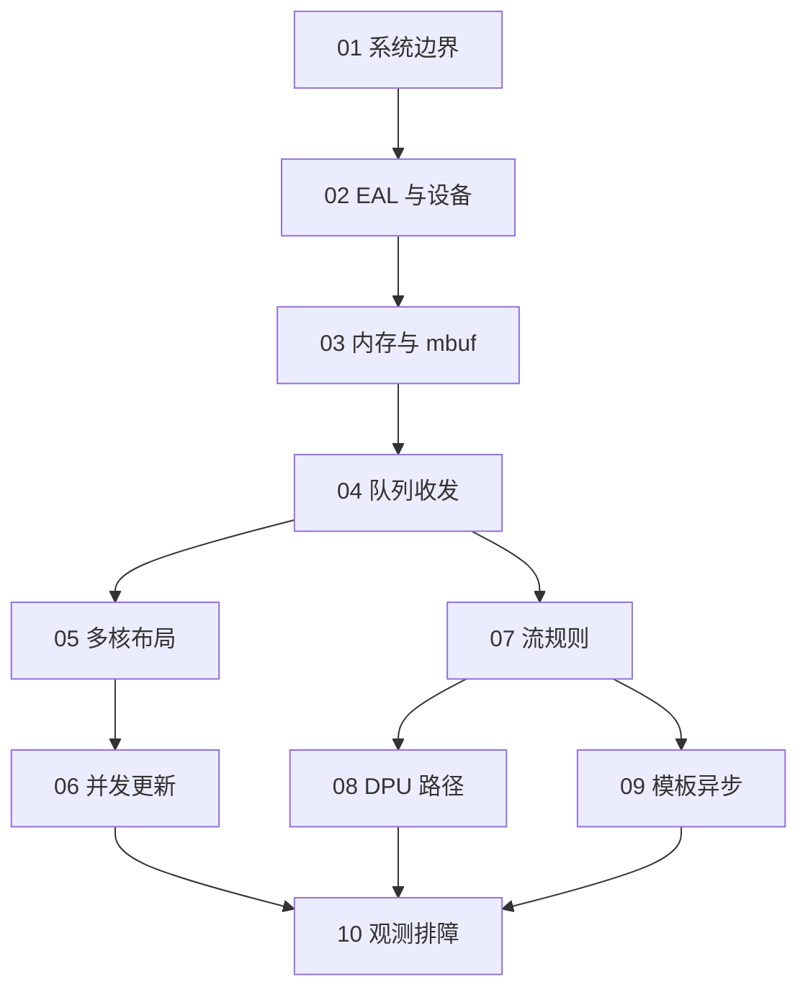

# 从本项目理解 DPDK 原理与应用

优先打开新的 [HTML 深度样章：一个包怎样从网卡进入程序](reader/index.html)。
它把描述符、DMA、mbuf 和 RX burst 放进同一条因果链，提供七步推演、资源计算练习、源码追踪和折叠自检。
下载仓库后可直接用浏览器打开，无需安装依赖或启动服务；GitHub 文件页默认展示 HTML 源码。
这一章用于评估新的讲解深度与阅读形式，下面原有十章保留作参考。

这套教程围绕三个问题展开：报文实际在哪里，谁拥有它，以及一次 API 调用改变了什么。
先看原理图和具体推演，再到本项目找调用点，最后通过实验验证自己的预测。
阅读完成后，应能解释收发和内存生命周期、追踪 PMD 调用、定位丢包，并区分软件转发与硬件卸载。

源码核查基线：`380d7da738eb363ae1424228e332249326ae1b54`，日期：2026-10-29。
教程以项目验证过的 DPDK 21.11.9 与 24.11.8 为背景；原生模板/异步适配的版本边界见 [版本说明](reference/versions.md)。
后续只修改文档的提交不会改变此代码基线。当前工作树链接方便走读，精确复核用上述 Git 提交。

## 学习顺序

| 阶段 | 读完应能回答的问题 | 入口 |
| --- | --- | --- |
| 01 全局认识 | CPU、内核、PMD、网卡分别做什么 | [全局模型](chapters/01-overview.md) |
| 02 启动与设备 | EAL、绑核、设备发现和 DMA 地址如何衔接 | [EAL 与设备](chapters/02-eal-devices.md) |
| 03 内存与报文 | mbuf、数据区、引用、多段包分别是什么 | [内存与 mbuf 样章](chapters/03-memory-mbuf.md) |
| 04 队列与收发 | RX/TX 描述符、burst 和发送回收怎样工作 | [队列与收发](chapters/04-queues-io.md) |
| 05 多核与性能 | 队列怎样分给 worker，NUMA 和 RSS 影响什么 | [多核与性能](chapters/05-multicore-performance.md) |
| 06 并发更新 | 发布新表后为什么不能立即释放旧表 | [QSBR](chapters/06-qsbr.md) |
| 07 规则卸载 | validate、create、COUNT 和 AGE 有什么边界 | [rte_flow](chapters/07-rte-flow.md) |
| 08 SmartNIC/DPU | representor 和 transfer 怎样改变报文路径 | [SmartNIC 与 DPU](chapters/08-smartnic-dpu.md) |
| 09 模板与异步 | 排队、push、完成和业务回执有什么区别 | [模板与异步](chapters/09-async-templates.md) |
| 10 观测与排障 | 怎样判断卡在入口、策略、出口还是回收 | [观测与排障](chapters/10-observability-debugging.md) |

已有收发基础时，可以先读第 03 章，再回到第 01、02 章补全环境模型。
每章的自检题附有参考答案，先独立解释再展开比对。
原来的 [项目源码学习材料](../learning/README.md) 按业务调用过程组织，本目录按 DPDK 机制组织，两者互补。

## 图怎样阅读

每章包含可在 GitHub 渲染的 Mermaid 图；内存图使用 SVG 或明确标注的文本布局。
实线的意义以图中标签为准，调用、地址引用和报文传递不能只靠颜色区分。
读图先确认它是“原理模型”“项目实现”还是“实验夹具”，再沿箭头解释状态变化。
复杂时序有 [TX 所有权交互图](diagrams/tx-ownership/tx-ownership.html)，无需联网可打开。

章节依赖的主线是：

## 实验与证据

[实验入口](labs/README.md) 说明环境、命令及结果记录方式；[验收记录](validation.md) 只登记本次确实完成的检查。
章节里的“预期”是预测，不等于本次执行结果。旧阶段测试报告也不自动算成本次重跑。
net_ring/TAP 能验证软件路径，不能证明真实 DMA、物理 RSS、线速或 DPU CPU 旁路。

- [项目调用地图](project-map.md)：机制、函数、文件和实现边界
- [API 索引](reference/api-index.md)：用途、所有权与失败约束
- [术语表](reference/glossary.md)：容易混淆的中英文概念
- [版本与扩展边界](reference/versions.md)：版本、PMD 与未使用的库
- [个人学习记录](progress.md)：只有读者确认后才更新掌握状态

这是一套针对本项目的教程，不承诺覆盖 DPDK 的全部库，也不引入新的业务功能。
