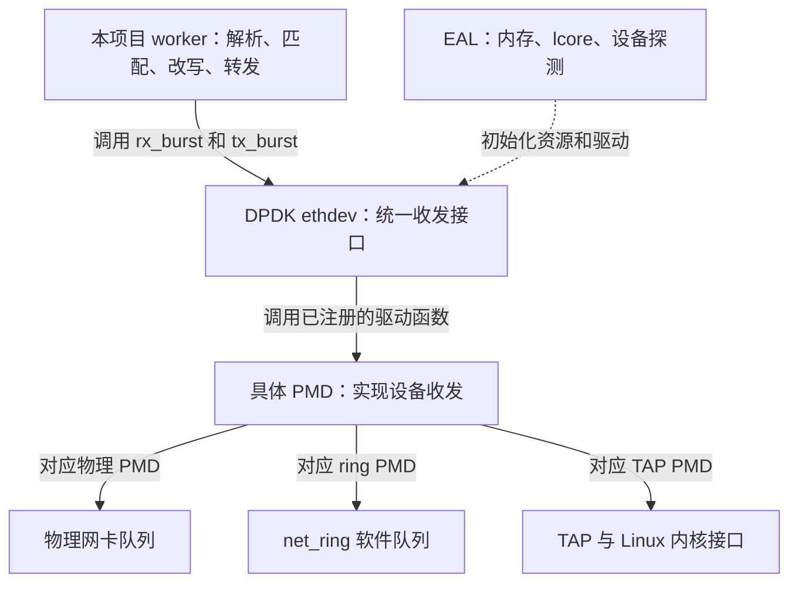
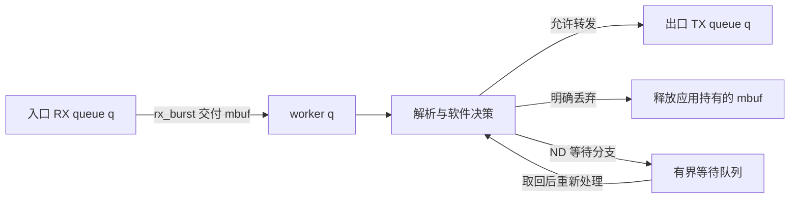

# 01 从一份报文认识 DPDK 与本项目

适用范围：本项目软件数据面与 DPDK 21.11/24.11 的基本模型

源码基线：`380d7da`；最后核查：2026-10-29

[教程入口](../README.md) · [下一章：EAL 与设备](02-eal-devices.md)

## 读完要能回答什么

- DPDK、PMD 和本项目分别负责哪一段工作
- 为什么同一个 `rte_eth_rx_burst()` 能从物理网卡或软件队列取包
- 一个包进入 worker 后，为什么仍需要项目自己的解析、规则和路由代码
- 哪些实验能证明软件处理正确，哪些问题必须查看实体设备

先修只需要 C 函数调用、指针与数组，以及以太网帧和 IP 包的基本层次。
遇到 `struct rte_mbuf *packets[32]`，先把它读成“最多存 32 个报文对象地址的数组”。
数组里的地址、地址指向的 mbuf 元数据、真正的报文字节，是三个不同概念。

## 1 先建立职责图

下面是职责关系图。实线表示调用或交接，虚线表示控制关系，不表示报文一定经过该节点。



ethdev 提供共同的调用形式，PMD 决定怎样完成实际 I/O。
选用 `net_ring` 时，调用背后是软件队列出入队；选用物理 PMD 时，可能涉及设备描述符和 DMA。
选择 TAP PMD 时，还会与 Linux 的 TAP 接口交互。
因此，看到 `rte_eth_rx_burst()` 不能直接推断“已经完成物理网卡零复制收包”。
这一区别可以对照官方 [Ring PMD](https://doc.dpdk.org/guides-24.11/nics/pcap_ring.html)
和 [TAP PMD](https://doc.dpdk.org/guides-24.11/nics/tap.html) 的说明。

DPDK 也不替这个项目决定什么包应该丢弃、下一跳是谁、NAT 怎样改地址。
本项目利用它获得报文、启动工作线程、管理报文缓冲区、提交硬件规则，并在这些机制上实现业务行为。

## 2 沿着一个包读代码

本项目主要使用 run-to-completion 模型：某个 worker 收到一批包后，在同一线程完成本轮处理并提交出口。
这里的“完成”指完成应用处理与发送提交，不能理解为已经收到远端确认。
官方对比见 [PMD 执行模型](https://doc.dpdk.org/guides-24.11/prog_guide/ethdev/ethdev.html)。



这张图只表达应用路径，不把 NIC 描述符、PCIe 或内存池塞进同一张图。
相关底层对象在后续章节逐个展开。
ND 等待是特定业务分支，不是所有包都必须经过的通用收发阶段。

推荐先顺序定位以下函数：

| 入口 | 读代码时追踪什么 |
| --- | --- |
| [main](../../../app/dppd/main.c) | `rte_eal_init()` 之后，什么时候才开始初始化应用 |
| [dppd_runtime_init / dppd_runtime_start](../../../lib/runtime/runtime.c) | worker、queue_id、lcore 怎样建立关系 |
| [dppd_worker_main](../../../lib/dataplane/worker.c) | 一轮循环扫描哪些端口，什么时候报告静默点 |
| [process_ingress](../../../lib/dataplane/worker.c) | `rx_burst` 返回的数量怎样进入处理函数 |
| [process_batch](../../../lib/dataplane/worker.c) | 丢弃、等待、转发分支怎样改变对象归属 |
| [flush_egress](../../../lib/dataplane/worker.c) | 提交成功的前缀和未提交的尾部怎样处理 |

### 数字推演

假设 `burst_size=32`，当前只收到 3 个包。
本轮可以立即返回 `count=3`，并处理这 3 个包，不会为了凑够 32 而一直等待。
若业务丢弃 1 个，出口数组只剩 2 个；假设 TX 接收了其中 1 个：

- RX 统计增加 3
- 业务丢弃增加 1
- TX 提交统计增加 1
- TX 队列丢弃增加 1

这四个数字描述不同阶段。不能拿原始 RX 数组的下标去释放已经重新组织的出口数组。
更不能从 TX 提交增加 1，推导对端收到 1。

## 3 普通 socket 路径与 DPDK 路径怎样比较

先以典型 Linux TCP socket 收包作对照：网卡和驱动把数据交给内核协议栈，内核完成协议处理，
应用通过 socket 接口取得数据。实际系统可能使用 NAPI、各种卸载和零复制接口，不能把它简化为“每个包必有一次中断和一次复制”。

DPDK 物理 PMD 路径则把报文处理的更多职责交给用户态程序。
应用轮询批量取包，自己选择处理策略、核与队列布局，并负责尚归自己的缓冲区。
减少逐包调度和重复工作的机会，与更明确的资源管理责任一起出现。

因此，“为什么快”应该拆开验证：

- 批处理减少了哪些固定调用开销
- 每个核处理自己的队列，减少了哪些共享竞争
- 数据是否在本地 NUMA 节点，缓存能否复用
- 实际路径发生了哪些复制、系统调用和 DMA

这些机制不是无条件提速承诺。低流量时轮询也可能持续占用 CPU；大量共享状态也可能成为瓶颈。

## 4 分清库机制、项目封装与测试夹具

| 内容 | 当前代码的身份 |
| --- | --- |
| EAL、ethdev、mbuf、mempool、QSBR | 使用 DPDK 机制 |
| 软件规则快照、ACL、路由、conntrack/NAT | 项目自身实现及封装 |
| `rte_flow` 安装与查询 | 项目编译规则，再调用 DPDK API 和具体 PMD |
| `net_ring` 收发注入与输出核对 | 集成测试夹具，仍会运行正式 worker |
| `simulate_m3.py` | 控制与报文字节模拟，不能证明 ASIC 硬件卸载 |

特别注意：应用目录没有使用 `rte_acl`、`rte_lpm`、`rte_hash` 或 `rte_graph` 来实现上述业务。
看到文件名 `acl.c` 或 `exact.c`，不能直接等同于相应 DPDK 库。
完整对应关系见 [项目使用地图](../project-map.md)。

## 5 实验：用现成夹具走一次正式 worker

运行位置：Linux 主机的项目根目录。
前提：有可用的 DPDK 开发环境，Meson 构建启用 `tests=true`、断言未关闭，且包含 `rte_net_ring` 库。
下面的 `build` 必须是本机 Linux 构建目录，不能使用 Windows 生成的其他工具目录。
新环境可先构建：

```sh
meson setup build -Dtests=true -Dwerror=true -Db_ndebug=false
meson compile -C build
```

已经配置的构建目录无需重复 `setup`。先检查当前 CPU 亲和集合：

```sh
python3 -c 'import os; print(sorted(os.sched_getaffinity(0)))'
python3 tests/integration/software_traffic.py --build-dir build --queues 1
```

脚本至少需要两个可用 CPU，自动映射主 lcore 与一个 worker。
它为测试进程使用 `--no-huge --no-pci` 和独立 file-prefix，不绑定物理网卡。
有三个以上可用 CPU 时，还可运行：

```sh
python3 tests/integration/software_traffic.py --build-dir build --queues 2
```

运行前先预测：单队列命令会覆盖两条规则和四条规则两组用例；双队列命令再增加两组。
预期输出包含每组 `PASS rules=... queues=...`，进程返回 0。
夹具会检查输出报文、规则更新、丢弃原因及缓冲区归还；这些是断言实际覆盖的行为，不能只凭看到一个 PASS 就假设所有协议都已验收。

查看 [Python 入口](../../../tests/integration/software_traffic.py)
与 [C 夹具](../../../tests/integration/software_traffic.c) 的 `main()`、`run_case()`、`configure_test_queues()`。
夹具会安排自己的 ring 和测试队列，不能据此证明某张物理网卡的 RSS 配置可用。
本节提供操作与预期，实际运行结果以教程验收记录为准。

## 6 自检与参考答案

1. **worker 收到的是完整报文字节数组吗？**
   收到的是 mbuf 指针数组，报文可以跨多个 segment，不能假设字节都在首段。
2. **启用 DPDK 是否等于每个包都绕过 Linux？**
   要看 PMD 和路径。TAP 就与内核网络设备交互；控制面也仍使用操作系统服务。
3. **为什么 net_ring 能验证正式 worker，却不能验证 DMA？**
   它保留 ethdev 接口和应用处理逻辑，但收发实现是软件队列，没有对应的物理设备 DMA。
4. **TX 提交量正常，对端不通，应该继续查什么？**
   区分驱动提交、设备完成、链路和对端接收，检查出口选择、报文字节、设备统计与对端抓包。
5. **能否只看 DPDK API 文档就解释本项目 ACL？**
   不能，ACL 匹配规则来自项目实现，DPDK 提供的是它所依赖的部分运行和收发机制。

继续 [02 EAL 与设备](02-eal-devices.md)，或先读 [03 内存与 mbuf](03-memory-mbuf.md) 建立报文对象模型。
