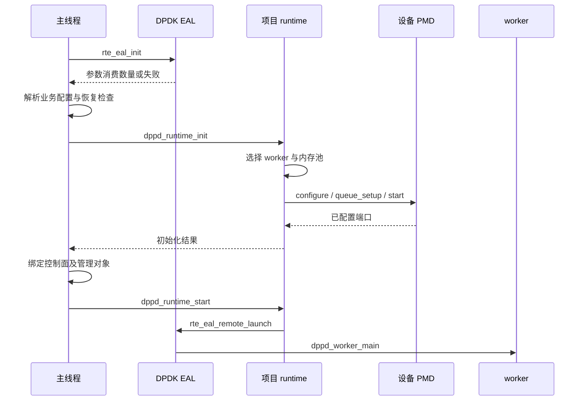

# 02 EAL 怎样建立线程 内存与设备环境

适用范围：Linux 下本项目的 DPDK 启动路径；21.11/24.11 通用概念，驱动细节按版本及 PMD 核对

源码基线：`380d7da`；最后核查：2026-10-29

[上一章：全局认识](01-overview.md) · [教程入口](../README.md) · [下一章：内存与 mbuf](03-memory-mbuf.md)

## 读完要能回答什么

- 为什么 `rte_eal_init()` 必须早于本项目的端口和 worker 初始化
- lcore 编号、Linux CPU 编号、线程、NUMA socket 分别是什么
- VA、PA、IOVA 与 DMA 怎样衔接
- 为什么有的 PMD 使用 VFIO，而 mlx5 不能照搬相同的解绑步骤

先修：进程与线程、虚拟内存和指针的基本概念。这里不要求提前掌握网卡寄存器。

## 1 EAL 初始化了什么

EAL 是环境抽象层。应用通过它获得可用的执行线程、内存布局、设备探测与进程运行环境。
它不替应用创建所有业务对象，也不会自动启动 `dppd_worker_main()`。

在 [main.c](../../../app/dppd/main.c) 中，先调用 `rte_eal_init(argc, argv)`，
再根据它消费的参数数量调整 `argc/argv`，随后才调用 `dppd_config_parse()`。
因此命令行里的 `--` 是重要分界：前面供 EAL 使用，后面供本项目使用。

| 参数举例 | 谁解析 | 决定什么 |
| --- | --- | --- |
| `-l`、`--lcores`、`--main-lcore` | EAL | 启用哪些 lcore，怎样绑定 CPU |
| `-a`、`--vdev`、`--no-pci` | EAL | 允许的 PCI 设备或虚拟设备 |
| `--no-huge`、`-m`、`--file-prefix` | EAL | 内存和运行文件相关配置 |
| `--ports`、`--queues`、`--burst` | 项目配置解析器 | 业务端口集合、队列数量与每次收包上限 |

`--no-pci` 不代表没有 ethdev，虚拟 PMD 仍可以注册 ethdev。
`--no-huge` 只选择了不同的内存模式，不能把它解释为“不需要内存映射”。
参数和初始化职责见 [DPDK 24.11 EAL 文档](https://doc.dpdk.org/guides-24.11/prog_guide/env_abstraction_layer.html)。

## 2 沿启动时序看依赖关系

下面显示普通启动路径的关键依赖。持久化、恢复检查和管理初始化被概括为一个步骤；
`--flow-state` 会进入受管理入口，仍通过 runtime 建立相应资源。



项目的 `dppd_runtime_init()` 会先决定 worker 布局，再通过 `dppd_devices_init()` 建池和配置端口。
`dppd_runtime_start()` 才把工作函数提交到选中的 lcore。
两个阶段分开，使初始化失败时不必一边收包、一边拆除未完成的资源。

向 DPDK 下层追踪时，可在 [v24.11 Linux EAL 源码](https://github.com/DPDK/dpdk/blob/v24.11/lib/eal/linux/eal.c)
中从 `rte_eal_init()` 查找 CPU 检查、内存初始化、总线探测和线程建立的调用。
该源码版本是原理阅读入口，不意味着当前机器运行的二进制一定由这个精确 tag 构建。

## 3 lcore 不是一块新增的 CPU

Linux CPU 编号是操作系统可调度的逻辑 CPU 身份；lcore 是 DPDK 管理执行上下文时使用的编号。
它们通常有关联，但可通过 `--lcores` 显式映射，数值不必相等。
线程绑核限制的是可运行 CPU 集合，不会凭空增加物理计算资源，也不保证这个 CPU 没有其他进程竞争。

例如，测试脚本发现进程可用的 Linux CPU 是 `4,6,8`，它构造：

```text
--lcores=0@4,1@6,2@8 --main-lcore=0

lcore 0 → Linux CPU 4 → 主线程
lcore 1 → Linux CPU 6 → 候选 worker
lcore 2 → Linux CPU 8 → 候选 worker
```

项目用 `RTE_LCORE_FOREACH_WORKER` 收集已启用的非主 lcore，
再由 [dppd_numa_select](../../../lib/runtime/numa.c) 选择 worker。
选择结果还受端口所在节点影响，不能把“编号最小”当作永远的选择规则。
每个 worker 的 `queue_id` 连续分配，但 `lcore_id` 可以不连续。

这也解释了为什么两个队列的测试至少需要三个可用 CPU：一个主线程加两个 worker。
本项目不是“每个端口各建一个线程”，worker 会轮询各端口的同编号队列。

## 4 地址有三个视角

下面是启用 IOMMU 时的概念图。箭头上的“翻译”与“读取数据”是不同动作。


- **VA**：CPU 运行应用代码时使用的虚拟地址
- **PA**：内存系统中的物理地址
- **IOVA**：设备发起 I/O 访问所使用的地址
- **DMA**：设备按已经设置好的访问关系读写内存的机制

启用相应 IOVA 模式时，IOVA 数值可能与 VA 或 PA 相同，但概念仍不同。
“把 C 指针写到网卡”不是完整解释，还必须保证设备端存在正确映射和可访问权限。
网卡通常读取 PMD 准备的描述符和数据缓冲区，不会解释项目的任意 C 结构体。

hugepage 主要改变内存页的组织方式。它有助于减少页表与 TLB 压力，也影响 DMA 映射组织，
但不能据此认为所有内存天然是一大段物理连续空间。
mbuf pool 怎样消费这类内存，留到 [03 内存与 mbuf](03-memory-mbuf.md)。

## 5 VFIO 与 mlx5 分叉驱动模型

VFIO 为用户态设备访问提供内核接口，并可利用 IOMMU 实现 DMA 隔离。
一些 PMD 要求把设备交给 `vfio-pci`。设备进入这种用法后，原来的普通 Linux 网络接口使用方式会发生变化。

mlx5 使用的 bifurcated 模型不同：它与相应内核驱动共存，控制资源设置由内核及相关接口参与，
PMD 使用所建立的数据通路。不能把针对其他 PMD 的“解绑到 vfio-pci”机械套用到 mlx5。
判断依据是 [Linux 驱动说明](https://doc.dpdk.org/guides-24.11/linux_gsg/linux_drivers.html)
和具体版本的 [mlx5 PMD 文档](https://doc.dpdk.org/guides-24.11/nics/mlx5.html)。

本章实验不改变设备绑定，不操作正在承担 SSH 管理连接的网卡。
实体设备实验应该先识别 PMD、PCI 地址、IOMMU 组和管理链路，再安排专用测试设备。

## 6 实验：观察现有脚本怎样构造 EAL 参数

运行位置：Linux 项目根目录；`build` 已配置并编译，启用 `tests=true` 和断言。
这个实验使用软件设备，不需要 VFIO 或物理 NIC。

```sh
python3 -c 'import os; print(sorted(os.sched_getaffinity(0)))'
python3 tests/integration/software_traffic.py --build-dir build --queues 1
```

阅读 [software_traffic.py](../../../tests/integration/software_traffic.py)：
它从当前亲和集合选择 CPU，生成 `--lcores`，配置独立运行前缀，然后启动 C 测试进程。
阅读 [software_traffic.c](../../../tests/integration/software_traffic.c) 的 `main()`：
先调用 `rte_eal_init()`，检查 lcore 数量，执行用例，最后 `rte_eal_cleanup()`。

预期结果：EAL 成功初始化、单队列的两组用例 PASS、进程返回 0。
如果可用 CPU 不足，Python 入口先拒绝运行。这里应记录“前提不满足”，不将它算作数据面测试失败。

再运行真实存在的 NUMA 布局单元测试：

```sh
meson test -C build "M5 NUMA worker placement and enabled CPU boundaries" --print-errorlogs
```

该测试名称来自 [unit/meson.build](../../../tests/unit/meson.build)。
它验证布局算法及允许的 CPU 边界，不执行物理跨节点带宽测量。
动手前先写下预测：候选核不足时应失败；两个相同 lcore 编号不能充当两个 worker。
执行后对照 [test_numa.c](../../../tests/unit/test_numa.c) 的断言，解释每一项，而不是只记录 PASS。

## 7 常见错误与定位顺序

| 现象 | 优先确认 |
| --- | --- |
| EAL 报 CPU 不可用 | 进程亲和集合、容器 cpuset、lcore 映射是否一致 |
| 找不到端口 | 是未探测到 PCI 设备，还是漏建 vdev；允许列表是否匹配 |
| 找得到端口但不能启动 | 继续读 configure/queue_setup/start 的具体错误，不能统称 EAL 失败 |
| 内存池创建失败 | 可用内存、NUMA 节点、池容量、缓存配置与 `rte_errno` |
| 换一个 PMD 后原命令失效 | 设备绑定、功能支持、队列限制和运行依赖是否变化 |

源码中 `port_socket()` 在设备节点未知或超界时，为内存池分配选择 socket 0。
worker 的 NUMA 选择则保留“端口节点未知”的语义。
这两个处理服务于不同目的，不能从分配池时的兜底值反推“设备确实位于节点 0”。

## 8 自检与参考答案

1. **EAL 初始化成功，端口是否就能开始收发？**
   不一定，项目还要选择配置、建立队列、启动端口并启动 worker。
2. **lcore 1 能绑定 Linux CPU 6 吗？**
   可以，前提是 CPU 6 可用且参数映射合法；编号属于不同命名空间。
3. **有了 hugepage，是否就可以把任意指针作为 DMA 地址？**
   不可以，必须遵循实际 IOVA 模式、内存注册/映射与驱动约束。
4. **为什么 mlx5 的准备步骤要单独看？**
   它的内核/用户态驱动协作模型不同，错误解绑可能破坏所需资源路径。
5. **测试通过能否证明 NUMA 布局提升了吞吐？**
   不能，算法正确性与实体环境的性能收益是两类证据。

继续 [03 内存与 mbuf](03-memory-mbuf.md)，再用 [04 队列与收发](04-queues-io.md) 把设备地址与描述符连起来。
