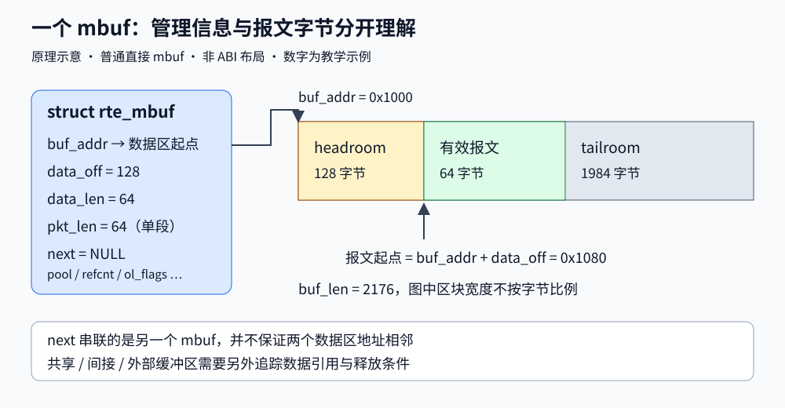
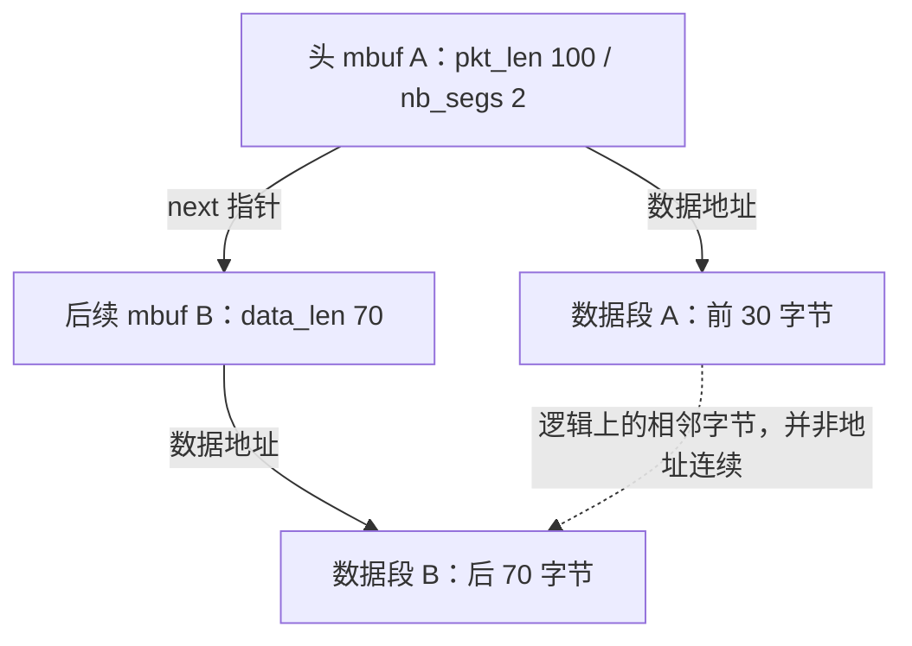
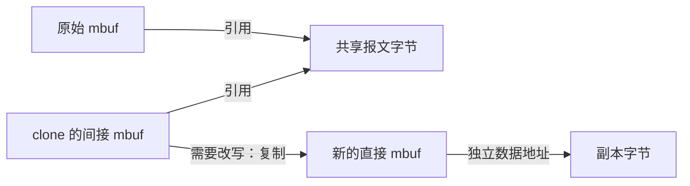
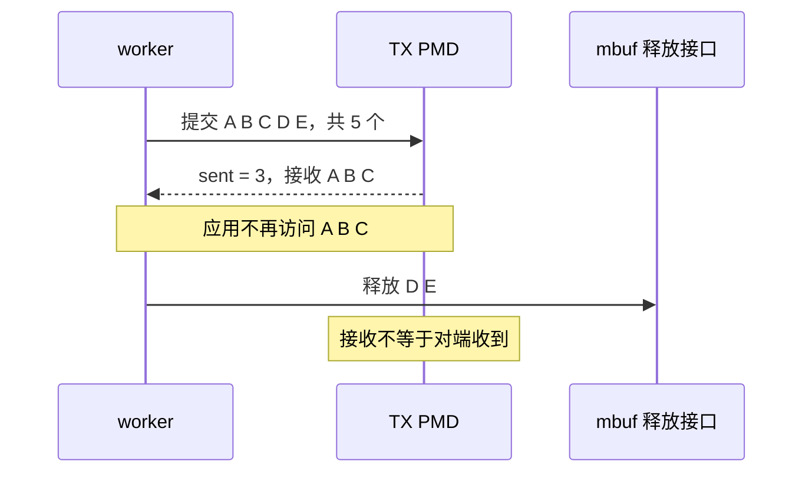

# 03 内存与 mbuf 从地址到报文所有权

适用范围：项目软件收发与改写路径，DPDK 21.11.9/24.11.8 背景；最后源码核查：2026-10-29，基线 `380d7da`。
前置阅读：[EAL 与设备](02-eal-devices.md)；也可先读本章，再回头补齐 IOVA 与 DMA。

## 本章要解决的问题

收到的 `struct rte_mbuf *` 是报文字节吗？为什么整包有 100 字节，却不能从首段直接读取 100 字节？
为什么只改 TTL 也可能要复制整包？为什么调用 free 后，别人还能使用报文？
学完应能画出数据区和引用关系，解释每条发送/丢弃分支由谁负责释放。

## 1 先分清管理结构与报文字节

`struct rte_mbuf` 记录报文的位置、长度、分段、引用及卸载标志。
普通直接 mbuf 的对象分配通常同时包含管理结构、可选私有区和数据缓冲区；间接 mbuf、外部缓冲区不一定如此。
不要把 C 结构体的地址当作以太网头地址。



图是字段关系示意，不承诺结构体 ABI 字节偏移。对实际类型布局应查看当前 DPDK 头文件。
核心关系是 `报文起点 = buf_addr + data_off`。
`data_len` 是本段有效数据长度；头 mbuf 的 `pkt_len` 是整包长度，`nb_segs` 是分段数量。
`buf_len` 记录数据缓冲区容量，不能当作有效报文长度。

用一组假设数字推演：数据区起点为 `0x1000`，容量 2176，`data_off=128`，`data_len=64`。
则有效数据位于 `0x1080` 开始的 64 字节，headroom 为 128，尾部余量为 `2176-128-64=1984`。
这些是算术示例，不是本项目所有报文的固定尺寸。

Headroom 使前面加头部有机会只调整偏移；但空间不足时操作会失败，不能因此宣称任意封装都无需复制。
分配 mbuf 也不会自动填入合法以太网/IP 头，长度与内容需要调用方正确构造。

向下看 DPDK：[rte_mbuf_core.h](https://doc.dpdk.org/api-24.11/rte__mbuf__core_8h_source.html)
定义结构与字段，[rte_mbuf.h](https://doc.dpdk.org/api-24.11/rte__mbuf_8h_source.html)
包含访问、引用和释放等内联实现。阅读时先找到 `rte_pktmbuf_mtod_offset` 和 `rte_pktmbuf_read`。

## 2 为什么使用 mempool

逐包 malloc/free 会把分配器争用和通用管理成本带进热路径。
mempool 提前组织固定大小的对象，通过批量获取和归还重复使用对象；它不表示内存永远不会耗尽。
每核缓存减少访问公共池的频率，但也会让可用对象暂时留在其他核的缓存中。


图是池与缓存的简化模型，实际分配路径取决于 pool ops 和缓存配置。
项目在 [device.c](../../../lib/device/device.c) 的 `create_socket_pools` 调用 `rte_pktmbuf_pool_create`，
将 socket、对象数量和 cache 大小作为配置的一部分。RX 队列设置再把对应的 pool 交给 PMD。

容量不能只按“每次 burst 32 个包，所以准备 32 个”估算。
在某一时刻，RX 描述符、TX 待完成操作、worker 手中批次、邻居等待队列和各核 cache 都可能占有对象。
多段包一包还可能占用多个对象。

例如教学预算中，RX 已挂 512 个对象，TX 持有 256 个，两个 worker 各持有 32 个，缓存共留 128 个，
暂存报文占 40 个，则已有 `512+256+64+128+40=1000` 个对象不在公共可用集合中。
这只是明确各项来源的模型，不是通用精确池容量公式；实际描述符与 mbuf 的对应由 PMD 决定。

Hugepage 减少页表/TLB 压力，NUMA 决定内存访问的远近，mempool 决定对象如何复用。
三者处于不同层次。使用 `--no-huge` 的虚拟测试依然能使用 mbuf/mempool，不能把“大页”当作对象池的定义。
参考 [mempool 官方原理](https://doc.dpdk.org/guides-24.11/prog_guide/mempool_lib.html)。

## 3 多段包并非一块连续内存



假设 IPv4 头在偏移 14，长度 20，那么它跨过 A/B 边界：前 16 字节在 A，后 4 字节在 B。
直接从 A 的数据地址加 14，再当作完整 IP 头解引用，会越过 A 的有效数据范围。
“整个报文足够长”和“当前这段内存足够长”是两个条件。

项目 [packet_mbuf.c](../../../lib/dataplane/packet_mbuf.c) 的 `dppd_packet_parse_mbuf`：

1. 获取整包 `pkt_len`
2. 把本次请求长度限制到最多 1024 字节
3. 调用 `rte_pktmbuf_read(mbuf, 0, read_len, scratch)`
4. 在返回指针仍有效时解析，只把字段值写入输出对象

请求范围在同一段中时，`rte_pktmbuf_read` 返回原数据地址；跨段时复制到调用方提供的 scratch。
因此必须使用它的返回值，不能无条件读取 scratch。返回 NULL 表示范围无法满足。
这里的 1024 是项目头部解析预算，并非 DPDK 限制所有包只能有 1024 字节。

scratch 是栈上数组，函数返回后失效。解析结果不能保存一个指向 scratch 的长期指针。
项目输出字段值，因此不把这段借用关系带到下一阶段。

## 4 共享报文为什么需要写时复制

`rte_pktmbuf_clone` 可以新建管理结构并共享原数据，`rte_pktmbuf_copy` 则建立数据副本。
引用计数表示生命周期上的共享关系，不能代替应用自己的并发写入协调。
两个对象共享同一数据时，即使各自都有不同的 mbuf 地址，改写数据仍会影响另一方。



在 [ipv4_rewrite.c](../../../lib/dataplane/ipv4_rewrite.c) 中，`needs_copy` 检查整条链：
只要有间接段、外部缓冲区或引用计数不为 1，就走复制路径。
这是项目的保守策略，并非所有 DPDK 应用都必须在这些情况下复制整包。

`dppd_ipv4_rewrite_flow` 先校验并在局部 header 中计算修改，再尝试获取独占副本。
分配失败就返回错误，不先改坏共享原包。成功后按段写回头部；若换成新 mbuf，释放旧引用并更新调用方指针。
二级指针 `struct rte_mbuf **` 的作用就在这里：调用方持有的报文对象可能被替换。

本项目软件完成 IPv4 校验和后清除旧 TX offload 标志，避免把已处理的包再错误交给硬件卸载。
扩展到 IPv6 时同时阅读 [ipv6_rewrite.c](../../../lib/dataplane/ipv6_rewrite.c)，不要照搬 IPv4 头部校验和模型。

## 5 发送成功接收的边界

项目 [worker.c](../../../lib/dataplane/worker.c) 的 `flush_egress` 把待发数组交给 `rte_eth_tx_burst`。
若 `count=5` 而 `sent=3`，前 3 个 mbuf 已移交给 PMD，后 2 个仍由 worker 持有。



本项目选择丢弃短发送的尾部并计数，没有在这个函数中无限重试。
统计使用发送前已保存的长度，避免对交给 PMD 的 mbuf 再次解引用。
PMD 对已接收报文的释放时机取决于实现；物理驱动可能批量检查 TX 完成，net_ring 则传递给软件接收方。
不能画成所有 PMD 都在 `tx_burst` 返回后立即触发同一种硬件完成中断。

可打开 [交互时序图](../diagrams/tx-ownership/tx-ownership.html)，对照引用的 worker 代码查看边界。
下一章 [队列与收发](04-queues-io.md) 继续解释描述符和 PMD 内部路径。

## 6 实验：先预测，再检查现有测试

命令在 Linux 项目根目录执行，需要已配置的 `build`、DPDK 开发环境和启用测试。
环境准备及本次真实运行状态见 [实验入口](../labs/README.md) 和 [验收记录](../validation.md)。

```bash
meson compile -C build
meson test -C build 'IPv4 routed packet rewrite' 'IPv6 parser and scattered packet rewrite' --print-errorlogs
python3 tests/integration/ipv4_traffic.py --build-dir build
python3 tests/integration/software_traffic.py --build-dir build --queues 2
```

前两项单测含包装/人工结构：例如 [test_ipv4_rewrite.c](../../../tests/unit/test_ipv4_rewrite.c)
将复制调用包装为分配失败，用来核验失败时不改坏原包，不能代替真实 mempool 的成功复制测试。
集成测试需要至少 3 个可用 CPU 以及 `rte_net_ring`，使用 `--no-pci --no-huge`。

先在 [ipv4_traffic.c](../../../tests/integration/ipv4_traffic.c) 搜索 `rte_pktmbuf_clone`、`rte_pktmbuf_chain`、`rte_mbuf_refcnt_update`：
预测共享包改写后原始对象是否改变、释放一份引用后还有几份持有者，再看对应断言。
在 [software_traffic.c](../../../tests/integration/software_traffic.c) 找到 TX ring 填满场景，预测丢包计数与池对象是否归还。
预期是脚本退出码为 0、内容和引用断言通过，停止并排空后池可用数量恢复；不是物理发包速率测量。

## 7 排查思路

| 现象 | 优先检查 |
| --- | --- |
| 小包正常，大包解析异常 | 是否误把 pkt_len 当首段 data_len；请求头部长度是否越界 |
| clone 后另一个消费者看到内容变化 | 是否直接写了共享数据，是否只检查了首段引用 |
| 运行一段时间分配失败 | 哪个队列/等待链仍持有对象，短发送和错误分支是否释放 |
| TX 后统计偶发崩溃 | 是否读了已移交 PMD 的 mbuf |
| free 后池没有立刻恢复 | 引用是否归零、驱动是否完成回收、其他核缓存是否仍持有 |

泄漏检查应在停止并排空资源后解释结果；流量运行中一个可用数下降的快照不足以证明泄漏。

## 8 自检与参考答案

1. `pkt_len=100`、`data_len=30` 时，为什么不能直接 memcpy 100 字节？
2. 为什么 parse 函数要接收 `rte_pktmbuf_read` 的返回值？
3. 引用计数为 2 时，free 一次意味着内存一定回到 pool 吗？
4. `sent=3` 能否再读取前三个 mbuf 的长度？
5. 只改 IPv4 TTL，为什么项目仍可能调用整包 copy？

<details>
<summary>先独立回答，再展开核对</summary>

1. 整包由多段组成，首段有效范围只有 30，剩余数据通过 next 查找
2. 连续范围直接返回原地址，scratch 未必被写入
3. 不一定，仍有引用或外部缓冲区关系；释放一个持有者不同于实际回收对象
4. 不可以再依赖其内容，应使用发送前保存的统计数据
5. 项目需要保证写入独占，整链任一段共享或外部缓冲时采用保守复制策略

</details>

资料：[mbuf 编程指南](https://doc.dpdk.org/guides-24.11/prog_guide/mbuf_lib.html)、
[mbuf API](https://doc.dpdk.org/api-24.11/rte__mbuf_8h.html)。
