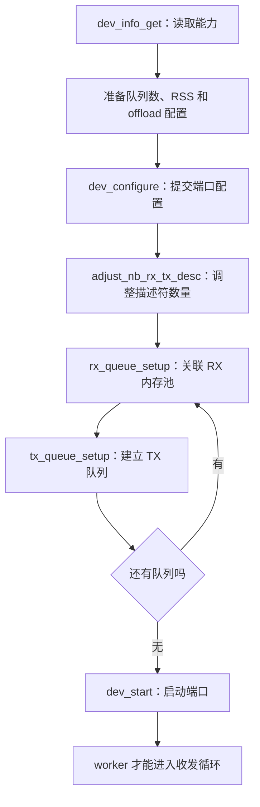
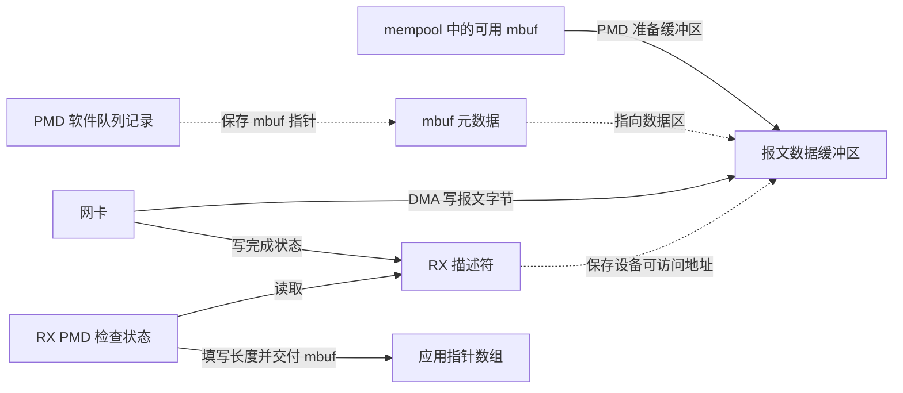
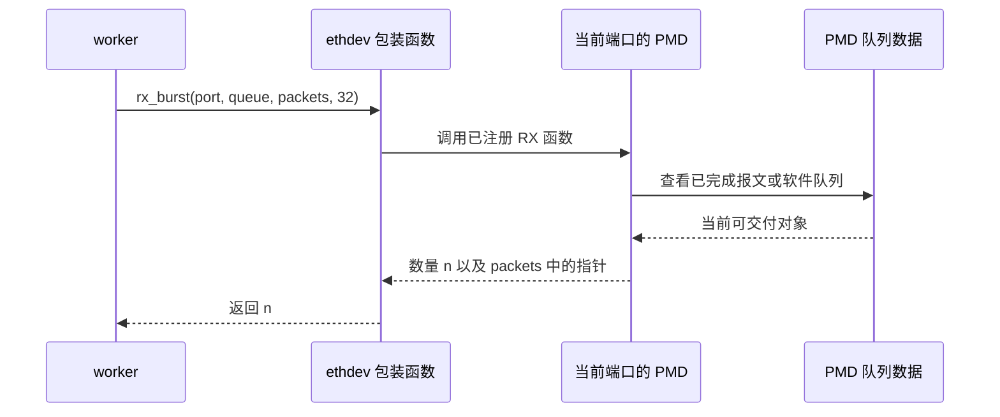
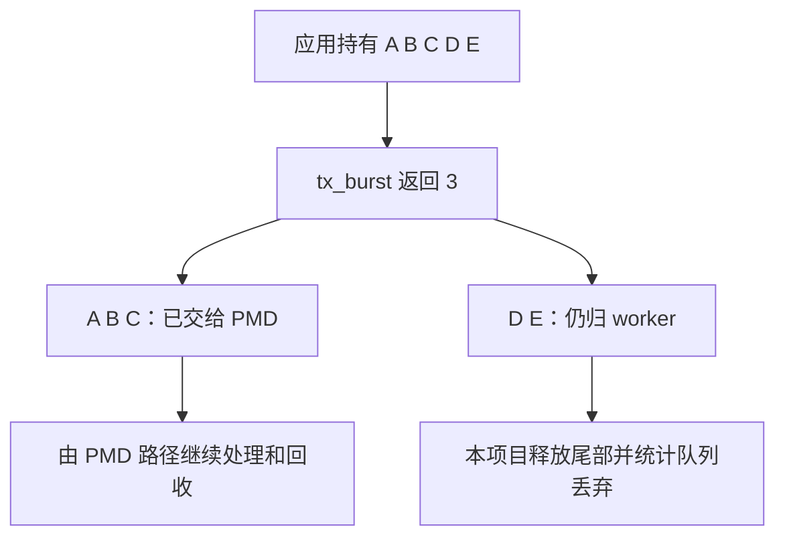

# 04 从队列描述符到 burst 收发

适用范围：本项目 ethdev 配置与正式 worker；用 DPDK v24.11 net_ring 和 ixgbe 作实现对照

源码基线：`380d7da`；最后核查：2026-10-29

[上一章：内存与 mbuf](03-memory-mbuf.md) · [教程入口](../README.md) · [下一章：多核与性能](05-multicore-performance.md)

## 读完要能回答什么

- RX/TX 队列、描述符、mbuf 与报文字节是什么关系
- 调用 ethdev API 后，怎样到达具体 PMD
- 为什么增加描述符数量与增加 burst 大小不是同一件事
- 短发送后谁负责释放报文，驱动何时能够回收已接收的报文

先修：[mbuf 所有权](03-memory-mbuf.md)、函数指针与数组下标。
先区分“队列槽位”和“报文对象”：槽位记录对象的位置和状态，槽位本身不是完整报文。

## 1 先配置资源，再调用快路径

在 [device.c](../../../lib/device/device.c) 中读三个函数：
`prepare_port_configuration()`、`configure_port_queues()`、`start_configured_port()`。



图中顺序来自本项目。每一步都可能失败，调用者必须停止推进并清理已建立的资源。
“设备报告支持”与“应用已经配置启用”是两件事。
本项目只请求能力允许的部分功能，例如按 `tx_offload_capa` 选择多段 TX 支持。

默认 RX/TX 描述符请求数各为 1024，随后通过 `rte_eth_dev_adjust_nb_rx_tx_desc()` 调整。
因此配置输入 1024 不代表驱动最终一定采用 1024。
实际数量保存在端口身份/配置记录中，复位恢复还会核对是否能重建原配置。

## 2 RX 描述符和 mbuf 怎样关联

以下图是典型物理 NIC 的概念模型，不规定所有驱动采用同一种描述符格式。



PMD 先准备可供设备写入的缓冲区，把其设备地址放进描述符。
网卡收到包后写入数据，并通过设备约定的状态表达完成。
PMD 轮询完成状态、找到对应 mbuf、设置相关元数据，再把指针交给应用。
随后要为可继续接收的描述符补充可用缓冲区。

这解释了一个常见现象：应用长时间持有报文，或者分配失败，可能让 RX 无法及时补充缓冲区。
只有 CPU 使用率高，并不能证明收包链路畅通。

为观察一个具体实现，可阅读 [ixgbe_rxtx.c](https://github.com/DPDK/dpdk/blob/v24.11/drivers/net/ixgbe/ixgbe_rxtx.c)
中的 `ixgbe_recv_pkts()`：跟踪完成标志、软件队列中的 mbuf、补充对象和 RX tail 更新。
这是 ixgbe 的一种路径；向量、分段或其他网卡路径必须单独看，不能套用全部内部细节。

## 3 ethdev API 怎样找到驱动函数

在 [v24.11 rte_ethdev.h](https://github.com/DPDK/dpdk/blob/v24.11/lib/ethdev/rte_ethdev.h)
中查找 `rte_eth_rx_burst()` 和 `rte_eth_tx_burst()`。
这些快路径包装函数根据端口取到收发操作及队列数据，再调用 PMD 注册的 burst 函数。
开启某些构建或回调配置时，还会有相关检查或回调处理。



项目的 [process_ingress](../../../lib/dataplane/worker.c) 使用返回值 `count` 调用 `process_batch()`。
这里的 32 是上限；返回 0、3、32 都可能正常，不要求凑满。
调用方要遵守具体 PMD 对 burst 参数及向量路径的约束，不把任意数值当作所有驱动都最优。

## 4 net_ring 的同名 API 背后没有物理 DMA

查看 [ring PMD 的 v24.11 源码](https://github.com/DPDK/dpdk/blob/v24.11/drivers/net/ring/rte_eth_ring.c)：

- `eth_ring_rx()` 从 `rte_ring` 批量取出指针，设置 mbuf 入口端口，再返回数量
- `eth_ring_tx()` 把指针批量放入 `rte_ring`，返回实际入队数量

测试夹具用 `rte_eth_from_rings()` 把这些 ring 包装成 ethdev，正式 worker 可以继续使用相同 API。
这里移动的是软件队列里的指针，不是网卡在 PCIe 上搬运报文字节。
已经成功入队的 mbuf 也需要接收方消费并归还；ring 不会凭空替消费者释放全部报文。

## 5 描述符数量与 burst 上限的数字推演

### 用四个槽位看索引怎样绕回

先用单生产者、单消费者的教学环形队列理解“环”：数组地址不移动，变化的是下一次读写的索引。
设槽位编号为 0、1、2、3，`read` 指向下一个待取对象，`write` 指向下一个待放位置。
这里刻意保留一个空槽，规定 `read == write` 为空，`(write + 1) % 4 == read` 为满，所以最多存 3 个对象。

```text
索引前进方向：0 → 1 → 2 → 3 → 0 → ...

时刻 T0                  时刻 T2
槽位    0  1  2  3       槽位    0  1  2  3
内容    -  -  A  -       内容    C  -  A  B
read = 2                 read = 2
write = 3                write = 1
有 1 个对象              有 3 个对象，已满
```

`A/B/C` 表示槽位保存的对象指针，`-` 表示逻辑空槽，不保证实际内存字节已清零。
从 T0 到 T2，具体变化如下：

| 操作 | read | write | 有效对象数 | 下一步为何这样走 |
| --- | --- | --- | --- | --- |
| 初始仅 A 位于槽 2 | 2 | 3 | 1 | 下一次写槽 3 |
| B 写入槽 3 | 2 | 0 | 2 | `(3+1)%4=0`，写索引绕回 |
| C 写入槽 0 | 2 | 1 | 3 | 下一写索引将追上 read，队列已满 |
| 再尝试放入 D | 2 | 1 | 3 | 拒绝，不能覆盖尚未消费的 A |
| 取出槽 2 的 A | 3 | 1 | 2 | 消费者持有 A，队列剩 B、C，可再放一个 |

取出 A 只把对象交给消费者，不自动等于释放 A 的 mbuf；生命周期还要按照本章后面的所有权规则处理。
本例只解释槽位复用、满空判断和索引环绕。真正的 `rte_ring` 可能使用生产者/消费者 head、tail、累计计数和不同同步模式，
物理 PMD 又有各自的描述符完成位及设备寄存器。不能把这里的两个模 4 索引当成它们的完整实现，
也不能由“本例保留一槽”推断所有 NIC 队列的可用容量都固定为描述符数减一。

### 再区分队列规模与每次取包数量

假设某物理 RX 队列配置 1024 个描述符，每次应用最多取 32 个包。
理想化地假设每包只占一个描述符、队列中已有 96 个可交付包且期间没有新包：
三次最多各取 32 个，就可能处理完当前积压。

但下面三个数不能画等号：

| 数值 | 含义 |
| --- | --- |
| 1024 | 配置的队列描述符规模，不等于任意时刻都能接收 1024 个包 |
| 32 | 一次 API 请求的最大包数，不是等满阈值 |
| 96 | 例子中当前已可交付的包数，不是内存池全部在用对象数 |

多段包、描述符格式、设备保留、补充和回收策略会影响实际容量，不能只用一个数字推断可用空间。
增大队列可能容纳更多积压，但也可能增加排队时延；增大 burst 改变一次处理规模，并可能影响其他端口得到处理的等待时间。
性能权衡见 [05 多核与性能](05-multicore-performance.md)。

## 6 TX 提交与释放必须按所有权划分

本项目 [flush_egress](../../../lib/dataplane/worker.c) 先检查端口和设备事件状态，
再调用 `rte_eth_tx_burst()`。它把返回值记为 `sent`，只释放未接收的尾部。

假设出口数组是 `[A,B,C,D,E]`，调用返回 3：



已接收意味着应用失去这些对象的独占访问权，不能为了统计字节数再读取它们。
所以项目在提交前保存长度，提交后使用保存的数字更新统计。
这比“发送后反正还没离开函数，可以再读一下”更严格，也更安全。

对于物理 NIC，PMD 通常将数据地址与长度写入 TX 描述符，设备消费后报告完成，
驱动再按自己的回收策略归还缓冲区。`ixgbe_tx_free_bufs()` 就展示了检查完成状态后批量回收的路径。
可能存在批量回收阈值和延迟，不能假设 TX 调用返回前全部 mbuf 已经回池。

对于 net_ring，成功 TX 是把指针交给输出 ring，由测试消费者读出并释放。
两者共享应用侧“提交成功后不再持有”的契约，但后续执行机制不同。
TX 成功不是对端接收确认，也不是 TCP ACK。

## 7 实验：制造发送队列满

运行位置：Linux 项目根目录。前提：`build` 已启用 `tests=true`、断言和 `rte_net_ring`，至少两个可用 CPU。

```sh
python3 tests/integration/software_traffic.py --build-dir build --queues 1
```

先阅读 [software_traffic.c](../../../tests/integration/software_traffic.c) 的丢弃场景循环：
`scenario == 3` 用 filler mbuf 填满出口 ring，再向入口放入一份报文并启动正式 worker。

执行前预测这些增量：

| 指标 | 预期变化 |
| --- | --- |
| `rx_packets` | 加 1 |
| `tx_packets` | 不增加 |
| 出口 `tx_queue_drops` | 加 1 |
| 入口 `tx_queue_drops` | 不把出口失败重复记到入口 |

测试停止 worker 后清空 filler，并在用例末尾核对 mempool 可用对象数量恢复。
如果忘记释放未被 TX 接收的报文，这类归还检查可以发现泄漏。
这个场景确定验证的是“完全未接收”的短发送边界；返回 1～N-1 的中间值仍需结合 `flush_egress()` 分支推演，
不能声称这个场景逐个验证了所有中间返回值。

预期命令输出两组单队列 PASS 并返回 0；实际结果以教程验收记录为准。
可用 CPU 足够时，再使用 `--queues 2` 覆盖双队列正式 worker。
若只想检查设备事件阻止继续收发及对象归还，可运行已登记的单元测试：

```sh
meson test -C build "worker RX TX event gates and mbuf return" --print-errorlogs
```

名称和构建方式见 [tests/unit/meson.build](../../../tests/unit/meson.build)。
该测试不能证明实体网卡被物理移除后的总线安全性。

## 8 排障与自检

收不到包时，依次确认端口已启动、选中了正确 queue、该 queue 有流量、内存池可补充、PMD 未报告设备错误。
发送不足时，区分业务丢弃、出口链路门禁与 TX 队列未接收；只看总丢包计数无法定位阶段。

1. **RX 返回 0 需要立即判为错误吗？**
   不需要，可能只是当前没有可交付报文；错误诊断还需要设备状态与统计。
2. **两个线程能否随意同时读取同一个 RX queue？**
   不能，必须遵守驱动并发契约；本项目按 queue_id 给 worker 划分使用范围。
3. **TX 返回 3 后可以读取前三个 mbuf 的 pkt_len 吗？**
   本项目不再访问它们，长度提前保存，避免使用已移交对象。
4. **把 burst 从 32 调到 64，能否消除长期过载？**
   不保证。若平均处理能力仍低于到达速率，队列最终仍会耗尽，且其他路径的等待可能增长。
5. **net_ring 通过了，是否证明物理描述符补充正确？**
   没有，物理 PMD 的 DMA、描述符和完成回收需要相应设备及驱动证据。

进一步阅读：[官方 PMD 模型](https://doc.dpdk.org/guides-24.11/prog_guide/ethdev/ethdev.html)
与 [ethdev API 源码契约](https://github.com/DPDK/dpdk/blob/v24.11/lib/ethdev/rte_ethdev.h)。
