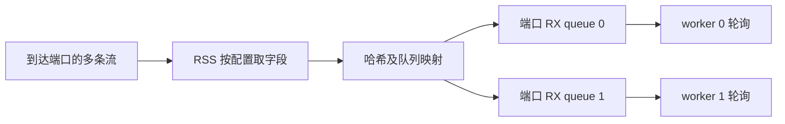
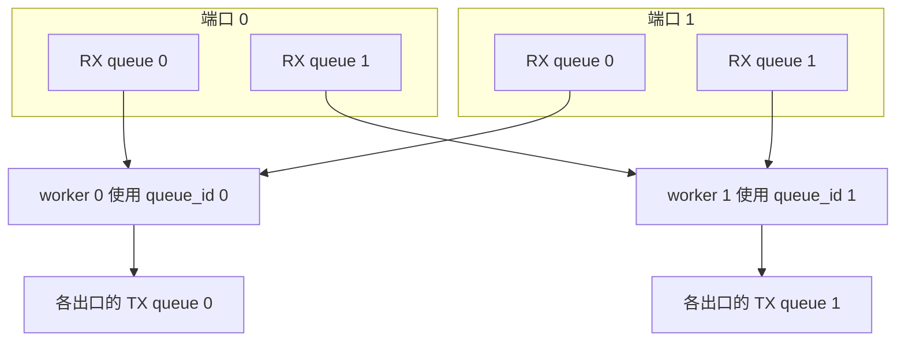
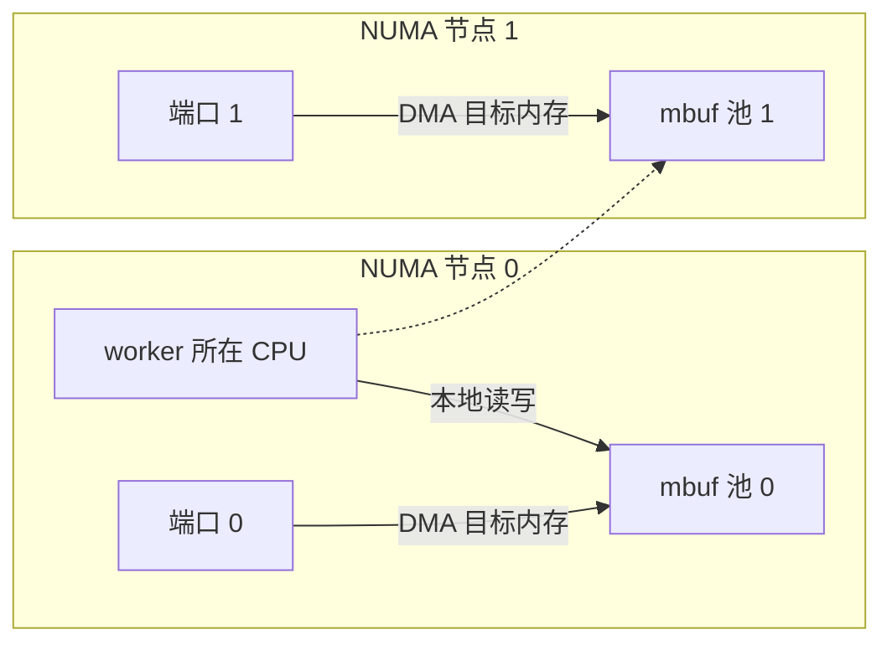

# 05 多核、RSS 与 NUMA 性能

最后核查：2026-10-29；项目源码基线：`380d7da`

适用范围：DPDK 21.11.9 与 24.11.8 上的项目线程布局及软件数据面；物理 RSS 分布、NUMA 吞吐收益需要对应实体环境

先读 [队列与收发](04-queues-io.md)。本章需要理解指针、线程和共享内存，不要求预先掌握 NUMA 优化。

## 学完要能回答的问题

- 为什么增加两个 CPU，不一定让同一条 TCP 流快两倍
- `port_id`、`queue_id`、lcore ID 和 Linux CPU 编号分别代表什么
- 本项目一个 worker 究竟处理几个端口、几个队列
- 内存池靠近网卡，为什么仍可能发生跨 NUMA 访问
- CPU 使用率很高时，怎样判断它在处理业务还是空轮询

## 从一条流到一个 worker

RSS 的任务是把符合配置的报文分配到 RX 队列。常见硬件会对选定字段做哈希，再通过重定向表选择队列。
具体字段、算法和可配置范围由设备及 PMD 决定。它分配的是队列，不会替应用启动工作线程。

同一流的输入字段不变、RSS 配置不变时，通常会落到同一队列，从而有利于保持顺序。
因此四个 worker 不等于一条流自动被四个 worker 平分；单流、少量大流和大量小流的负载分布会不同。
双向流是否对称分配也不能默认成立，应检查实际哈希配置。



这是 RSS 原理图。某个虚拟 PMD 可以宣称支持配置，却采用不同的软件执行方式；不能仅凭设置成功证明实体网卡按这个路径分流。

## 四种编号不能互相替代

| 名称 | 表示什么 | 本项目如何使用 |
| --- | --- | --- |
| `port_id` | EAL 当前实例中的 ethdev 端口标识 | 标识收发 API 的设备，不假定等于 PCI 功能号 |
| `queue_id` | 一个端口内部的 RX/TX 队列编号 | worker 固定使用自己的连续队列号 |
| lcore ID | DPDK 分配的逻辑执行单元标识 | 传给 `rte_eal_remote_launch` |
| Linux CPU ID | 操作系统调度与亲和性使用的 CPU 编号 | 可通过 EAL 参数映射，与 lcore ID 不一定相等 |

例如 `--lcores='0@2,1@6' --main-lcore=0` 把主 lcore 0 放到 Linux CPU 2，把工作 lcore 1 放到 CPU 6。
这只是一份映射示例；运行前必须确认 CPU 2、6 位于当前进程允许的 CPU 集合内。
不要把示例复制到只有两个可用 CPU 的容器里。

## 本项目实际怎样分工

按下面顺序读代码：

1. [runtime.c](../../../lib/runtime/runtime.c) 的 `dppd_runtime_init` 枚举 `RTE_LCORE_FOREACH_WORKER`
2. [numa.c](../../../lib/runtime/numa.c) 的 `dppd_numa_select` 选出允许使用的 lcore
3. `dppd_runtime_init` 为 worker 设置 `queue_id = worker_index`
4. `dppd_runtime_start` 调用 `rte_eal_remote_launch`
5. [worker.c](../../../lib/dataplane/worker.c) 的 `dppd_worker_main` 扫描所有配置端口的同编号队列

以两个端口、两个 worker 为例：



一个 worker 轮询两个入口，并使用各出口相同编号的 TX 队列。这种安排使不同 worker 不必共同修改同一个队列的收发状态。
DPDK 对一些支持特定能力的 TX 队列允许多线程并发，但本项目不依赖这个例外来安排 worker。

项目当前采用 run-to-completion：同一 worker 完成收包、解析、规则判断和发送提交。
函数名中有 `pipeline` 不代表已经采用“收包核通过 `rte_ring` 把包交给处理核”的多核流水线。
原生模型区别可对照 [DPDK PMD 指南](https://doc.dpdk.org/guides-24.11/prog_guide/ethdev/ethdev.html)。

## NUMA 为什么影响一份报文

NUMA 机器有多个内存节点。CPU 访问本节点内存与访问另一节点内存，路径和代价可能不同。
网卡所连接的 PCIe 节点、mbuf 所在内存节点、执行 worker 的 CPU 节点共同决定访问路径。



图中是实体 NUMA 原理示例，不是当前虚拟机的实测拓扑。
虚线从节点 0 的 CPU 指向节点 1 的内存池，表示处理该池的报文时可能发生远端读写。
本项目按网口 socket 创建池和配置队列，而一个 worker 又要扫描所有端口，所以跨节点端口组合不可能总让所有访问都本地化。

`dppd_numa_select` 的选择规则很具体：

- 候选必须是用户已经启用的非主 lcore，不会偷偷扩大 CPU 集合
- 优先选与更多已知端口位于同一 socket 的核
- 分数相同时，优先选已分配 worker 较少的 socket
- 仍相同则按 lcore ID 选择，保证结果稳定

这是一种确定性启发式布局，不是根据实时流量寻找最优方案。
拓扑未知时不会在选核算法里伪造“已知同节点”。
但要区分选核与分配：当前 [device.c](../../../lib/device/device.c) 的 `port_socket` 在设备 socket 无效时，
会用节点 0 作为内存池和队列分配的回退位置。这是可运行的分配选择，不能据此报告设备已知位于节点 0。

## 用数字走一次选核

[test_numa.c](../../../tests/unit/test_numa.c) 提供了可以手算的真实测试输入：

```text
候选 lcore/socket：7/1，2/0，5/1，3/0，9/未知
三个端口 socket：1，1，0
需要 worker 数：3
```

节点 1 的候选与两个端口同节点，节点 0 的候选与一个端口同节点。
所以先选 lcore 5，再选 lcore 7，最后选 lcore 2。
最终 queue ID 仍是 0、1、2，与 lcore 5、7、2 一一对应，不会出现 queue 5、7、2。

把端口分布改成一个节点 0、一个节点 1，节点分数相同，四个 worker 的选择顺序变为 2、5、3、7。
这次才由节点已用数量决定交替选择。

## 性能要拆成多个问题

burst 能分摊每次调用、队列索引维护和部分硬件操作的成本，但更大不一定始终更好。
本项目每轮依次处理各端口；单个端口一次处理的包变多，也可能让后面端口等待更久。
`rte_eth_rx_burst` 的上限参数不要求驱动等待凑齐整批。

假设两次计数采样相隔 2 秒，`tx_packets` 从 100 万变成 140 万，则应用提交速率为 20 万包/秒。
这是该计数口径的速率，并非物理链路成功发送率，也不能只凭它推导端到端延迟。

控制变量时至少记录：包长、流数量、方向、worker 数、CPU 集合、burst、队列数、RSS 能力与实际启用值、丢包以及 CPU 时间。
若使用虚拟机，还需记录宿主机调度干扰。先完成可重复基线，再每次改变一个变量。

共享状态也可能限制扩展。本项目分类规则主要通过不可变快照读取，但连接跟踪等路径仍有共享数据和锁。
因此“用了 DPDK”不能推出“整个应用逐包无锁”；继续读 [conntrack.c](../../../lib/dataplane/conntrack.c) 的锁范围才知道具体争用在哪里。

CPU 缓存还会引入另一种竞争：两个核更新不同计数器，如果计数器恰好位于同一条 cache line，
硬件仍可能反复转移该缓存行的写权限，这叫伪共享。它不要求两个线程写同一个 C 变量。
对于每包更新的指标，先在本批局部变量累计、最后统一提交，通常能减少共享写入次数。
本项目 [stats.c](../../../lib/observability/stats.c) 和 worker 的局部 `delta` 可以作为这种处理方式的阅读入口。
不过计数仍是原子更新，不能据此保证所有缓存行竞争已经消除。

若一批 32 个包各产生一个计数增量，逐包共享累加需要 32 次更新，而本批先累计再提交可降到一次。
这个例子只说明操作次数，不代表吞吐必定提升 32 倍；解析、内存访问、PMD 和其他共享状态仍消耗时间。

## 实验一：验证选核规则

在 Linux 项目根目录运行，前提是已按 [入口说明](../README.md) 配置带测试的 `build`：

```sh
meson compile -C build
meson test -C build 'M5 NUMA worker placement and enabled CPU boundaries' --print-errorlogs
```

先手算上面的两个顺序，再对照测试中的断言。这项测试验证普通 C 算法，不接物理网卡，也不证明 NUMA 吞吐改善。
预期结果是测试通过；此处是复现步骤，实际执行结果应查看本次教材验收记录。

## 实验二：观察正式 worker 布局

Linux 进程至少有两个允许 CPU，DPDK 包含 `net_ring`，并已构建测试专用程序时，从项目根目录运行：

```sh
python3 tests/integration/m5_observability.py --build-dir build --report-dir build/dpdk-learning-observability
```

脚本使用独立 EAL 前缀、`--no-pci` 和临时配置启动正式 daemon；它还会启动专用故障程序验证心跳超时。
查看输出目录中的 `report.json` 和 `daemon-*.log`，找出 `worker_layout` 的 queue、lcore、socket。
预期检查包括布局受 EAL CPU 集合约束、空闲 worker 继续发布心跳。
该脚本的 NUMA 性能验收字段保持 `not_run`，即使执行成功也不把虚拟队列当作硬件 RSS 证据。

## 自检与参考答案

1. 两个端口、两个 worker，共有几个应用 worker？答：两个，每个扫描两个端口的同编号 RX 队列
2. lcore ID 为 7，队列号一定是 7 吗？答：不一定，本项目连续分配队列号，lcore 可以稀疏
3. 增加 worker 后单流吞吐不变，必然是绑核失败吗？答：不是，单流可能仍集中到一个 RSS 队列，还要查瓶颈位置
4. CPU 100% 能证明有大量流量吗？答：不能，轮询循环在无包时也可能持续运行，应结合包计数和周期采样
5. 虚拟机选核测试通过，能证明跨 NUMA 优化有效吗？答：只能证明算法契约，物理收益需要实体拓扑下的对照实验

## 继续阅读

- [QSBR 与安全更新](06-qsbr.md)：多核持续读规则时，控制面怎样更新
- [DPDK EAL 核心分配说明](https://doc.dpdk.org/guides-24.11/prog_guide/env_abstraction_layer.html)：lcore、线程与运行环境
- [项目 M5 观测和 NUMA 边界](../../m5_observability.md)：已实现行为及验收范围
