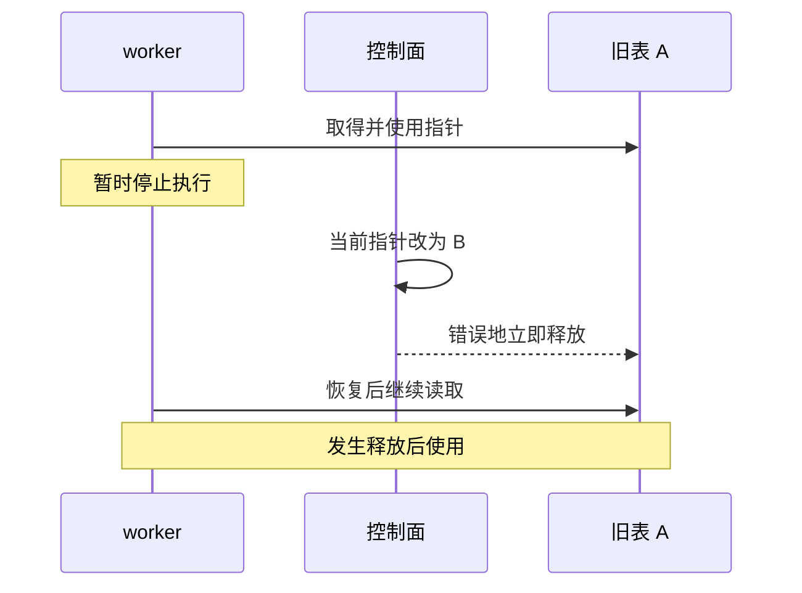
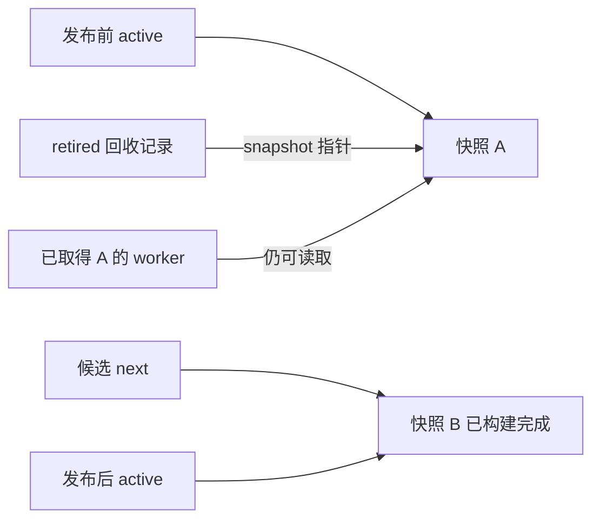
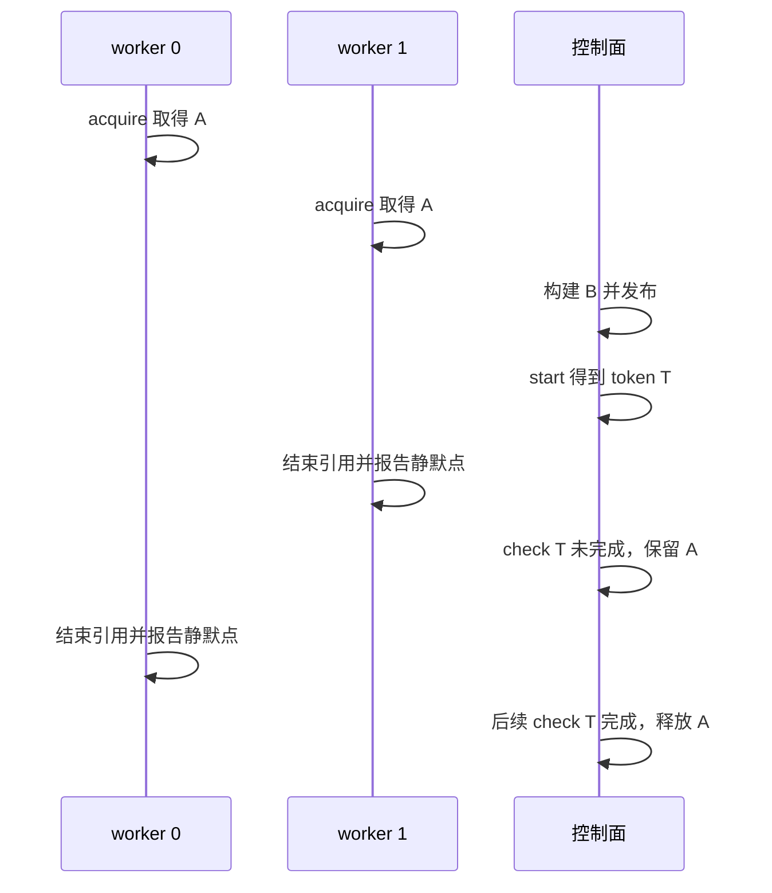
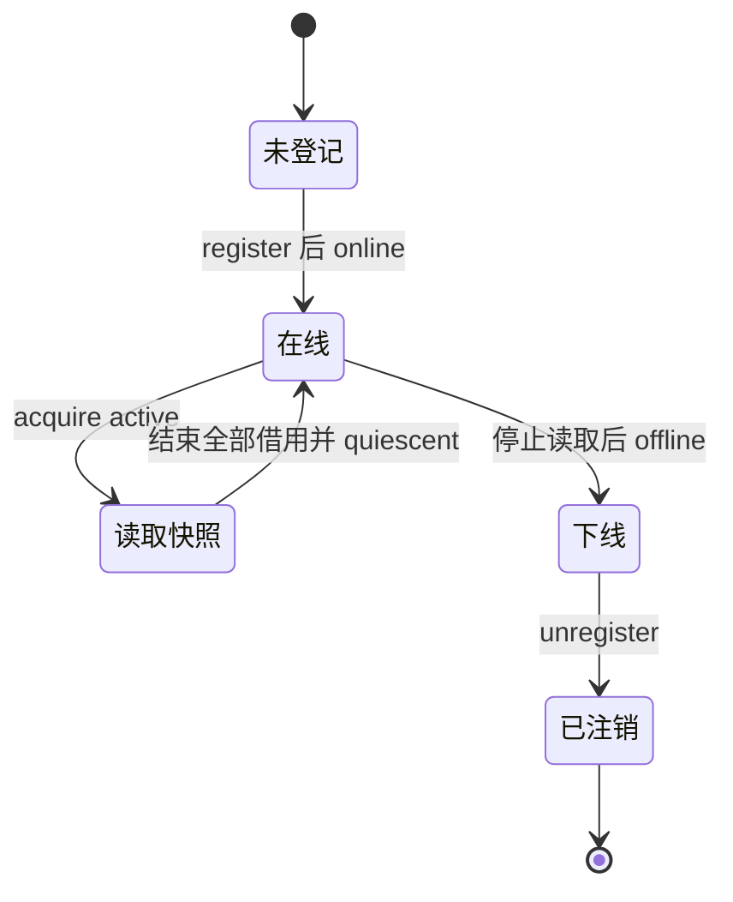

# 06 原子发布、QSBR 与旧快照回收

最后核查：2026-10-29；项目源码基线：`380d7da`

适用范围：项目软件分类器和路由快照，使用 DPDK QSBR；不将这个机制等同于硬件多规则原子更新

先读 [多核与性能](05-multicore-performance.md)。必要基础是指针、对象生命周期与原子变量，本章会结合例子解释 acquire/release。

## 先看会出错的交错

worker 取得旧规则表 A 的指针，然后被操作系统暂停。控制面把当前规则指针换成 B，并立即 `free(A)`。
worker 恢复后继续使用 A，这时访问的已经是失效内存。
即使“当前指针”的交换完全原子，这个错误仍然成立，因为原子交换没有撤销 worker 手里的旧指针。



本章把两件事分开解决：让新读者看到完整新对象，以及知道旧读者何时已经离开旧对象。

## 发布只改变入口

项目先在独立内存中准备 B，复制需要保留的规则信息，重建匹配索引。
准备失败时仍让 `active` 指向 A；准备完成后，才一次交换入口指针。



这是两个时刻合并展示的所有权图。`retired` 是记录旧对象和回收标记的管理节点，不是 A 的副本。
实际入口在 [software_backend.c](../../../lib/dataplane/software_backend.c) 的 `publish_locked`。

```c
previous = atomic_exchange_explicit(&backend->active, next, memory_order_release);
```

这句代码把 B 的地址放进 `active`，并取回原地址 A。它没有复制整个对象，没有释放 A，也没有等待所有 worker。
读者在 `dppd_software_backend_decide_counted` 中用 acquire 读取 `active`。
读者如果取得这次发布的 B，发布前对 B 的初始化应对它可见。

不要把 acquire/release 理解为“禁止所有 CPU 缓存”或“把其他线程暂停”。它们建立必要的内存顺序与可见性关系。
互相独立的计数更新不一定需要同样的顺序，具体要求取决于那个变量承担的协议。

## QSBR 解决什么时候可以回收

QSBR 是 Quiescent State Based Reclamation。应用把“不再持有先前共享对象引用的位置”定义为静默点。
DPDK 负责记录读者进度，让写者判断某个回收阶段是否已经完成；静默点放在哪里，由应用负责。
这种“先移除入口，再延迟释放”的机制见 [DPDK RCU 指南](https://doc.dpdk.org/guides-24.11/prog_guide/rcu_lib.html)。

项目的写路径在发布 B 后调用 `rte_rcu_qsbr_start`，得到 token，再把 A 放入回收链表。
token 表示这轮回收的进度标记，不是 Unix 时间、规则 ID 或 generation。
`rte_rcu_qsbr_check(qsbr, token, false)` 中的 `false` 表示不在该调用里等待。
检查尚未满足时，控制面保留 A，之后再检查。



这条时间线特意让 worker 0 更慢。快读者已经进入下一轮，并不允许写者跳过仍可能使用 A 的读者。
报告静默点不是释放动作；释放发生在后续控制面的回收检查中。

## 再往下看 DPDK 怎样记进度

打开 [DPDK v24.11 的 rte_rcu_qsbr.h](https://github.com/DPDK/dpdk/blob/v24.11/lib/rcu/rte_rcu_qsbr.h)，
依次找 `rte_rcu_qsbr_start`、`rte_rcu_qsbr_quiescent` 和 `__rte_rcu_qsbr_check_selective`。
这个版本维护一个全局 token、每个读者的计数和已登记读者集合。
`start` 推进全局 token；读者到达静默点后把观察到的新 token 记录到自己的计数；检查方比较这些进度。
离线读者使用专门的值表示，不需要当作仍在读取旧表的线程等待。

用一个简化状态表说明比较过程：

| 时刻 | 全局 token | 读者 0 进度 | 读者 1 进度 | 对 token 4 的检查 |
| --- | --- | --- | --- | --- |
| 新回收开始 | 4 | 3 | 3 | 未完成 |
| 读者 1 报告 | 4 | 3 | 4 | 未完成 |
| 读者 0 报告 | 4 | 4 | 4 | 可以完成 |

表格省略了注册并发、原子顺序和缓存优化，不能直接当作自行实现 QSBR 的完整算法。
阅读源码时留意每个读者计数的 cache 对齐：它既是同步协议，也是高频读写的数据布局设计。

## 读者有完整生命周期

| 阶段 | DPDK API | 应用必须满足的前提 |
| --- | --- | --- |
| 登记 | `rte_rcu_qsbr_thread_register` | ID 稳定且唯一，尚未开始不受保护的读取 |
| 上线 | `rte_rcu_qsbr_thread_online` | 准备参与共享数据读取 |
| 读取 | 项目使用 acquire 取得快照 | 保证本轮持有的引用都在保护范围内 |
| 报告静默点 | `rte_rcu_qsbr_quiescent` | 此后不再访问此前借用的对象 |
| 下线 | `rte_rcu_qsbr_thread_offline` | 已停止共享数据访问，例如进入不读共享对象的长期等待 |
| 注销 | `rte_rcu_qsbr_thread_unregister` | 不再作为该 QSBR 实例的读者 |

本项目封装对应 `dppd_software_backend_worker_register`、`worker_quiescent`、`worker_unregister`。
QSBR 的 API 接受 reader ID，但不会替你检查某个 C 指针是否真的还在使用。
若先报告静默点再使用旧指针，应用已经破坏了协议，库无法自动补救。



## 项目把安全点放在哪里

读 [worker.c](../../../lib/dataplane/worker.c) 的 `dppd_worker_main`：

1. 开始收发前登记软件规则读者和路由读者
2. 每轮扫描各端口，调用相应报文处理函数
3. 完成这一轮匹配和计数处理后，为两个 QSBR 域分别报告静默点
4. 即使没有包，也继续报告进度
5. 停止时先停止读取，再下线、注销，最后返回线程入口

主线程仍须 `rte_eal_wait_lcore` 确认 worker 返回，然后才能销毁共享后端。
某个读者下线，不代表所有其他读者也下线了。

路由器采用类似方法，入口是 [ipv4_router.c](../../../lib/dataplane/ipv4_router.c) 的 `dppd_ipv4_router_reader_register`、
`dppd_ipv4_router_reader_quiescent` 和 `dppd_ipv4_router_reader_unregister`。
软件规则与路由有不同对象及 QSBR 实例，不能把其中一个实例的 token 拿去证明另一个实例可回收。

## 不可变快照也可能引用可变对象

规则定义与匹配索引发布后供读者读取，计数器却仍然需要递增。
项目把计数对象单独管理，通过原子计数与引用关系让多个版本安全借用。
旧表销毁时归还它持有的引用，并不意味着那个计数对象一定立刻释放。

因此要分别画三条生命周期：当前入口指针、快照对象、快照引用的计数对象。
“规则已经删除”也不等于旧 worker 不能完成最后一次合法累计。
具体核对 `snapshot_destroy`、`count_packet` 和共享计数绑定代码，而不是把整个快照里的每一字节都称为不可变。

## 用数字估算滞后回收的代价

假设每份快照连同索引占 2 MiB，每秒发布 20 次，一个在线读者 3 秒都没有经过安全点。
若这些版本都等待该读者，可能额外保留约 `2 × 20 × 3 = 120 MiB` 的快照内存。
这只是教学估算，实际大小和共享对象引用必须按实现计算。

所以 QSBR 把逐包抢写锁的代价，部分转化为版本构建、内存保留和读者进度管理的代价。
长时间阻塞的读者会拖延回收。不能为了降内存直接强行释放它可能引用的对象。

项目回收检查不等待，不意味着整个控制面是无锁算法；`writer_lock` 仍串行化写路径。
同样，完整应用中的连接跟踪、管理和持久化也有自己的同步机制。

## 实验：验证并发发布与失败前保持旧表

Linux 项目根目录，已配置带测试的 `build`：

```sh
meson compile -C build
meson test -C build 'software rule backend' --print-errorlogs
meson test -C build 'software batch snapshot publication' --print-errorlogs
meson test -C build 'atomic software create replace delete and allocation failures' --print-errorlogs
```

这些是 [tests/unit/meson.build](../../../tests/unit/meson.build) 中的测试名，不需要实体 NIC。
命令成功是预期；实际执行状态另见教材验收记录。

先读 [test_software_backend.c](../../../tests/unit/test_software_backend.c)：登记读者、匹配、报告安全点、删除、注销的顺序与正式 worker 对齐。
再读 [test_software_batch.c](../../../tests/unit/test_software_batch.c)：真实读线程持续匹配，写线程替换规则，断言读者不会看到破坏约束的中间结果。
其中的分配失败注入断言 `active` 仍是原来的对象，适合区分“准备失败”和“发布成功后尚未回收”。

无需修改生产代码的进一步练习：在纸上把时间线中的 worker 0 延后一个安全点，逐项填写 `active` 指向谁、A 是否存活、token 是否完成。
若需要调试器观察，可在测试进程的 `publish_locked` 与 `reclaim_locked` 设置断点；暂停整个进程会同时停止读者，不能用这种暂停证明真实并发等待时间。

## 自检与参考答案

1. 原子指针交换成功后能立即 `free(previous)` 吗？答：不能，已有读者可能还持有旧地址
2. acquire/release 与 QSBR 分别解决什么？答：前者保证所需发布可见性，后者协助判断旧引用生命周期结束
3. 静默点就是让线程睡眠吗？答：不是，它是已经结束相关借用的进度报告
4. `check(..., false)` 返回未完成，会撤销新表吗？答：不会，新表已生效，旧表继续等待回收
5. generation 与 token 能混用吗？答：不能，前者是项目规则版本，后者是某个 QSBR 实例的回收进度
6. 单元测试验证软件整批发布，能证明硬件多条规则同时生效吗？答：不能，两者的执行机制和验收对象不同

## 继续阅读

- [DPDK v24.11 QSBR 定义与实现](https://github.com/DPDK/dpdk/blob/v24.11/lib/rcu/rte_rcu_qsbr.h)：各生命周期函数的调用约束
- [项目软件后端接口](../../../include/dppd/software_backend.h)：对象关系与调用者契约
- [规则卸载](07-rte-flow.md)：把软件快照与硬件安装行为分开理解
