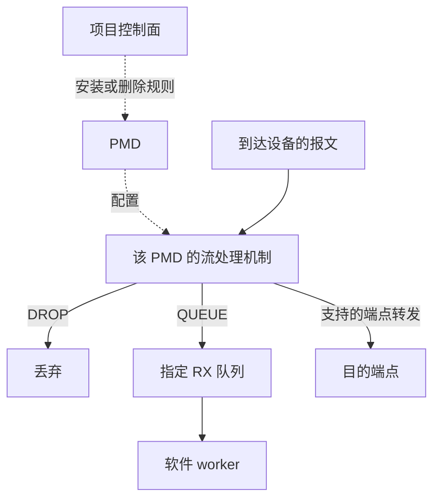
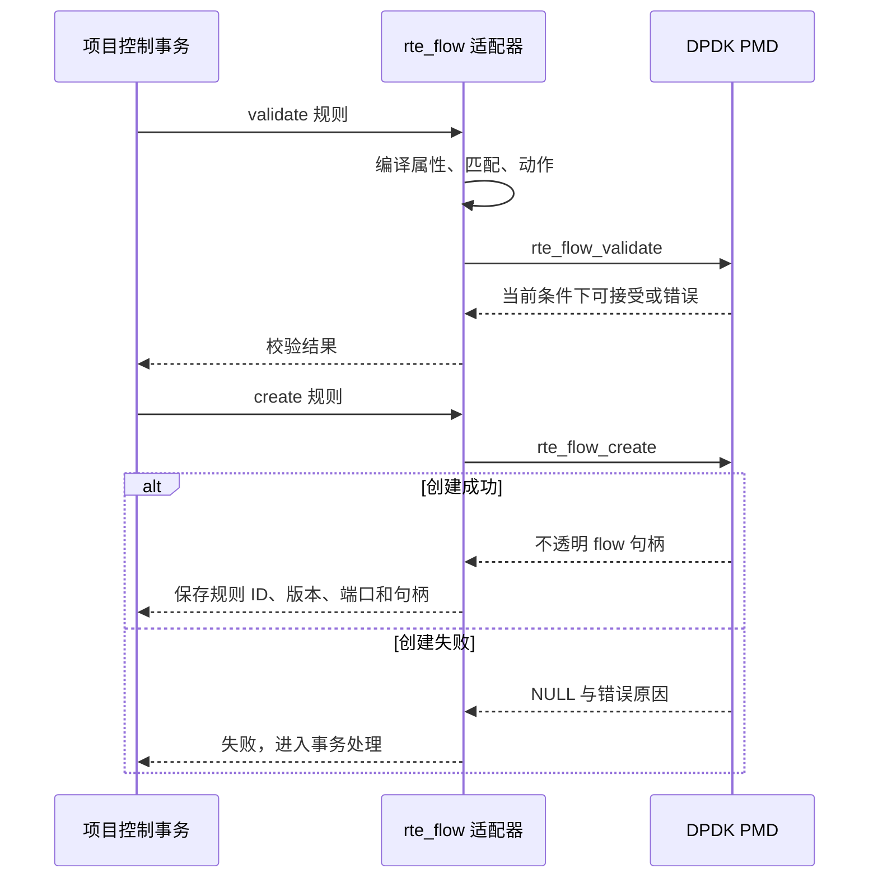
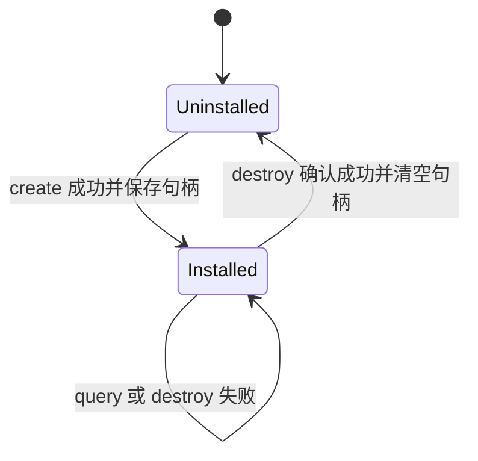
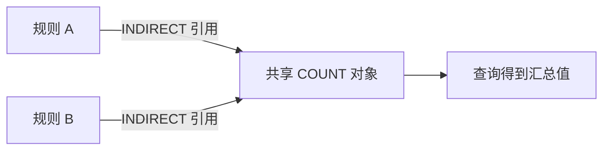

# 07 从规则描述到 rte_flow

适用范围：项目同步规则路径、AGE 与共享 COUNT；源码核查基线 `380d7da`，最后核查 2026-10-29

先读 [队列与收发](04-queues-io.md)，并能解释“报文到了 CPU”和“报文经过网卡”为什么是两件事。
本章目标是读懂一条规则怎样从 C 结构体变成 PMD 对象，以及失败时为什么不能只释放应用内存。

## 先把控制操作和逐包执行分开

`rte_flow_create()` 的调用发生在安装规则时。它把匹配条件与动作交给 PMD，并不要求应用对每个包调用一次。
创建完成后的报文处理发生在该 PMD 对应的数据路径。实体网卡可以由硬件执行，TAP 可以映射到内核机制；
因此“调用了 `rte_flow`”本身不等于“已经使用 ASIC 卸载”。

以下是机制示意，虚线表示控制请求，实线表示报文路径。硬件命中的包是否进入 CPU 取决于动作。



DPDK 的规则由属性、匹配数组和动作数组组成，具体组合需要目标 PMD 接受。
基础定义见 [DPDK 21.11 Generic flow API](https://doc.dpdk.org/guides-21.11/prog_guide/rte_flow.html)。

## 一条规则的三部分

用“进入端口 0、IPv4 目的地址为 192.0.2.10、UDP 目的端口为 9000，计数并丢弃”作概念例子。
这只是规则推演，不是对当前设备能力的断言，也不是现有 CLI 的直接命令。

| 部分 | 示例内容 | 决定的问题 |
| --- | --- | --- |
| 属性 `rte_flow_attr` | ingress、group 0、priority 10 | 在哪个方向、哪个规则组中比较 |
| 匹配 `rte_flow_item[]` | ETH、IPv4、UDP、END | 哪些报文满足条件 |
| 动作 `rte_flow_action[]` | COUNT、DROP、END | 满足条件后做什么 |

项目的 [dppd_compile_flow](../../../lib/offload/rte_flow.c) 将自己的 rule IR 编译为这三部分。
`compile_match()` 把 IPv4 地址与 TCP/UDP 端口写入对应的 `spec` 和 `mask` 存储；
`compile_action()` 填写动作类型和配置指针；两个数组最后都补上 `END`。

`spec` 表示希望匹配的值，`mask` 表示哪些位参与比较。理解时可以用下面的概念公式：

```text
(报文字段 & mask) == (spec & mask)

UDP 目的端口 9000，mask = 0xffff：完整比较这 16 位
IPv4 地址 192.0.2.10，mask = 255.255.255.0：比较网络前缀
mask = 0：该字段的位不影响这个匹配条件
```

公式帮助理解按位匹配，但不能代替 PMD 的格式、层次与组合校验。
本项目字段进入编译器前已是网络字节序，编译器直接复制。重复转换字节序会改变含义。
不要把“结构体里写了整数 9000”和“线上两个字节表示 9000”自动等同。

`rte_flow_item.spec` 与 `action.conf` 都可能指向另一块存储。
只复制最外层数组不会自动深复制其指针指向的数据；异步路径必须额外解决生命周期，见 [第 09 章](09-async-templates.md)。

## 安装并不是一个函数完成的

下面对应项目同步适配器的主线。规划和事务属于项目，`rte_flow_*` 属于 DPDK。



`validate` 是检查，不是资源预留。例如检查时还剩一个硬件表项，随后其他操作使用了它，
`create` 仍可能返回容量错误。即使没有并发调用，创建过程中的分配或设备错误也可能失败。

[flow_create](../../../lib/offload/rte_flow.c) 只有拿到有效句柄后才写入安装信息。
同步创建返回 `NULL` 时，适配器优先使用 `rte_errno`，没有错误码时保守返回 `-EIO`。
调试时同时保留操作阶段与驱动错误文字，单看 `EINVAL` 无法区分是哪项匹配或动作不被接受。

## 句柄为什么要留到删除确认以后

句柄是 PMD 管理对象的身份，不是应用可以直接 `free()` 的普通内存。
项目将它与安装端口、规则 ID、generation 一起保存在 `dppd_flow_handle`。



读 [dppd_flow_remove](../../../lib/offload/rte_flow.c)：先调用 `rte_flow_destroy()`，
只有成功才清零项目句柄。删除失败意味着驱动对象可能仍存在，提前忘记句柄会失去精确重试的依据。
端口级 `flush` 的范围更大，不能当作删除一条规则的等价操作。

这也是“硬件规则原子事务”的边界：账本可以在某个时刻统一发布，但多次硬件创建/删除期间，
设备是否暴露过中间状态要另行证明。项目的补偿机制不能凭空提供所有 NIC 都支持的逐包原子切换。

## COUNT、AGE 与共享对象

COUNT 是命中统计；AGE 是闲置状态。COUNT 长时间不变不能自动证明 AGE 已到期，
因为查询能力、有效位、计数范围和时钟语义都可能不同。

项目的 `dppd_flow_query_count()` 同时检查 `hits_set` 和 `bytes_set`。
若驱动没有提供有效值，返回 `-ENODATA`，不把初始化后的零解释为“没有命中”。
`dppd_flow_query_age()` 单独查询 AGE，`sec_since_last_hit_valid` 决定闲置秒数是否可解释。

共享 COUNT 的形状可以理解为两个规则引用同一计数对象：



例如 A 命中 3 个包、B 命中 5 个包，共享对象的包数可累计为 8。
这个 8 不能同时解释为“A 的私有包数”和“B 的私有包数”。
[shared_count.c](../../../lib/offload/shared_count.c) 调用 `rte_flow_action_handle_create/query/destroy`；
上层引用保护与版本管理属于项目，而不只是调用这三个函数。

## 回退必须保留含义

[dppd_plan_rule](../../../lib/control/planner.c) 决定候选后端；后续校验与事务决定能否安装。
`REQUIRE_HARDWARE` 不能静默转为软件，`PREFER_HARDWARE` 也只有软件语义等价时才有回退资格。
例如硬件 QUEUE 是 RX 分流，软件在包已被某个 worker 收到之后更换 TX 队列，不能完成同一件事。

同理，绕过软件 worker 的 transfer 规则可能跳过软件连接跟踪、路由或 ND。
项目对相关运行模式设置限制，不能只看动作名称相同就认定可替换。
当前软件 ACL 和路由查询是项目实现，不能因为规则用了同一个 IR 就称其为 DPDK `rte_acl` 或 `rte_lpm`。

## 实验：校验适配契约及失败语义

前提：在 Linux 仓库根目录，已有启用 `-Dtests=true` 的真实 DPDK 构建目录 `build`。
若尚未构建，先按 [构建说明](../../build_and_run.md) 准备依赖；已有其他构建目录时替换 `build`。

```sh
meson test -C build --print-errorlogs \
  'transfer compilation and hardware counter validity' \
  'AGE driver contract and exact generation' \
  'shared COUNT indirect driver contract' \
  'rule planner'
```

名称来自 [单测注册](../../../tests/unit/meson.build)。这些是适配器/控制契约测试，部分通过链接器包装 DPDK 入口，
因此不要求实体网卡；通过不代表物理设备已经接受或执行了规则。

运行前先预测三件事，再查看 [test_flow_contract.c](../../../tests/unit/test_flow_contract.c) 等测试中的断言：

1. COUNT 查询调用成功，但一个有效位未设置时，调用方原有输出是否改变
2. destroy 失败后，原来的 flow 句柄是否保留
3. 软件规则能否替代 transfer 或不等价的 QUEUE

预期分别是：查询失败且不覆盖输出、保留句柄、拒绝不等价替代。
本节命令是复现入口，实际执行记录应以本轮验收报告为准；不要把“预期”改写成运行结果。

## 自检与参考答案

**问：规则安装成功，worker 包计数却没有增加，一定是没有命中吗？**

答：不一定。DROP 或硬件端点转发可能根本不把包交给 worker；应结合动作、硬件计数和目的端收包判断。

**问：为什么需要保存规则 ID 和 generation，不能只保存 PMD 指针？**

答：PMD 指针解决当前对象访问，ID/版本解决业务身份与更新冲突；进程或设备重建后，旧指针不能充当持久身份。

**问：有哪些证据能逐步增强“卸载生效”的判断？**

答：驱动创建成功、有效硬件计数变化、对应报文在预期出口出现，再结合 CPU 路径统计与负载对比。
每一步解决不同疑问，单独一项不足以证明全部效果。

继续阅读 [SmartNIC 与 DPU](08-smartnic-dpu.md)。查参数时使用 [DPDK 24.11 rte_flow API](https://doc.dpdk.org/api-24.11/rte__flow_8h.html)，
并同时核对目标 PMD 的限制。
