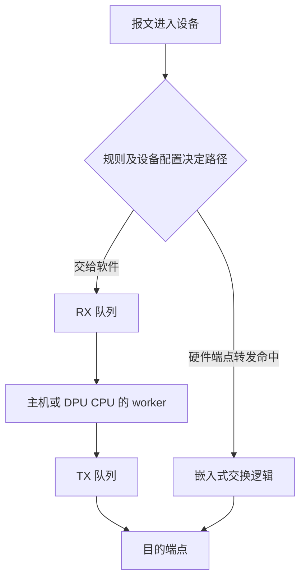
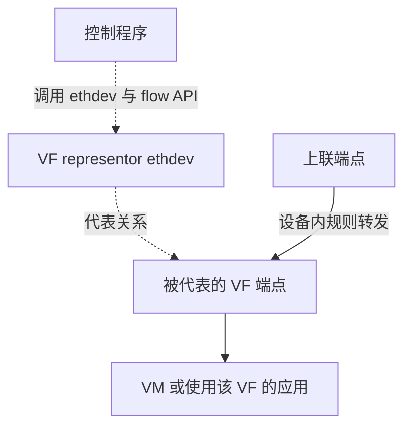
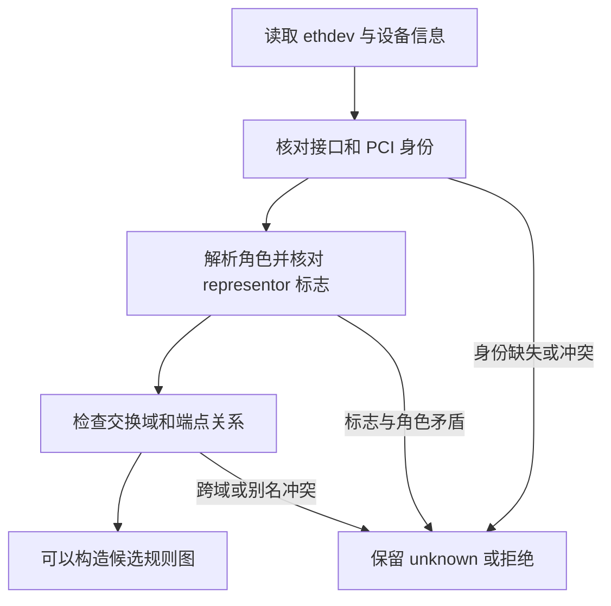

# 08 SmartNIC 与 DPU 中的端点和硬件路径

适用范围：项目角色发现、transfer 规划与模拟；源码基线 `380d7da`，最后核查 2026-10-29

先读 [rte_flow](07-rte-flow.md)。本章要解决的问题是：为什么安装规则的 ethdev、报文来源和报文去向可能是三个不同的端点。

## 把 CPU、网卡交换逻辑和应用位置分开

SmartNIC/DPU 可能包含嵌入式交换逻辑、硬件加速单元以及独立 CPU。
应用运行在 DPU CPU 上，与报文完全在网卡硬件中转发，是两种不同执行路径。
“程序交叉编译到 ARM”只能说明能在对应 CPU 上运行，不能单独证明硬件卸载。

以下是两条概念路径，不是当前两台虚拟机的实际拓扑。



软件路径保留复杂处理的灵活性，但消耗 CPU、内存访问和队列资源。
硬件路径是否能避开这些开销，取决于规则、设备和实际报文是否满足要求。
未命中时可能丢弃、进入其他表或被送往 CPU，不能在图中一律画成“自动软件回退”。

## 六个经常混淆的名字

| 名称 | 在这里怎样理解 | 不能据此推断什么 |
| --- | --- | --- |
| PF | PCIe Physical Function | 不等于“网口 0” |
| VF | SR-IOV Virtual Function | VF 编号不等于 DPDK port_id |
| SF | 设备提供的 Sub Function | 不是所有设备都支持，也不等于一个独立 PCIe VF |
| uplink | 通向外部网络的上联端点 | 不能只凭枚举顺序辨认 |
| representor | 管理应用可见的端点代表，通常表现为额外 ethdev | 不意味着每个包都会经过该 ethdev 的软件 RX/TX |
| switch domain | DPDK 暴露的交换域身份 | 不是 VLAN ID，也不能把未知域当成共同域 |

代表端口是观察、注入和控制对应设备端点的接口。被代表的端点才是规则所描述的实际来源或去向之一。
对于特定平台，还要结合驱动定义判断代表端口具备哪些收发能力。
这些关系见 [DPDK Switch Representation](https://doc.dpdk.org/guides-24.11/prog_guide/ethdev/switch_representation.html)。



图中的虚线分别表达调用和代表关系，不表示完整报文被复制到控制程序。
项目使用 `REPRESENTED_PORT` 匹配和动作来描述被代表端点；不要将它与 `PORT_REPRESENTOR` 的语义混写。

## 从真实身份构造可信拓扑

[topology.c](../../../lib/device/topology.c) 的 `dppd_topology_discover_with_reader()` 从 ethdev 信息进入发现流程。
`discover_identity()` 结合接口编号、设备名、netlink 和 sysfs 信息，确认角色标签来自当前设备。
`dppd_topology_resolve_role()` 再解析 mlx5 命名中的 uplink、PF、VF、SF 等关系。

字符串 `pf0vf1` 的语法成立，不足以证明当前 ethdev 就是该 VF 的 representor。
必须核对其驱动、representor 标志和接口身份；读取失败或矛盾时保留未知及错误原因。

例如两台独立设备都可能出现 `pf0vf1`。父 PF 编号相同并不能证明它们属于同一个 PF。
[matching_parent](../../../lib/control/transfer.c) 还检查 controller 或可证明的共同设备命名域。



这是代码证据流程，不是存在一张 Mellanox 网卡的证明。
mlx5 还有重要的驱动边界：它使用与内核驱动共存的模式，不能照搬“所有 DPDK 网卡先绑定 vfio-pci”的步骤。
设备相关配置应遵循 [mlx5 官方驱动说明](https://doc.dpdk.org/guides-24.11/nics/mlx5.html)。

## INSTALL、SRC、DST 分别回答什么

`dppd_transfer_graph_build()` 生成候选图，`dppd_control_transfer()` 处理 plan/apply。
对应实现位于 [transfer.c](../../../lib/control/transfer.c)。

假设已经核实同一交换域内，安装 ethdev 为 10，来源端点为 12，目的端点为 14：

```text
INSTALL = 10：通过哪个 ethdev 调用 PMD 创建规则
SRC     = 12：匹配来自哪个被代表端点的报文
DST     = 14：转给哪个被代表端点
```

这三个数字是教学例子，不是当前实验机的真实编号。
`oneway` 生成一条边；`bidir` 生成两条相反方向的边，并使用相邻两个规则 ID。
双向转发需要两个方向都建立，不能只装 12 → 14 就推断回程也会自动存在。

`transfer-plan` 只计算并验证项目约束，不调用 PMD 安装。
`transfer-apply` 使用 plan 得到的账本版本重新检查，并交给正式事务执行。
版本变化后必须重做计划，因为期间已有规则或共享对象可能发生了变化。

本项目 transfer 图强制硬件策略。缺少交换域或目标 PMD 不支持时明确失败；
把不支持的请求改成 worker 两端口转发会改变旁路、角色及软件处理语义。

### 一个必须按源码看的版本差异

[dppd_compile_flow](../../../lib/offload/rte_flow.c) 对 transfer 始终设置 `transfer`。
在 `RTE_VERSION < 22.11` 时还设置 `ingress`，用于该版本路径的兼容；新版本分支不这样设置。
不要从历史文档中抽出“transfer 一律同时设置 ingress”作为跨版本规则。

## 实验：在没有 DPU 时理解规则图

前提：Linux，已有启用测试的 DPDK 构建目录；以下命令均在仓库根目录执行。
这些实验使用独立模拟器或包装入口，不会把虚拟机变成真实 DPU。

先验证拓扑与规则图的契约：

```sh
meson test -C build --print-errorlogs \
  'verified endpoint roles and bounded topology discovery' \
  'simulated transfer templates and control lifecycle' \
  'transfer management protocol and role evidence'
```

测试名来自 [单测注册](../../../tests/unit/meson.build)，详细断言见
[test_topology.c](../../../tests/unit/test_topology.c) 和 [test_transfer.c](../../../tests/unit/test_transfer.c)。

再运行已有完整演练，给本次记录使用独立目录：

```sh
python3 scripts/simulate_m3.py demo --build-dir build \
  --report-dir build/dpdk-learning-transfer
```

[simulate_m3.py](../../../scripts/simulate_m3.py) 复用正式管理协议、控制事务与持久化，
替换驱动和端点。预期演练覆盖七种模板、计数、AGE、失败补偿及重启，并生成报告。
实际通过与否看进程退出码和报告；本节没有把命令预期当作已执行结果。

阅读报告时必须同时检查 `simulation`、`hardware_acceptance` 和 `complete_m3_validation`。
预期分别明确模拟、硬件未执行、完整硬件 M3 尚未完成。

### 用 14 字节帧进行手算

现有 [手动演练说明](../../m3_simulation.md) 给出帧 `02000000000202000000000188b5`。
它包含目的 MAC 6 字节、源 MAC 6 字节和 EtherType 2 字节，共 14 字节。
若新建的单向规则命中这一个帧，模拟私有 COUNT 的预期是 `hits=1 bytes=14`。
这验证的是模拟器定义的字节计数，不是物理线速、前导码、FCS 或某硬件计数口径。

## 怎样才算证明硬件价值

| 证据 | 能回答的问题 |
| --- | --- |
| 创建规则返回有效句柄 | PMD 是否接受这次创建 |
| 硬件有效计数随目标流量增加 | 规则是否观察到目标流量 |
| 外部目的端收到正确报文 | 转发结果是否符合预期 |
| 软件 RX/worker 统计及 CPU 对照 | 目标流量是否减少软件处理，收益有多大 |
| 受控物理复位后重新验证 | 真实设备恢复是否成立 |

当前可运行的模拟与软件测试覆盖控制逻辑，不能代替最后这些设备证据。
实验设计还应固定报文长度、流数、速率和 CPU 采样方法，避免把不同负载下的数字直接比较。

## 自检与参考答案

**问：`port_id=2` 就是 VF 2 吗？**

答：不是。前者是当前进程的 ethdev 索引，后者是设备功能编号，需要拓扑与身份映射。

**问：看到 representor 的软件 RX 为零，但目的 VF 收到包，矛盾吗？**

答：不一定。硬件转发可能直接到 VF；还要核对具体规则、计数和设备模式。

**问：在 DPU CPU 上跑软件 NAT 与 NAT 硬件卸载是否同义？**

答：不同。前者改变计算发生的位置，后者还改变执行单元和数据路径，必须分别测量。

**问：模拟复位后规则能恢复，能否宣布实体设备恢复完成？**

答：不能。模拟能检查身份、重建顺序及失败处理，无法覆盖 PCIe、固件和真实 PMD 的全部行为。

继续阅读 [模板和异步规则](09-async-templates.md)；当前范围与实机限制见 [M3 软件验收](../../m3_software_acceptance.md)。
