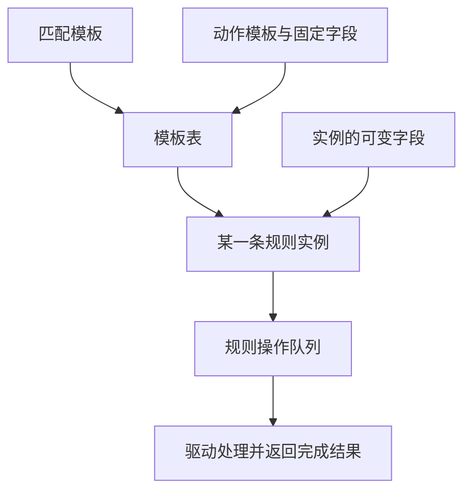
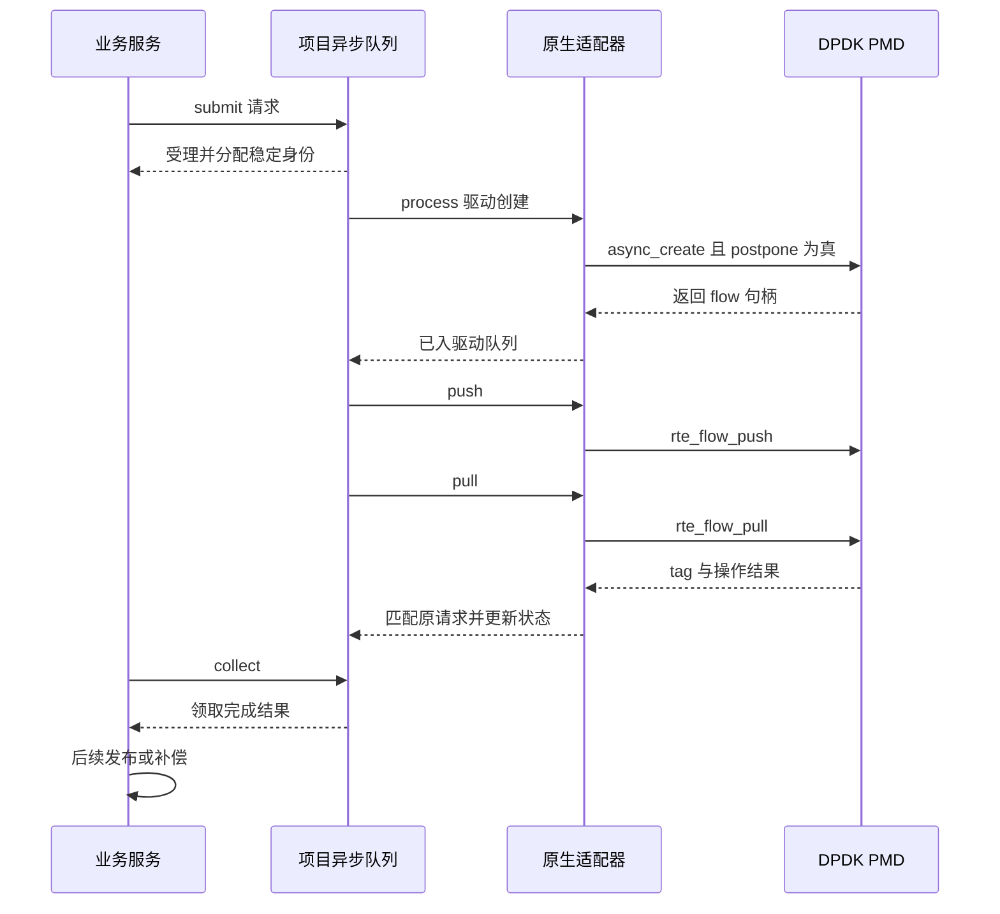
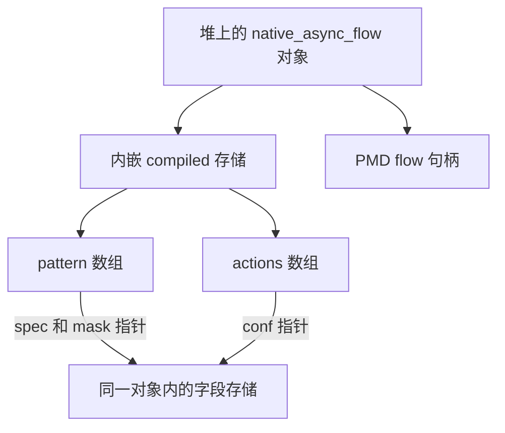
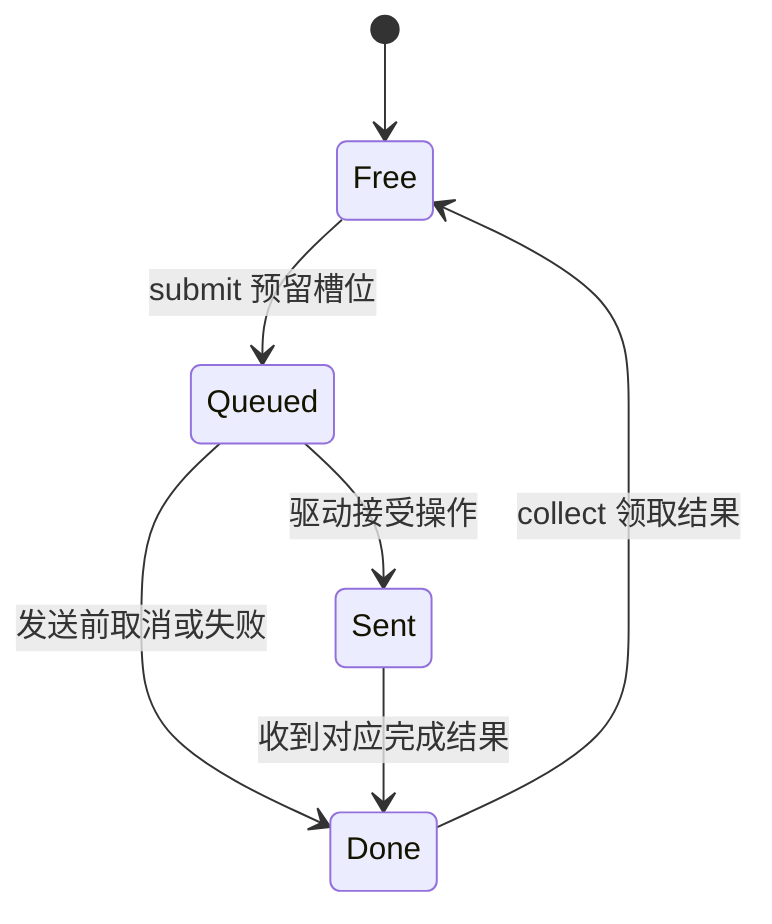

# 09 模板、异步规则与背压

适用范围：项目 M4 原生适配与控制状态机；源码基线 `380d7da`，最后核查 2026-10-29

先读 [rte_flow](07-rte-flow.md) 和 [并发更新](06-qsbr.md)。
本章要分清“请求已受理”“驱动已入队”“操作已完成”和“业务已发布”四种状态。

## 为什么规则创建也需要模板和队列

假设一批规则都匹配 Ethernet/IPv4/UDP，只有地址和端口不同。
每次都重新处理相同结构会有重复工作；模板让应用提前描述规则形状及哪些字段可以变化，
设备/PMD 可以据此准备资源。异步队列则允许先提交一批操作，再统一推进和收集结果。

这是控制路径的批处理。它与 worker 每次收 32 个报文的 RX burst 不属于同一种队列：
RX/TX 队列装的是报文描述，flow queue 装的是规则操作。



本项目 [flow_template.c](../../../lib/offload/flow_template.c) 将模式模板、动作模板和模板表分成三个 PMD 对象。
项目自己的模板 ID、generation、引用凭据和容量检查位于
[控制层 flow_template.c](../../../lib/control/flow_template.c)，不能与 DPDK 对象指针混为一谈。

## 固定字段与可变字段怎样理解

例如模板的动作顺序固定为 MARK、COUNT、DROP：MARK 值可以随实例变化，DROP 本身没有参数。
固定动作值与动态动作值的掩码决定哪些内容提前确定，实例仍需符合模板约束。

在原生 `native_create()` 中，项目按 `dynamic_actions` 构造动作掩码；
MARK 的固定值使用全一掩码，动态值使用零掩码。匹配模板与动作模板的掩码含义应结合各自 API 阅读，
不要把“动作是否固定的掩码”和“报文匹配哪些位的掩码”只凭名字当作同一件事。

模板表配置容量，并不等于每次创建都必然成功；全局资源、计数器、共享对象和队列槽位还可能独立不足。
共享 COUNT 被模板引用时，模板自身也需要持有引用，不能只等第一条规则创建后才保护它。

删除应沿依赖反方向进行：先确认相关流已移除，再销毁模板表，之后拆动作模板和匹配模板。
项目原生销毁函数每成功一步才清空相应指针；中途失败保留其余对象，供后续精确清理。

## 四个阶段怎样连接

以下是一次正常创建的简化时序。业务层的批量发布、补偿和持久回执在队列完成之上另有处理。



对照 [async_flow.c](../../../lib/control/async_flow.c) 的三个入口：

- `dppd_async_flow_submit()`：检查身份、模板和容量，准备项目对象，尚未调用创建驱动
- `dppd_async_flow_process()`：按预算 dispatch，调用 push/pull，并关联完成结果
- `dppd_async_flow_collect()`：领取项目完成记录并释放该操作占用的槽位与额度

因此 submit 返回 0，不说明硬件规则已生效。原生 async_create 返回非空句柄，也不能替代完成结果。
对有句柄但创建完成失败的情况，仍可能需要销毁该句柄；项目不会简单把一次失败当成“没有任何对象”。
DPDK 队列操作规则见 [24.11 异步操作说明](https://doc.dpdk.org/guides-24.11/prog_guide/ethdev/flow_offload.html#asynchronous-operations)。

## 为什么必须保留参数存储

同步适配器可以在调用期间使用局部的编译结构。异步适配器必须考虑调用返回后驱动还会使用哪些参数。
[原生 async_flow.c](../../../lib/offload/async_flow.c) 使用堆上的 `native_async_flow`，
把 `dppd_compiled_flow` 连同其内部指针指向的数组一起保留，直到确认清理后再释放。



想象把 `compiled` 改成函数栈变量：enqueue 返回后函数结束，原地址可能被下一次调用覆盖。
稍后驱动读取 `conf`，拿到的就可能不是原来的 MARK 或 AGE 配置。
这类错误常表现为偶发参数错误；根因是生命周期，而不是字段赋值语法。

项目测试专门在 enqueue 返回后继续读取保存的指针，见
[test_native_async_flow.c 的 check_storage](../../../tests/unit/test_native_async_flow.c)。

## 状态机与背压的数字推演

项目把“操作记录”和“已安装流对象”分开保存。下面仅画操作记录状态：



流对象的 READY、CREATE_FAILED、DESTROYING 等状态是另一层。
create 的操作记录被 collect 回收，不表示已安装的 flow 也应该被释放。

假设队列深度为 4，当前 `queued=1`、`pending=1`、`completed=2`，则可用操作槽位为：

```text
4 - queued - pending - completed = 4 - 1 - 1 - 2 = 0
```

此时再提交一条会遇到 `-EAGAIN`。即使两条操作早已完成，只要调用方不领取结果，槽位仍然被占用。
这是有界背压，避免慢消费者导致完成结果无限增长或被覆盖。

另外，硬件表项额度与操作槽位不同：领取创建成功的结果可以释放操作槽位，
但不能归还仍被已安装流占用的硬件表项额度。

完成顺序也不能假定等于提交顺序。项目以整数 tag 识别结果，而非依赖第一个完成就是第一个请求。
未知 tag 被当作协议/状态错误，而不是拿来解引用成一个任意请求指针。

## 超时不等于取消成功

若操作已发送但暂时没完成，超时只能证明等待过久，不能证明设备没有执行。
`dppd_async_flow_process()` 锁存超时故障，保留在途身份与相关资源，后续仍需处理结果或执行受控恢复。
立即释放内存、归还额度再重用同一槽位，可能让迟到结果错误地作用到另一条规则。

`dppd_async_flow_cancel()` 仅处理还在项目队列中、尚未发送的操作。
原生队列操作本身不提供“多个线程任意同时调用就安全”的承诺；本项目还用队列归属与锁组织调用。
硬件接口异步不等于应用不需要同步设计。

## 版本与后端边界

[原生模板适配](../../../lib/offload/flow_template.c) 和 [原生异步适配](../../../lib/offload/async_flow.c)
以 `RTE_VERSION >= RTE_VERSION_NUM(24, 11, 0, 0)` 选择实现，旧分支返回 `-ENOTSUP`。
这是项目当前支持策略，不是在宣称所有相关 API 都首次出现在 24.11。

[software_async_flow.c](../../../lib/dataplane/software_async_flow.c) 提供软件后端。
它让同一类业务流程可以在软件环境中验证，但软件完成结果不是某张实体网卡的硬件完成通知。
端口配置与原生 flow queue 配置的具体时序见
[rte_flow_configure API](https://doc.dpdk.org/api-24.11/rte__flow_8h.html)，应结合设备支持读取。

## 实验：观察乱序、存储保留与未领取结果

前提：Linux 仓库根目录，真实 DPDK 构建目录 `build` 已启用测试。
不需要修改业务源码或接入实体网卡。

```sh
meson test -C build --print-errorlogs \
  'template masks leases quotas and partial cleanup' \
  'native DPDK template API and version contract' \
  'bounded asynchronous flow lifecycle and completion identity' \
  'native asynchronous enqueue push pull and retained storage'
```

测试名称来自 [meson.build](../../../tests/unit/meson.build)。
`native` 测试通过包装 DPDK 公共入口来检查参数、顺序和对象存活，不能据此宣称真实硬件模板队列已验收。
旧 DPDK 构建验证的是明确拒绝原生路径的版本契约；新构建才覆盖对应原生适配调用。

运行前阅读 [test_async_flow.c](../../../tests/unit/test_async_flow.c)，并写下预测：

1. 队列完成结果没有 collect 时，后续 submit 是否仍有无限容量
2. 驱动按相反顺序返回两个 tag 时，调用方应按什么关联结果
3. 创建完成失败但仍有句柄时，能否直接销毁模板

预期分别是：会受背压限制；按 tag/稳定身份关联；先处理流对象及依赖，不能直接跳过清理。
以实际退出码和测试日志记录执行结果；本节列出的是实验步骤和预期，不是硬件测试报告。

## 自检与参考答案

**问：为什么 push 成功以后还要 pull？**

答：推进队列和取得具体操作结果是两个阶段，push 不给出每条规则最终成功与否。

**问：为什么 flow queue 深度和硬件规则容量不能合成一个数字？**

答：前者限制在途及未领取操作，后者限制安装对象；创建操作完成后，规则还可以长期存在。

**问：把模式数组复制到堆上，是否就解决了全部异步参数生命周期？**

答：没有。数组中的 `spec/mask/conf` 也可能指向栈，必须检查整个引用链。

**问：业务接口何时可以承诺操作完成？**

答：必须按自己的契约等待驱动结果，并处理账本发布、补偿及所要求的持久化；
仅收到 submit 的受理结果不够。继续读 [观测与排障](10-observability-debugging.md)。
