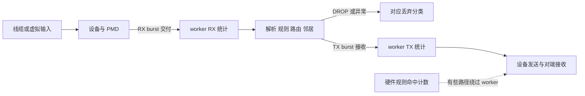
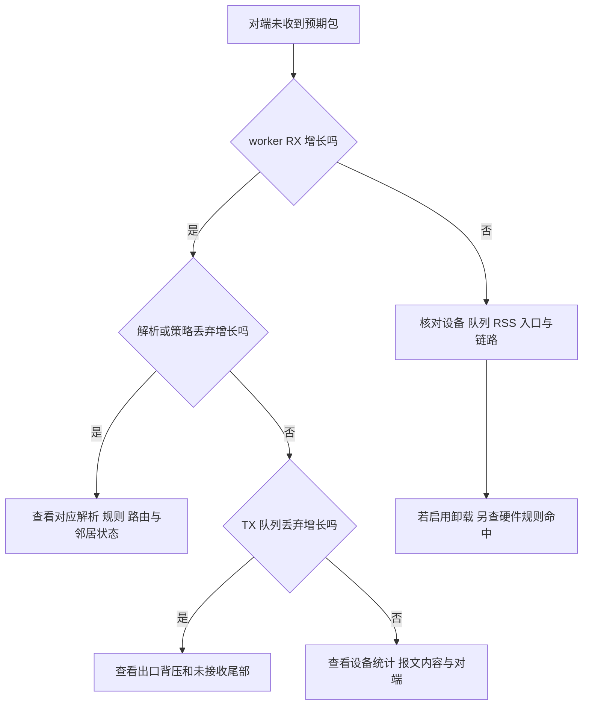
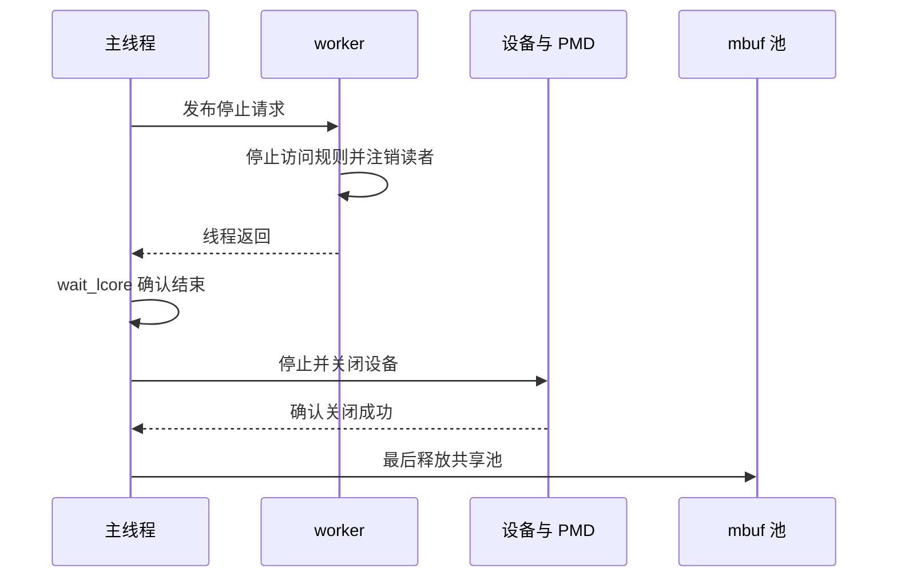

# 10 观测、排障与安全停机

最后核查：2026-10-29；项目源码基线：`380d7da`

适用范围：现有 daemon、CLI、telemetry 和测试夹具；物理硬件计数、真实复位与卸载收益必须另行实测

先读 [队列与收发](04-queues-io.md)、[QSBR](06-qsbr.md) 和 [规则卸载](07-rte-flow.md)。本章把前面建立的模型用于定位故障。

## 先确定你观察的是哪一层

一份包经过多个边界，每个边界的“成功”含义不同。
对端应用成功收到包、网卡发送统计增加、PMD 接收发送请求、worker 的 `tx_packets` 增加，不能直接画等号。



虚线表示硬件卸载可能产生的独立观测路径，不表示当前虚拟环境已经验证旁路。
包未进入 worker 时，软件 RX 计数自然不能反映全部线缆流量。

| 观测项 | 能说明什么 | 不能单独说明什么 |
| --- | --- | --- |
| worker `rx_packets` | 应用从 RX API 取得的报文数 | 网卡此前有没有丢包 |
| worker `tx_packets` | PMD 接收的发送请求数量 | 对端是否收到、是否重传 |
| 规则 COUNT | 指定规则或共享对象的命中范围 | 所有端口总流量 |
| ethdev stats/xstats | PMD 提供的设备统计 | 每个字段跨设备语义完全一致 |
| health/ready | 项目当前观测到的线程和服务状态 | 整个网络端到端畅通 |
| heartbeat | worker 最近到达进度报告点 | 其处理结果一定正确或没有丢包 |

## 从症状逐层缩小范围



这是一条诊断顺序，不是自动判定公式。采样时间不同、邻居等待、重试和硬件旁路都可能打破简单守恒关系。
先固定测试流、方向与时间窗口，再比较同一轮的证据。

## 项目的软件统计怎样更新

[worker.c](../../../lib/dataplane/worker.c) 在处理过程中累加局部 `delta`，随后调用 `dppd_stats_add`。
[stats.c](../../../lib/observability/stats.c) 对各字段使用 relaxed 原子操作。
这意味着一个字段可安全并发读写，但整组字段不是同一时刻冻结的事务快照。

例如读取 RX 后，worker 刚好又处理一批包，再读取 TX，两个字段就横跨了一个处理窗口。
短暂看到算术不相等，不应立即下结论“丢包统计错了”。停止流量并等待在途操作稳定后，再核对累计值更容易解释。

入口和出口统计也有归属：报文接收计入入口，发送提交计入出口。
假设端口 0 收到 10 个测试包，策略丢弃 2 个，剩余 8 个发往端口 1，而 TX 只接收 6 个：

```text
入口端口 0：RX 增加 10，策略丢弃增加 2
出口端口 1：TX 增加 6，TX 队列丢弃增加 2
已接收的 6 个是否到达对端：继续看设备和对端证据
```

数字是教学场景，不是本次运行结果。涉及 ND 等待时还需算上仍被等待队列持有的报文。

## 三类查询入口

本机 CLI 使用管理 socket，命令格式在 [dppctl/main.c](../../../app/dppctl/main.c) 的 `usage` 与请求构造分支中。
对于已经运行的实验实例，在 Linux 项目根目录把下面路径替换为它自己的 socket：

```sh
./build/dppctl --socket /path/to/experiment.sock health
./build/dppctl --socket /path/to/experiment.sock ready
./build/dppctl --socket /path/to/experiment.sock stats all all
./build/dppctl --socket /path/to/experiment.sock port-show 0
```

`ready` 的退出码适合脚本判断是否就绪。以上是读取现有实例，不会替你创建一个 daemon，也不应指向未知生产实例。

DPDK telemetry 使用另一个 socket，由 telemetry 库提供查询接口。
使用对应 DPDK 源码中的 `usertools/dpdk-telemetry.py` 连接正确的 file-prefix 后，可以查询 `/ethdev/list` 和 `/ethdev/xstats,0`。
socket 位置和多实例选择见 [官方 telemetry 指南](https://doc.dpdk.org/guides-24.11/howto/telemetry.html)。
CLI socket 与 telemetry socket 不是同一个协议，不能交换使用。

正式 managed 模式还提供 `/dppd/managed/status`、`/dppd/managed/stats`、`/dppd/managed/rule` 和 `/dppd/managed/worker`。
实现入口在 [production.c](../../../lib/observability/production.c)，使用说明见 [M5 观测](../../m5_observability.md)。
规则等数据由管理线程发布副本；worker 查询另读取受保护的原子心跳和状态，以及稳定的 lcore/socket 配置。
查询线程不直接调用 PMD 或执行持久化写入，因此不能把所有查询结果都理解为同一个时刻冻结的完整快照。
规则 COUNT 首次查询可能返回 `null` 并登记采样意愿，后续返回带采样时间的值；`null` 不能当作零。
共享 COUNT 显示的是同一对象总量，不能把多条引用规则的同一总量重复相加。

## 抓包为什么也有边界

项目可选开启 `rte_pdump_init`，入口在 [runtime.c](../../../lib/runtime/runtime.c)。
DPDK 的 [Packet Capture Framework](https://doc.dpdk.org/guides-24.11/howto/packet_capture_framework.html) 提供 pdump 捕获机制。
需要正确启用服务、选择设备/队列，并使用与运行环境匹配的捕获工具。

软件抓包增加处理和复制开销，不能把开启抓包后的吞吐直接当作未开启时的性能基线。
硬件 transfer 直接旁路 CPU 的包也不一定出现在软件捕获点。
未抓到包首先说明“这个捕获点没有观察到”，仍需检查捕获点是否处于真实包路径上。

## 空闲与卡死要怎样区分

`dppd_worker_main` 在每轮收发扫描和 QSBR 安全点后检查廉价周期计时器，约每 10 毫秒发布一次心跳时间。
没有流量时也会继续报告。因此空闲 worker 和停在某个调用中的 worker 有不同的进度表现。

managed 模式默认心跳阈值为 5000 毫秒，可以配置；旧入口禁用该监护。
例如上次心跳为 10000 ms、当前时间为 15100 ms、阈值为 5000 ms，则差值 5100 ms 超过阈值。
两个时间来自本机单调时钟，不能直接拿去与另一台机器的时间戳比较。

心跳超时也可能由长期调度饥饿触发，而不只意味着逻辑死循环。
排查时结合 CPU 配额、亲和性、系统负载和日志，主线程自身卡死则需要外部监护发现。

## 为什么停止过程必须按顺序



这是资源依赖主线；正式代码还有 pdump、ND 等待包、连接跟踪、回调注销等清理步骤。
`dppd_runtime_destroy` 首先确认 worker 已结束，再销毁运行资源；`dppd_devices_stop` 只有在相关设备均成功关闭后才释放共享池。
因为几个端口可能借用同一个池，一个端口关闭失败时，不能只释放看起来“属于另一个端口”的那份内存。

managed 入口等待卡死线程超时后，通过 [managed.c](../../../lib/runtime/managed.c) 的失败路径 `_Exit` 退出。
它不会为了输出“正常清理完成”而释放仍被线程借用的对象。
这种失败退出不证明网卡硬件流已经消失；硬件恢复仍有独立约束。

## 实验一：检查统计和事件门禁

Linux 项目根目录，使用已配置并构建、启用测试的 `build`：

```sh
meson test -C build 'port and queue statistics' --print-errorlogs
meson test -C build 'health and worker readiness' --print-errorlogs
meson test -C build 'worker RX TX event gates and mbuf return' --print-errorlogs
meson test -C build 'M5 managed telemetry snapshots counts and lifecycle' --print-errorlogs
```

对应测试分别位于 [test_stats.c](../../../tests/unit/test_stats.c)、[test_health.c](../../../tests/unit/test_health.c)、
[test_worker_device_gate.c](../../../tests/unit/test_worker_device_gate.c) 和 [test_production.c](../../../tests/unit/test_production.c)。
设备事件相关断言验证代码的门禁行为，不代表真实热拔插已经验收。
运行通过是预期，本章不把命令说明当作已执行报告。

## 实验二：观察故障退出与恢复

前提：Linux、有至少两个允许 CPU、DPDK 支持 `net_ring`，并构建包含 `test_m5_worker_stall` 的集成程序。
从项目根目录运行：

```sh
python3 tests/integration/m5_observability.py --build-dir build --report-dir build/dpdk-learning-observability
```

脚本使用正式 daemon 验证 telemetry 和日志，再用独立测试程序制造 worker 停顿。
预期报告包含有界失败退出、SIGTERM 遇到卡死 worker 时仍限时等待，以及使用同一持久配置恢复。
故障开关只在测试程序中生效，不能假定正式发布程序存在同样的注入入口。

读取 `report.json` 的 `steps`，再与 `daemon-*.log` 对照。解释为什么失败实例有 `worker_timeout`，却没有正常结束的 `stop` 事件。
不要覆盖需要保留的旧实验目录；再次运行时给 `--report-dir` 换一个新目录。
这个实验与第 05 章共用同一入口，完成一次后可复用同一份报告，从布局和故障两个角度分析。

## 自检与参考答案

1. 软件 TX 加一就代表线缆发送成功吗？答：这里只表示驱动接收，应继续查看设备和对端
2. 规则查询返回 `null` 是零命中吗？答：不是，可能尚未取得样本或查询当前不可用
3. 两条规则引用同一共享 COUNT，能把两条显示值相加吗？答：不能，会重复计算同一对象总量
4. CPU 100% 且 RX 不增长应先重启吗？答：先确认空轮询、流量入口、队列分配与硬件旁路，保留现场证据
5. worker 等待超时后为什么不继续释放池？答：线程可能仍借用池和设备，强行释放会产生并发非法访问
6. 单次统计字段不守恒就证明泄漏吗？答：不能，还要考虑采样时刻、在途包、等待队列和统计口径

## 继续练习

选一个症状，先在纸上标出观测点，列出能排除它的最小证据，然后再选择 CLI、telemetry、抓包或测试。
把“观察到了什么”“据此推断什么”“还缺什么证据”分开记录，会比只保存一段完整日志更容易复现问题。
