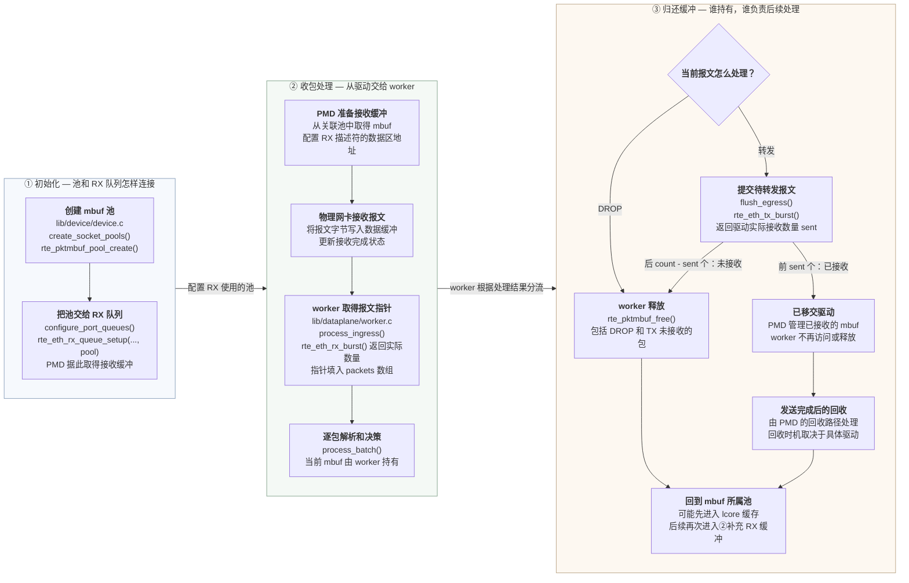

# mbuf 从内存池到收发，再回到所属池

[程序启动、运行与停止总图](startup-stop.md) · [学习材料说明](../README.md)

把启动图中的“准备池和队列”与运行图中的“收包、处理、发送”连接起来。下面采用典型物理网卡、普通单段报文说明缓冲怎样复用，以及每一步由谁管理 mbuf

归还之后，PMD 可以从关联池中再次取得可用对象，回到图②的“准备接收缓冲”，形成持续复用的循环；池和队列的初始化不需要每个包重新做

## 发送三个包，驱动只接收两个

`flush_egress()` 的待发送数组中有 3 个包，TX burst 返回 `sent = 2`：

| 数组中的包 | 调用后由谁管理 | 后续如何处理 |
| --- | --- | --- |
| `packets[0]` | PMD | 完成发送后，由驱动回收路径归还 |
| `packets[1]` | PMD | 完成发送后，由驱动回收路径归还 |
| `packets[2]` | worker | 本项目不重试，立即释放这个未接收的包 |

这里的 `packets` 是当前出口的待发送数组，先前已 DROP 的包不在里面。`sent` 只表示驱动接收了多少个包，不能据此认定对端已经收到

## 归还时容易混淆的两点

1. **回到 mbuf 所属池**：归还目标由 mbuf 自身所属的池决定，不按发送出口另选一个池；入口与出口可以属于不同 NUMA 节点
2. **先归还到本地缓存也属于复用过程**：图中省略了 lcore 缓存层，不表示每次释放都立刻进入全局空闲队列

PMD 要提前准备接收缓冲，并在收包过程中补充可用缓冲。worker 长时间持有 mbuf，或者池中的可用对象不足，都可能影响后续 RX 缓冲补充

## 对应代码

| 图中的位置 | 文件与函数 | 重点看什么 |
| --- | --- | --- |
| 创建池 | [lib/device/device.c:268](../../../lib/device/device.c#L268) · `create_socket_pools()` | 按端口使用的 NUMA 节点创建池，保存到 `devices->pools[]` |
| RX 关联池 | [lib/device/device.c:512](../../../lib/device/device.c#L512) · `configure_port_queues()` | 将 `pool` 传入 RX queue setup；TX queue setup 不需要这个池参数 |
| 收到 mbuf 指针 | [lib/dataplane/worker.c:512](../../../lib/dataplane/worker.c#L512) · `process_ingress()` | RX burst 填写指针数组，返回实际收包数 |
| 逐包处理 | [lib/dataplane/worker.c:272](../../../lib/dataplane/worker.c#L272) · `process_batch()` | 根据结果释放包，或放入出口的待发送数组 |
| TX 交接与短发送 | [lib/dataplane/worker.c:37](../../../lib/dataplane/worker.c#L37) · `flush_egress()` | 用 `sent` 区分驱动已接收部分和 worker 仍持有的尾部 |
| 释放仍由 worker 持有的包 | [lib/dataplane/worker.c:13](../../../lib/dataplane/worker.c#L13) · `free_packets()` | 逐个调用 `rte_pktmbuf_free()` |
| PMD 原理对照 | [队列描述符与 burst 收发](../../dpdk/chapters/04-queues-io.md) | RX 缓冲补充、ethdev 到 PMD 的调用，以及发送完成和回收 |

图中省略引用共享、分段、ND 等待和停机清理。虚拟 PMD 可能将对象转交给软件消费者，其路径不保证存在物理 DMA 或硬件发送完成；停止阶段的资源顺序见[程序启动、运行与停止总图](startup-stop.md)
