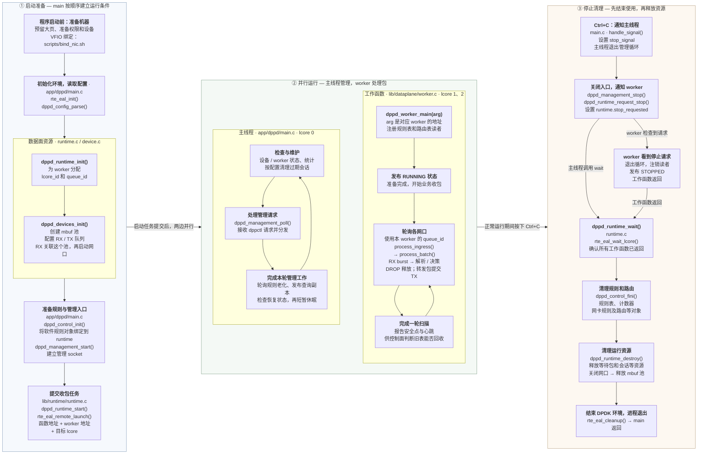

# 程序从启动到停止

按“启动准备 → 并行运行 → 停止清理”从左向右看。每个大框是一段过程，小框中同时标明作用、文件和主要函数

图中采用正常启动、软件收包、Ctrl+C 停止的路径；示例中主线程使用 lcore 0，worker 0、1 分别使用 lcore 1、2



## RSS

上一段沿着同一份 worker 配置连接了初始化、任务提交和收包调用：

```text
runtime_init：worker 1 的 queue_id = 1，示例选中 lcore 2
  → runtime_start：把 worker 1 的地址交给 lcore 2
  → worker_main：通过 arg 拿回同一份配置
  → process_ingress：依次读取网口 0、1 的 RX 队列 1
```

接着回到启动阶段的 [prepare_port_configuration](../../../lib/device/device.c#L394)，看这些 RX 队列怎样接收不同报文。RSS 是接收端扩展，负责将符合配置的报文分到 RX 队列；worker 按既定编号轮询这些队列

典型物理网卡的处理顺序是：

```text
报文到达网口
  → 按 RSS 类型选择报文字段
  → 计算哈希值
  → 通过 RETA（接收队列重定向表）等映射确定 RX 队列
  → 对应 worker 用 rx_burst 取得报文
```

例如某条流被分到 RX 0，它的后续报文在所选字段和 RSS 配置不变时，通常仍进入 RX 0，由 worker 0 处理。另一条流可能进入 RX 1，也可能同样进入 RX 0；RSS 不保证按包轮流分配或负载平均

项目先选择要启用的 RSS 类型：

```c
uint64_t requested_rss = RTE_ETH_RSS_IP | RTE_ETH_RSS_UDP | RTE_ETH_RSS_TCP;
plan->rss_hf = cfg->nb_queues > 1U ? requested_rss & info->flow_type_rss_offloads : 0;
```

`requested_rss` 是希望启用的类型，`info->flow_type_rss_offloads` 是设备支持的类型。按位与取两者共有的部分；例如请求 IP、UDP、TCP，设备只支持 IP、TCP，结果就只保留 IP、TCP 类型。单队列时这里直接设为 0；多队列却没有可用 RSS 类型时，函数返回 `-ENOTSUP`

随后在 [RSS 模式配置](../../../lib/device/device.c#L488) 中写入 `plan->conf`：

```c
plan->conf.rxmode.mq_mode = cfg->nb_queues > 1U ? RTE_ETH_MQ_RX_RSS : RTE_ETH_MQ_RX_NONE;
plan->conf.rx_adv_conf.rss_conf.rss_hf = plan->rss_hf;
```

示例配置 `--queues 2`，因此选择 RSS 模式。这里仍只是在填配置；后续 [configure_port_queues](../../../lib/device/device.c#L525) 调用 `rte_eth_dev_configure`，才把 `plan->conf` 交给 PMD

本项目没有主动指定 RSS key，也没有编程设置 RETA，具体默认值和分布由 PMD 决定。RSS 选择 RX 队列，runtime 决定哪个 lcore 的 worker 来轮询它；队列编号与 CPU 编号通过 worker 配置连接

下一段继续沿同一条启动调用链，看 `configure_port_queues()` 如何提交端口配置、创建 RX/TX 队列并把 mbuf 池交给 RX

## 队列配置

上一步 `prepare_port_configuration()` 填好了 `plan`。[configure_port](../../../lib/device/device.c#L639) 检查它成功后，将同一个 `&plan` 和网口使用的 `pool` 传给 [configure_port_queues](../../../lib/device/device.c#L512)

```text
prepare_port_configuration：准备 RSS 等配置，写入 plan
  → configure_port_queues：提交 plan->conf，建立 RX/TX 队列
  → start_configured_port：下一步才启动网口
```

先看 [rte_eth_dev_configure 调用](../../../lib/device/device.c#L525)：

```c
rc = rte_eth_dev_configure(port->port_id, cfg->nb_queues, cfg->nb_queues, &plan->conf);
```

四个参数依次是当前网口编号、RX 队列数量、TX 队列数量和端口配置。示例中 `--queues 2` 表示这个网口要有两个 RX 队列和两个 TX 队列，同时提交上一段准备的 RSS 设置；具体队列随后由 setup 建立

接着 [adjust_nb_rx_tx_desc](../../../lib/device/device.c#L536) 按设备约束调整描述符数量。项目默认分别请求每队列 1024 个 RX/TX 描述符；函数通过 `&rx_desc`、`&tx_desc` 写回调整结果，再存到 `plan->identity`。描述符可理解为记录缓冲位置和收发状态的槽位，其具体形式由 PMD 决定

这里分清三个数量：队列数决定建立多少条 RX/TX 通道，描述符数决定各队列的资源规模，`burst_size` 是 worker 每次收包的上限

准备好驱动默认的 RX/TX 配置并填入选定的卸载功能后，循环按编号建立队列：

```c
for (uint16_t queue = 0; queue < cfg->nb_queues; ++queue) {
    /* 每个 setup 调用之后都检查错误，失败立即返回 */
    rc = rte_eth_rx_queue_setup(port->port_id, queue, rx_desc, port->socket_id, &rx_conf, pool);
    /* ... */
    rc = rte_eth_tx_queue_setup(port->port_id, queue, tx_desc, port->socket_id, &tx_conf);
    /* ... */
}
```

这是省略错误检查和复位事件核对后的结构，正常启动时 `devices` 为 NULL。以网口 0 为例：

```text
queue = 0 → 建立 RX 0 和 TX 0
queue = 1 → 建立 RX 1 和 TX 1

RX 0 ─┐
      ├─ 都关联本次传入的 pool，供 PMD 取得接收缓冲
RX 1 ─┘

TX 0、TX 1 → 发送时使用 worker 提交的 mbuf 指针
```

RX setup 最后一个参数是 `pool`，每个队列没有另建一个池。TX setup 无需绑定接收池，因为待发送 mbuf 由应用在后续 `rte_eth_tx_burst()` 中提交；驱动仍需准备 TX 队列自己的资源

函数返回成功，说明当前网口配置和各队列已准备好，后面仍需 `start_configured_port()` 启动网口。不同网口会各自执行这套过程，网口 0 的队列 0 与网口 1 的队列 0 是两个独立队列

## 网口启动

前面的 `configure_port_queues()` 返回成功后，[configure_port](../../../lib/device/device.c#L639) 才调用 [start_configured_port](../../../lib/device/device.c#L581)。继续沿普通启动路径看，调用传入 `devices = NULL`，因此这一轮不进入复位时的设备事件核对分支

先调用驱动启动网口：

```c
int rc = rte_eth_dev_start(port->port_id);
if (rc != 0)
    return rc;
port->started = true;
```

`port->started` 立即记下网口已启动。即使后面的模式设置或 MAC 读取失败，上层也能据此清理已经启动的网口；它不等于整个启动过程已经成功，也不保证物理链路已连通

接着按配置设置两种接收方式：

| 条件 | 调用 | 作用 |
| --- | --- | --- |
| `cfg->promiscuous` 为真 | `rte_eth_promiscuous_enable()` | 放宽网口的目的 MAC 过滤，允许接收发给其他 MAC 的帧 |
| `cfg->nd6[]` 中有当前网口的配置 | `rte_eth_allmulticast_enable()` | 启用全组播接收，让 IPv6 邻居发现使用的组播报文进入接收路径 |

混杂模式与全组播模式是不同设置。ND6 配置循环只匹配当前网口，启用成功后就 `break`，同一网口不必反复调用。任一操作失败都立即返回错误

然后读取当前网口的 MAC：

```c
rc = rte_eth_macaddr_get(port->port_id, &plan->mac);
```

结果先写入本次配置计划 `plan->mac`。复位路径还会核对 MAC 是否与原来一致；普通启动没有这一步比较

回到 `configure_port()`，前三步全部成功后，才调用 `publish_port_configuration()`，将 RSS、卸载功能、设备信息和 MAC 等结果保存到 `port`，再输出配置日志：

```text
读取设备 MAC → plan->mac
  → 整套配置成功 → port->mac
  → worker 执行路由转发改写时，将出口 MAC 用作以太网源地址
```

至此，一个网口的准备过程是：

```text
准备 RSS 等配置
  → 提交端口配置并建立 RX/TX 队列
  → 启动网口，按需设置接收模式，读取 MAC
  → 保存配置结果并打印日志
```

网口已启动之后，程序还会继续初始化控制关联和管理服务，后续 `runtime_start()` 才提交 worker 的业务收包任务。下一段回到 `dppd_devices_init()`，看两个网口怎样分别执行这套过程，以及各自使用哪个 mbuf 池

## 双网口与内存池

刚才沿 `configure_port()` 完成的是单个网口。现在回到它的调用方 [dppd_devices_init](../../../lib/device/device.c#L812)，把这个过程放回网口列表的循环

本例配置 `cfg->ports = [0, 1]`、`cfg->nb_ports = 2`。函数先为两个网口填写 `devices->ports[]`，保存各自的 port ID、使用的 NUMA 节点和初始状态，再准备 mbuf 池。先填好所有网口信息，是因为后面注册的设备移除回调可能立即触发，需要读取完整的端口状态

接着调用 [create_socket_pools](../../../lib/device/device.c#L848)。它按使用到的 NUMA 节点建池：已有 `devices->pools[socket_id]` 就直接复用，不会为每个端口重新创建

然后进入逐网口配置的循环。下面省略回调注册与错误分支，只看本轮选择哪个网口、使用哪个池：

```c
for (i = 0; i < cfg->nb_ports; ++i) {
    struct dppd_port *port = &devices->ports[i];
    rc = configure_port(port, cfg, devices->pools[port->socket_id]);
}
```

如果两个网口都使用 NUMA 节点 0：

| 循环 | 当前网口对象 | `port->socket_id` | 传给配置函数的池 |
| --- | --- | --- | --- |
| `i = 0` | `devices->ports[0]`，本例 port ID 为 0 | 0 | `devices->pools[0]` |
| `i = 1` | `devices->ports[1]`，本例 port ID 为 1 | 0 | `devices->pools[0]` |

```text
devices->pools[0]
  ├─ 网口 0：RX 0、RX 1
  └─ 网口 1：RX 0、RX 1

两轮分别完成：准备端口配置 → 建立队列 → 启动当前网口
```

这时两个网口共用一个池，队列却各自独立。如果网口 0、1 分别使用节点 0、1，就分别传 `pools[0]`、`pools[1]`。`socket_id` 用来选择池，`queue_id` 用来选择网口内的队列；两者含义不同。设备返回的 NUMA 节点未知或超出范围时，本项目的 `port_socket()` 回退到节点 0

`i` 是配置列表的数组下标，实际网口编号来自 `cfg->ports[i]`；本例中它们恰好都是 0、1

两个网口都配置成功之后，函数继续查询链路状态、收集网口拓扑信息，成功返回到 `dppd_runtime_init()`。这里的拓扑包含网口身份与关联，供后面的规则配置使用；链路查询成功也不意味着所有链路都是 UP，下一段再展开

任一网口准备失败都会进入 `fail`，调用 `dppd_devices_stop()` 处理已经准备的资源。因此第二个网口出错时，第一个已启动的网口也在清理范围内；具体清理依据各网口的配置、启动和回调注册状态执行

## 链路状态

两个网口启动后，`dppd_devices_init()` 调用 [dppd_devices_poll_links](../../../lib/device/device.c#L896)。它逐个检查已启动网口，先确认设备仍有效，再查询链路并把结果存到 `port->link_state`

普通初始化时尚未开启事件跟踪，因此先沿不进入复位事件核对的路径阅读；设备移除检查仍然执行。已经移除或无效的设备会触发移除处理并返回 `-ENODEV`，不会继续按正常网口查询

核心查询是：

```c
struct rte_eth_link link = {0};
rc = rte_eth_link_get_nowait(port->port_id, &link);
```

`rc` 表示查询调用是否成功，输出参数 `link.link_status` 表示查到的链路状态。`nowait` 表示不在这里等待链路变为 UP

| 结果 | 保存的 `link_state` | 函数接下来怎么做 |
| --- | --- | --- |
| `rc == 0`，链路为 UP | `DPPD_LINK_UP` | 继续检查下一个网口 |
| `rc == 0`，链路为 DOWN | `DPPD_LINK_DOWN` | 继续检查下一个网口，DOWN 本身不作为查询错误 |
| 原状态为 UNKNOWN，返回 `-ENOTSUP` | `DPPD_LINK_UNSUPPORTED` | 记下不支持查询，后续跳过链路 API |
| 其他查询错误 | `DPPD_LINK_DOWN` | 先阻止该网口发送，再返回原错误码 |

成功查询后按链路结果选择项目中的状态：

```c
next = link.link_status == RTE_ETH_LINK_UP ? DPPD_LINK_UP : DPPD_LINK_DOWN;
atomic_store_explicit(&port->link_state, next, memory_order_release);
```

比如网口 0 是 UP，网口 1 是 DOWN，只要查询及设备检查正常完成，整个函数仍可返回 0。返回值表达检查过程是否完成，UP/DOWN 则保存在每个网口中，不能把返回 0 理解成全部网口已连通

`UNSUPPORTED` 只接受从初始 UNKNOWN 状态识别出来的“不支持查询”。记录这个状态后，后续仍会先检查设备是否移除，不能因为跳过链路 API 而漏掉设备失效

主线程在运行期间也会周期调用本函数刷新状态。worker 在发送检查中通过 [dppd_port_tx_available](../../../include/dppd/device.h#L151) 原子读取同一个 `port->link_state`：端口未移除，且状态为 UP 或 UNSUPPORTED 时，才通过这项发送检查；UNKNOWN 和 DOWN 都不通过

```text
主线程查询 PMD
  → 保存 port->link_state
  → worker 发送前读取保存的状态
  → 决定该出口是否允许提交 TX
```

UNSUPPORTED 表示缺少链路查询能力，不能据此认定链路已 UP；本项目保留这类端口的发送资格。相同状态不重复输出日志，只在状态发生变化时打印

下一段回到 `dppd_devices_init()` 的下一步 `dppd_topology_discover()`，看它收集哪些网口身份和关联信息，供后面的规则配置使用

## 网口拓扑

链路检查之后，`dppd_devices_init()` 调用 [dppd_topology_discover](../../../lib/device/topology.c#L553)，输出参数是 `&devices->topology`。这里保存的是配置网口的身份与设备关联：网口编号、驱动、设备名称、普通口或代理口种类，以及驱动提供的交换域等信息

### 先看结果放在哪里

[dppd_topology](../../../include/dppd/topology.h) 保存条目数和内嵌数组：

```c
struct dppd_topology {
    uint16_t nb_endpoints;
    struct dppd_endpoint endpoints[DPPD_MAX_PORTS];
};
```

一个 `dppd_endpoint` 对应一个选定网口。沿用 `cfg->ports = [0, 1]` 的例子，成功后得到两条记录：

```text
devices->topology
  ├─ nb_endpoints = 2
  ├─ endpoints[0]：ethdev_port_id = 0，保存网口 0 的身份与关联
  └─ endpoints[1]：ethdev_port_id = 1，保存网口 1 的身份与关联
```

| endpoint 字段 | 含义 |
| --- | --- |
| `ethdev_port_id` | DPDK 网口编号，来自 `cfg->ports[i]` |
| `kind` | 普通 ethdev 或 representor 代理网口种类；代理口用于代表另一个端口或功能 |
| `driver_name`、`device_name` | PMD 驱动名称与 DPDK 设备名称，PCI 设备名例如 `0000:03:00.0` |
| `has_switch_domain`、`switch_domain_id` | 驱动是否提供有效交换域，以及对应编号 |
| `role`、`role_error` | 能否确认具体端口角色，以及无法确认的原因 |

驱动没有证明某种角色时，保持 `UNKNOWN` 并记录原因。普通 ethdev 的种类本身不能证明它是 PF、VF 或物理上联口

### 从入口进入实际收集过程

入口将正式身份读取函数传给 [dppd_topology_discover_with_reader](../../../lib/device/topology.c#L504)：

```c
return dppd_topology_discover_with_reader(cfg, topology, read_identity, NULL);
```

`read_identity` 是函数地址，交给 `reader` 参数；`NULL` 是传给读取器的附加上下文。遍历中再由 `discover_identity()` 调用这个读取器核对接口身份

实现先清空调用方的输出，再在局部对象 `discovered` 中逐口收集：

```c
struct dppd_topology discovered = {0};
/* 参数检查和清空输出后，遍历 cfg->ports */
struct dppd_endpoint *endpoint =
    &discovered.endpoints[discovered.nb_endpoints];
```

当前网口的基础信息由 `rte_eth_dev_info_get()` 读出，填写种类、交换域和驱动等字段，再补充身份信息。完成这一条后执行 `discovered.nb_endpoints++`，下一轮填写下一个空条目

所有配置网口的基础读取完成后，才执行：

```c
*topology = discovered;
```

C 的结构体赋值会连同内嵌的 `endpoints[]` 数组一起复制，结果保留在调用方的 `devices->topology` 中。基础读取中途失败时，输出保留为清零状态，不会交出半份列表；无法确认的身份或角色则记录在对应条目中，不一定使整个发现函数失败

### 后面在哪里使用

启动主线随后把它传给控制服务：

```text
dppd_devices_init 填写 devices->topology
  → 即 runtime.devices.topology
  → main 调用 dppd_control_init，传入这份对象的地址
  → control 保存该地址
  → 规则规划查询相关网口的身份与交换域
```

例如涉及设备内部交换的 TRANSFER 规则，规划器要核对安装口和规则涉及的代理端口是否属于同一交换域。这份信息用于判断配置能否成立

本段先读清入口、记录结构与整体收集过程。下一段展开 `discover_identity()`，看 `device_name`、Linux 接口编号和端口角色怎样核对

## 接口身份

上一段已经为每个网口建立 `endpoint`，当前网口的 PMD 基础信息放在 `info` 中。现在沿拓扑遍历中的 [discover_identity](../../../lib/device/topology.c#L429) 调用，核对这个设备与 Linux 接口的对应关系，并补充能确认的角色

### 分清同一网口的三种标识

下面只是字段含义的例子，不是本机运行输出：

| 标识 | 例子 | 在哪里使用 |
| --- | --- | --- |
| DPDK 网口编号 | `ethdev_port_id = 0` | DPDK 的端口配置和收发 API |
| Linux 接口编号 | `info->if_index = 5` | 内核接口查询，编号与 DPDK port ID 分开记录 |
| DPDK 设备名称 | `0000:03:00.0` | PCI 场景下与内核接口所属设备核对 |
| 核对成功后的接口名 | `enp3s0` | 保存到 `endpoint->interface_name`，与前面接口编号和 PCI 设备相匹配 |

函数先记录 PMD 提供的接口编号和设备名，将角色清为 UNKNOWN，清空尚未核对的接口名。后面只发布本次核对通过的名称，不沿用旧角色和旧接口名

### 检查能否进入身份读取器

当前正式读取器按 PCI 设备与内核接口核对：设备名称必须符合 PCI 名称格式，接口编号必须非零且在允许范围内，还必须提供 `reader`。前提不满足时，函数保留 UNKNOWN 并记录相应的 `role_error`；非 PCI 设备名不进入这套核对路径

随后实际调用读取器：

```c
rc = reader(info->if_index, device_name, &identity, opaque);
```

正式入口已经把 `read_identity` 的函数地址传给了 `reader`。沿用上面的例子，这一轮相当于调用：

```c
read_identity(5, "0000:03:00.0", &identity, NULL);
```

接口编号和设备名是待核对的输入，`identity` 接收核对后的结果，`rc` 表示这次核对是否成功。下一段再进入 `read_identity()` 查看内核接口和 sysfs 的具体读取步骤

读取器失败时，当前函数将错误保存在 `endpoint->role_error` 后返回。成功时仍检查输出接口编号、完整字符串、接口名格式和设备名是否与输入相符，然后才将接口名、物理端口名复制到 `endpoint`

### 接口身份与端口角色分两步确认

接口核对成功后，代码继续判断驱动是否为 `mlx5_pci` 或 `net_mlx5`：

```c
if (!mlx5)
    return;
```

当前角色解析只支持 mlx5。其他驱动即使已经成功核对接口身份，仍保留 UNKNOWN 角色；接口对应关系与 PF/VF/SF 角色识别是两个不同结果

mlx5 还需要非空且已核对的 `phys_port_name`，再交给 `dppd_topology_resolve_role()`，结合 representor 标志确认角色。例如 `p0` 是物理上联端口名称的一种形式；角色解析细节后续按需展开

```text
PMD 提供设备名、接口编号
  → read_identity 核对 Linux 接口与 PCI 设备
  → discover_identity 检查输出，保存已核对的接口名
  → 支持 mlx5 角色解析时，进一步确认具体角色
```

`discover_identity()` 的返回类型为 `void`。这里无法确认身份或角色，不会直接让外层停止收集基础网口记录；外层保留条目及其 UNKNOWN、`role_error`，后续功能再据所需信息判断能否使用

### 读取器怎样核对同一个网口

沿 `discover_identity()` 的 `reader(...)` 调用进入 [read_identity](../../../lib/device/topology.c#L356)。它接收待核对的 Linux 接口编号和 PCI 设备名，成功才填写 `identity` 并返回 0；失败返回负错误码，输出保持原样

这里用到两种读取方式：**Netlink** 是程序向内核查询网络接口的通信方式；**sysfs** 将内核中的设备信息呈现在 `/sys` 路径下，程序可以像读取文件一样获取这些属性。当前代码只查询和核对，不修改网口配置

继续用前面的假设：PMD 提供接口编号 `5`、PCI 名称 `0000:03:00.0`，Netlink 查到接口名 `enp3s0`

```text
输入：if_index = 5，device_name = "0000:03:00.0"
  │
  ├─ Netlink 按编号 5 查询 → observed 保存接口名和物理端口名
  ├─ 读 /sys/class/net/enp3s0/ifindex → 编号也必须是 5
  ├─ 解析 /sys/class/net/enp3s0/device → 实际路径末段必须是 0000:03:00.0
  ├─ 读 /sys/class/net/enp3s0/phys_port_name → 必须与 Netlink 结果相同
  ├─ 再次查询接口 → 名称、物理端口名和名称对应的编号仍一致
  └─ 全部通过 → 补齐设备名，*identity = observed，返回 0
```

`device` 通常是符号链接。`realpath()` 得到它指向的实际设备路径，`strrchr(target, '/')` 找到最后一个斜杠，`basename + 1` 就是末段设备名。例如实际路径以 `/0000:03:00.0` 结尾，就拿 `0000:03:00.0` 与输入比较

`phys_port_name` 并非每个接口都有。Netlink 和 sysfs 两边都没有这个名称时，核对仍可通过；一边有而另一边没有，或名称不同，则返回 `-EXDEV`。上层是否能解析端口角色，还要另外判断

**为什么查完还要再查一次？** 这些读取不是一次完成的，期间接口可能被改名或编号被复用。`observed` 保存第一次查询结果，`current` 保存第二次结果；最后还用 `if_nametoindex()` 核对原接口名对应的编号。发现变化返回 `-EAGAIN`，本次不交付结果。复查可以发现这些变化，但不代表把内核接口锁住

| 返回结果 | 这一层的含义 |
| --- | --- |
| `0` | 本次核对全部通过，已填写输出 |
| `-EXDEV` | 读取到的编号、设备或物理端口名不一致 |
| `-EAGAIN` | 最后复查时发现接口信息变化，本次不能采用 |
| 其他负错误码 | 例如 PCI 名称不支持、文件或内核查询失败，向调用方返回具体原因 |

所有检查都使用局部变量，最后才执行 `*identity = observed`。因此失败不会把半份结果写给调用方；回到 `discover_identity()` 后，错误会被记录到当前网口的 `role_error`

下一步进入 `read_netlink_identity()`，看接口编号怎样组成内核查询请求，返回信息又怎样填入 `observed`

### Netlink 怎样查询接口信息

从 `read_identity()` 的 `read_netlink_identity(if_index, &observed)` 进入 [read_netlink_identity](../../../lib/device/topology.c#L162)。这一层负责向当前网络命名空间的内核查询接口编号、接口名和可选物理端口名；PCI 设备仍由上一层读取 sysfs 核对

查询过程与业务收发路径分开：这里使用 Netlink socket 与本机内核通信，不经过 worker、RX/TX 队列或业务网卡发送

```text
read_identity：请求查询编号 5 的接口
  → request：消息头写 RTM_GETLINK，接口条件写 ifi_index = 5
  → socket(NETLINK_ROUTE)：建立与内核通信的 socket
  → sendto：向内核发送查询请求
  → recvmsg：接收回复，缓冲区最多容纳 16 KiB，接收超时设为 200 ms
  → 校验回复来源、消息序号、类型和接口编号
  → 遍历属性，取出接口名和物理端口名
  → close(fd)，返回查询结果给 read_identity
```

请求是一个包含两个成员的局部结构体：`header` 描述消息类型、长度和序号，`link` 描述要查询的接口。`nlmsg_seq = 1` 与回复中的序号对应；每次调用都新建 socket，因此这里使用固定序号。`AF_UNSPEC` 表示不限定 IPv4 或 IPv6，查询目标由接口编号指定

接收前，`vector` 指向 `buffer`，`message` 引用 `vector` 并提供发送方地址空间。`recvmsg()` 接收后，回复数据写进 `buffer`，发送方地址写进 `kernel`。`_Alignas` 让缓冲起始地址满足消息头的对齐要求

一次接收的数据可包含多条消息，因此有两层遍历：

```text
buffer
  └─ 外层：逐条 Netlink 消息
       ├─ 对应本次序号、RTM_NEWLINK 类型、接口编号 5
       └─ 内层：逐个接口属性
            ├─ IFLA_IFNAME         → identity->interface_name，例如 enp3s0
            ├─ IFLA_PHYS_PORT_NAME → identity->phys_port_name，可缺省
            └─ 其他属性           → 跳过
```

`RTM_GETLINK` 是发出的查询请求；收到的 `RTM_NEWLINK` 在这里承载接口信息，不表示本函数新建了网口。`NLMSG_OK/NEXT` 按长度和对齐位置遍历消息，`RTA_OK/NEXT` 对属性做同样的边界检查

复制名称时由 `copy_attribute()` 检查容量、末尾 `\0` 和中间是否夹有 `\0`。同一种所需属性重复出现会返回错误，避免采用含糊的结果。属性区必须完整，接口名必须非空；物理端口名允许没有

**输出边界要与上一层区分**：本函数直接填写传入对象，失败时可能留下部分字段；调用它的 `read_identity()` 使用已清零的局部 `observed/current` 接收，只有全部核对成功后才复制给自己的调用方，因此不会向外发布半份身份结果

socket 成功创建后，后续错误统一走 `done` 关闭它；`goto done` 在这里用于集中释放资源。成功返回 0，失败返回负错误码

接口查询这条支线到这里读完。下一步返回 `discover_identity()`，沿已有的 `dppd_topology_resolve_role(...)` 调用，看已核对的物理端口名怎样转换成 mlx5 端口角色；不用从 Netlink 跳到新的业务流程

## 怎么对应到代码

| 看图中的哪一步 | 文件与函数 | 在这里完成什么 |
| --- | --- | --- |
| 主机准备 | [scripts/bind_nic.sh](../../../scripts/bind_nic.sh) | 提供 VFIO 驱动加载与网卡绑定，大页需在启动前另行准备；具体操作取决于驱动和部署环境 |
| 初始化环境和参数 | [app/dppd/main.c:395](../../../app/dppd/main.c#L395) · `main` | 先调用 `rte_eal_init`，再由 `dppd_config_parse` 读取项目参数 |
| 准备资源 | [lib/runtime/runtime.c:28](../../../lib/runtime/runtime.c#L28) · `dppd_runtime_init` | 准备 worker 配置，创建 mbuf 池，配置队列并启动网口 |
| 准备 RSS 配置 | [lib/device/device.c:394](../../../lib/device/device.c#L394) · `prepare_port_configuration` | 选择项目请求且设备支持的 RSS 类型，写入 `plan->conf`，留给下一步提交 |
| 连接规则与管理入口 | [app/dppd/main.c:484](../../../app/dppd/main.c#L484) · `main` | 初始化 control，将软件规则对象交给 runtime，建立管理 socket |
| 提交 worker 任务 | [lib/runtime/runtime.c:159](../../../lib/runtime/runtime.c#L159) · `dppd_runtime_start` | `rte_eal_remote_launch` 让指定 lcore 的 EAL 工作线程执行 `dppd_worker_main` |
| 主线程的循环 | [app/dppd/main.c:622](../../../app/dppd/main.c#L622) · `main` | 周期检查运行状态，处理管理请求、统计和维护工作 |
| worker 的循环 | [lib/dataplane/worker.c:560](../../../lib/dataplane/worker.c#L560) · `dppd_worker_main` | 按自己的队列编号扫描各网口，处理包后报告安全点与心跳 |
| 逐包处理入口 | [lib/dataplane/worker.c:512](../../../lib/dataplane/worker.c#L512) · `process_ingress` | `rte_eth_rx_burst` 取得 mbuf 指针，再进入 `process_batch` |
| 通知停止 | [app/dppd/main.c:726](../../../app/dppd/main.c#L726) · `main` | 关闭管理入口，调用 `dppd_runtime_request_stop`，再调用 wait |
| 等待 worker 返回 | [lib/runtime/runtime.c:258](../../../lib/runtime/runtime.c#L258) · `dppd_runtime_wait` | 使用 `rte_eal_wait_lcore` 确认工作函数返回并取得结果 |
| 清理资源 | [app/dppd/main.c:748](../../../app/dppd/main.c#L748) · `main` | `control_fini` → `runtime_destroy` → `rte_eal_cleanup`；设备清理先关闭网口，再释放池 |

## 读图时抓住三个联系

1. **资源准备和业务开始是两个时刻**：`runtime_init` 已经配置并启动网口；`runtime_start` 才提交 worker 的收包任务
2. **主线程和 worker 同时工作**：示例中 worker 0 扫描各网口的队列 0，worker 1 扫描各网口的队列 1；lcore 编号对应逻辑 CPU，不保证是不同物理核
3. **发出停止请求之后还要等待**：`stop_signal` 让主线程退出管理循环，`stop_requested` 让 worker 退出收包循环；正常路径中 wait 成功确认任务已返回后，才继续释放它们使用的资源

TX burst 返回的 `sent` 是驱动接收的包数，不能据此认定对端已收到。已接收的 mbuf 交给驱动管理，DROP 和 TX 未接收的尾部由 worker 释放。完整流转图与 `count = 3、sent = 2` 的例子见 [mbuf 内存池与收发循环](mbuf-cycle.md)

图中收起了启动失败、设备移除和恢复隔离等分支，先用于串起已学习的正常主线
