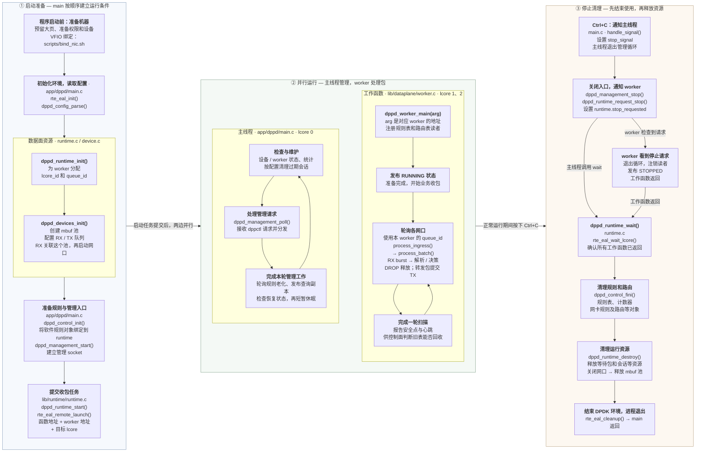

# 程序从启动到停止

按“启动准备 → 并行运行 → 停止清理”从左向右看。每个大框是一段过程，小框中同时标明作用、文件和主要函数

图中采用正常启动、软件收包、Ctrl+C 停止的路径；示例中主线程使用 lcore 0，worker 0、1 分别使用 lcore 1、2



## RSS

上一段沿着同一份 worker 配置连接了初始化、任务提交和收包调用：

```text
runtime_init：worker 1 的 queue_id = 1，示例选中 lcore 2
  → runtime_start：把 worker 1 的地址交给 lcore 2
  → worker_main：通过 arg 拿回同一份配置
  → process_ingress：依次读取网口 0、1 的 RX 队列 1
```

接着回到启动阶段的 [prepare_port_configuration](../../../lib/device/device.c#L394)，看这些 RX 队列怎样接收不同报文。RSS 是接收端扩展，负责将符合配置的报文分到 RX 队列；worker 按既定编号轮询这些队列

典型物理网卡的处理顺序是：

```text
报文到达网口
  → 按 RSS 类型选择报文字段
  → 计算哈希值
  → 通过 RETA（接收队列重定向表）等映射确定 RX 队列
  → 对应 worker 用 rx_burst 取得报文
```

例如某条流被分到 RX 0，它的后续报文在所选字段和 RSS 配置不变时，通常仍进入 RX 0，由 worker 0 处理。另一条流可能进入 RX 1，也可能同样进入 RX 0；RSS 不保证按包轮流分配或负载平均

项目先选择要启用的 RSS 类型：

```c
uint64_t requested_rss = RTE_ETH_RSS_IP | RTE_ETH_RSS_UDP | RTE_ETH_RSS_TCP;
plan->rss_hf = cfg->nb_queues > 1U ? requested_rss & info->flow_type_rss_offloads : 0;
```

`requested_rss` 是希望启用的类型，`info->flow_type_rss_offloads` 是设备支持的类型。按位与取两者共有的部分；例如请求 IP、UDP、TCP，设备只支持 IP、TCP，结果就只保留 IP、TCP 类型。单队列时这里直接设为 0；多队列却没有可用 RSS 类型时，函数返回 `-ENOTSUP`

随后在 [RSS 模式配置](../../../lib/device/device.c#L488) 中写入 `plan->conf`：

```c
plan->conf.rxmode.mq_mode = cfg->nb_queues > 1U ? RTE_ETH_MQ_RX_RSS : RTE_ETH_MQ_RX_NONE;
plan->conf.rx_adv_conf.rss_conf.rss_hf = plan->rss_hf;
```

示例配置 `--queues 2`，因此选择 RSS 模式。这里仍只是在填配置；后续 [configure_port_queues](../../../lib/device/device.c#L525) 调用 `rte_eth_dev_configure`，才把 `plan->conf` 交给 PMD

本项目没有主动指定 RSS key，也没有编程设置 RETA，具体默认值和分布由 PMD 决定。RSS 选择 RX 队列，runtime 决定哪个 lcore 的 worker 来轮询它；队列编号与 CPU 编号通过 worker 配置连接

下一段继续沿同一条启动调用链，看 `configure_port_queues()` 如何提交端口配置、创建 RX/TX 队列并把 mbuf 池交给 RX

## 队列配置

上一步 `prepare_port_configuration()` 填好了 `plan`。[configure_port](../../../lib/device/device.c#L639) 检查它成功后，将同一个 `&plan` 和网口使用的 `pool` 传给 [configure_port_queues](../../../lib/device/device.c#L512)

```text
prepare_port_configuration：准备 RSS 等配置，写入 plan
  → configure_port_queues：提交 plan->conf，建立 RX/TX 队列
  → start_configured_port：下一步才启动网口
```

先看 [rte_eth_dev_configure 调用](../../../lib/device/device.c#L525)：

```c
rc = rte_eth_dev_configure(port->port_id, cfg->nb_queues, cfg->nb_queues, &plan->conf);
```

四个参数依次是当前网口编号、RX 队列数量、TX 队列数量和端口配置。示例中 `--queues 2` 表示这个网口要有两个 RX 队列和两个 TX 队列，同时提交上一段准备的 RSS 设置；具体队列随后由 setup 建立

接着 [adjust_nb_rx_tx_desc](../../../lib/device/device.c#L536) 按设备约束调整描述符数量。项目默认分别请求每队列 1024 个 RX/TX 描述符；函数通过 `&rx_desc`、`&tx_desc` 写回调整结果，再存到 `plan->identity`。描述符可理解为记录缓冲位置和收发状态的槽位，其具体形式由 PMD 决定

这里分清三个数量：队列数决定建立多少条 RX/TX 通道，描述符数决定各队列的资源规模，`burst_size` 是 worker 每次收包的上限

准备好驱动默认的 RX/TX 配置并填入选定的卸载功能后，循环按编号建立队列：

```c
for (uint16_t queue = 0; queue < cfg->nb_queues; ++queue) {
    /* 每个 setup 调用之后都检查错误，失败立即返回 */
    rc = rte_eth_rx_queue_setup(port->port_id, queue, rx_desc, port->socket_id, &rx_conf, pool);
    /* ... */
    rc = rte_eth_tx_queue_setup(port->port_id, queue, tx_desc, port->socket_id, &tx_conf);
    /* ... */
}
```

这是省略错误检查和复位事件核对后的结构，正常启动时 `devices` 为 NULL。以网口 0 为例：

```text
queue = 0 → 建立 RX 0 和 TX 0
queue = 1 → 建立 RX 1 和 TX 1

RX 0 ─┐
      ├─ 都关联本次传入的 pool，供 PMD 取得接收缓冲
RX 1 ─┘

TX 0、TX 1 → 发送时使用 worker 提交的 mbuf 指针
```

RX setup 最后一个参数是 `pool`，每个队列没有另建一个池。TX setup 无需绑定接收池，因为待发送 mbuf 由应用在后续 `rte_eth_tx_burst()` 中提交；驱动仍需准备 TX 队列自己的资源

函数返回成功，说明当前网口配置和各队列已准备好，后面仍需 `start_configured_port()` 启动网口。不同网口会各自执行这套过程，网口 0 的队列 0 与网口 1 的队列 0 是两个独立队列

## 网口启动

前面的 `configure_port_queues()` 返回成功后，[configure_port](../../../lib/device/device.c#L639) 才调用 [start_configured_port](../../../lib/device/device.c#L581)。继续沿普通启动路径看，调用传入 `devices = NULL`，因此这一轮不进入复位时的设备事件核对分支

先调用驱动启动网口：

```c
int rc = rte_eth_dev_start(port->port_id);
if (rc != 0)
    return rc;
port->started = true;
```

`port->started` 立即记下网口已启动。即使后面的模式设置或 MAC 读取失败，上层也能据此清理已经启动的网口；它不等于整个启动过程已经成功，也不保证物理链路已连通

接着按配置设置两种接收方式：

| 条件 | 调用 | 作用 |
| --- | --- | --- |
| `cfg->promiscuous` 为真 | `rte_eth_promiscuous_enable()` | 放宽网口的目的 MAC 过滤，允许接收发给其他 MAC 的帧 |
| `cfg->nd6[]` 中有当前网口的配置 | `rte_eth_allmulticast_enable()` | 启用全组播接收，让 IPv6 邻居发现使用的组播报文进入接收路径 |

混杂模式与全组播模式是不同设置。ND6 配置循环只匹配当前网口，启用成功后就 `break`，同一网口不必反复调用。任一操作失败都立即返回错误

然后读取当前网口的 MAC：

```c
rc = rte_eth_macaddr_get(port->port_id, &plan->mac);
```

结果先写入本次配置计划 `plan->mac`。复位路径还会核对 MAC 是否与原来一致；普通启动没有这一步比较

回到 `configure_port()`，前三步全部成功后，才调用 `publish_port_configuration()`，将 RSS、卸载功能、设备信息和 MAC 等结果保存到 `port`，再输出配置日志：

```text
读取设备 MAC → plan->mac
  → 整套配置成功 → port->mac
  → worker 执行路由转发改写时，将出口 MAC 用作以太网源地址
```

至此，一个网口的准备过程是：

```text
准备 RSS 等配置
  → 提交端口配置并建立 RX/TX 队列
  → 启动网口，按需设置接收模式，读取 MAC
  → 保存配置结果并打印日志
```

网口已启动之后，程序还会继续初始化控制关联和管理服务，后续 `runtime_start()` 才提交 worker 的业务收包任务。下一段回到 `dppd_devices_init()`，看两个网口怎样分别执行这套过程，以及各自使用哪个 mbuf 池

## 双网口与内存池

刚才沿 `configure_port()` 完成的是单个网口。现在回到它的调用方 [dppd_devices_init](../../../lib/device/device.c#L812)，把这个过程放回网口列表的循环

本例配置 `cfg->ports = [0, 1]`、`cfg->nb_ports = 2`。函数先为两个网口填写 `devices->ports[]`，保存各自的 port ID、使用的 NUMA 节点和初始状态，再准备 mbuf 池。先填好所有网口信息，是因为后面注册的设备移除回调可能立即触发，需要读取完整的端口状态

接着调用 [create_socket_pools](../../../lib/device/device.c#L848)。它按使用到的 NUMA 节点建池：已有 `devices->pools[socket_id]` 就直接复用，不会为每个端口重新创建

然后进入逐网口配置的循环。下面省略回调注册与错误分支，只看本轮选择哪个网口、使用哪个池：

```c
for (i = 0; i < cfg->nb_ports; ++i) {
    struct dppd_port *port = &devices->ports[i];
    rc = configure_port(port, cfg, devices->pools[port->socket_id]);
}
```

如果两个网口都使用 NUMA 节点 0：

| 循环 | 当前网口对象 | `port->socket_id` | 传给配置函数的池 |
| --- | --- | --- | --- |
| `i = 0` | `devices->ports[0]`，本例 port ID 为 0 | 0 | `devices->pools[0]` |
| `i = 1` | `devices->ports[1]`，本例 port ID 为 1 | 0 | `devices->pools[0]` |

```text
devices->pools[0]
  ├─ 网口 0：RX 0、RX 1
  └─ 网口 1：RX 0、RX 1

两轮分别完成：准备端口配置 → 建立队列 → 启动当前网口
```

这时两个网口共用一个池，队列却各自独立。如果网口 0、1 分别使用节点 0、1，就分别传 `pools[0]`、`pools[1]`。`socket_id` 用来选择池，`queue_id` 用来选择网口内的队列；两者含义不同。设备返回的 NUMA 节点未知或超出范围时，本项目的 `port_socket()` 回退到节点 0

`i` 是配置列表的数组下标，实际网口编号来自 `cfg->ports[i]`；本例中它们恰好都是 0、1

两个网口都配置成功之后，函数继续查询链路状态、收集网口拓扑信息，成功返回到 `dppd_runtime_init()`。这里的拓扑包含网口身份与关联，供后面的规则配置使用；链路查询成功也不意味着所有链路都是 UP，下一段再展开

任一网口准备失败都会进入 `fail`，调用 `dppd_devices_stop()` 处理已经准备的资源。因此第二个网口出错时，第一个已启动的网口也在清理范围内；具体清理依据各网口的配置、启动和回调注册状态执行

## 链路状态

两个网口启动后，`dppd_devices_init()` 调用 [dppd_devices_poll_links](../../../lib/device/device.c#L895)。它逐个检查已启动网口，先确认设备仍有效，再查询链路并把结果存到 `port->link_state`

普通初始化时尚未开启事件跟踪，因此先沿不进入复位事件核对的路径阅读；设备移除检查仍然执行。已经移除或无效的设备会触发移除处理并返回 `-ENODEV`，不会继续按正常网口查询

核心查询是：

```c
struct rte_eth_link link = {0};
rc = rte_eth_link_get_nowait(port->port_id, &link);
```

`rc` 表示查询调用是否成功，输出参数 `link.link_status` 表示查到的链路状态。`nowait` 表示不在这里等待链路变为 UP

| 结果 | 保存的 `link_state` | 函数接下来怎么做 |
| --- | --- | --- |
| `rc == 0`，链路为 UP | `DPPD_LINK_UP` | 继续检查下一个网口 |
| `rc == 0`，链路为 DOWN | `DPPD_LINK_DOWN` | 继续检查下一个网口，DOWN 本身不作为查询错误 |
| 原状态为 UNKNOWN，返回 `-ENOTSUP` | `DPPD_LINK_UNSUPPORTED` | 记下不支持查询，后续跳过链路 API |
| 其他查询错误 | `DPPD_LINK_DOWN` | 先阻止该网口发送，再返回原错误码 |

成功查询后按链路结果选择项目中的状态：

```c
next = link.link_status == RTE_ETH_LINK_UP ? DPPD_LINK_UP : DPPD_LINK_DOWN;
atomic_store_explicit(&port->link_state, next, memory_order_release);
```

比如网口 0 是 UP，网口 1 是 DOWN，只要查询及设备检查正常完成，整个函数仍可返回 0。返回值表达检查过程是否完成，UP/DOWN 则保存在每个网口中，不能把返回 0 理解成全部网口已连通

`UNSUPPORTED` 只接受从初始 UNKNOWN 状态识别出来的“不支持查询”。记录这个状态后，后续仍会先检查设备是否移除，不能因为跳过链路 API 而漏掉设备失效

主线程在运行期间也会周期调用本函数刷新状态。worker 在发送检查中通过 [dppd_port_tx_available](../../../include/dppd/device.h#L151) 原子读取同一个 `port->link_state`：端口未移除，且状态为 UP 或 UNSUPPORTED 时，才通过这项发送检查；UNKNOWN 和 DOWN 都不通过

```text
主线程查询 PMD
  → 保存 port->link_state
  → worker 发送前读取保存的状态
  → 决定该出口是否允许提交 TX
```

UNSUPPORTED 表示缺少链路查询能力，不能据此认定链路已 UP；本项目保留这类端口的发送资格。相同状态不重复输出日志，只在状态发生变化时打印

下一段回到 `dppd_devices_init()` 的下一步 `dppd_topology_discover()`，看它收集哪些网口身份和关联信息，供后面的规则配置使用

## 网口拓扑

链路检查之后，`dppd_devices_init()` 调用 [dppd_topology_discover](../../../lib/device/topology.c#L565)，输出参数是 `&devices->topology`。这里保存的是配置网口的身份与设备关联：网口编号、驱动、设备名称、普通口或代理口种类，以及驱动提供的交换域等信息

### 先看结果放在哪里

[dppd_topology](../../../include/dppd/topology.h) 保存条目数和内嵌数组：

```c
struct dppd_topology {
    uint16_t nb_endpoints;
    struct dppd_endpoint endpoints[DPPD_MAX_PORTS];
};
```

一个 `dppd_endpoint` 对应一个选定网口。沿用 `cfg->ports = [0, 1]` 的例子，成功后得到两条记录：

```text
devices->topology
  ├─ nb_endpoints = 2
  ├─ endpoints[0]：ethdev_port_id = 0，保存网口 0 的身份与关联
  └─ endpoints[1]：ethdev_port_id = 1，保存网口 1 的身份与关联
```

| endpoint 字段 | 含义 |
| --- | --- |
| `ethdev_port_id` | DPDK 网口编号，来自 `cfg->ports[i]` |
| `kind` | 普通 ethdev 或 representor 代理网口种类；代理口用于代表另一个端口或功能 |
| `driver_name`、`device_name` | PMD 驱动名称与 DPDK 设备名称，PCI 设备名例如 `0000:03:00.0` |
| `has_switch_domain`、`switch_domain_id` | 驱动是否提供有效交换域，以及对应编号 |
| `role`、`role_error` | 能否确认具体端口角色，以及无法确认的原因 |

驱动没有证明某种角色时，保持 `UNKNOWN` 并记录原因。普通 ethdev 的种类本身不能证明它是 PF、VF 或物理上联口

### 从入口进入实际收集过程

入口将正式身份读取函数传给 [dppd_topology_discover_with_reader](../../../lib/device/topology.c#L516)：

```c
return dppd_topology_discover_with_reader(cfg, topology, read_identity, NULL);
```

`read_identity` 是函数地址，交给 `reader` 参数；`NULL` 是传给读取器的附加上下文。遍历中再由 `discover_identity()` 调用这个读取器核对接口身份

实现先清空调用方的输出，再在局部对象 `discovered` 中逐口收集：

```c
struct dppd_topology discovered = {0};
/* 参数检查和清空输出后，遍历 cfg->ports */
struct dppd_endpoint *endpoint =
    &discovered.endpoints[discovered.nb_endpoints];
```

当前网口的基础信息由 `rte_eth_dev_info_get()` 读出，填写种类、交换域和驱动等字段，再补充身份信息。完成这一条后执行 `discovered.nb_endpoints++`，下一轮填写下一个空条目

所有配置网口的基础读取完成后，才执行：

```c
*topology = discovered;
```

C 的结构体赋值会连同内嵌的 `endpoints[]` 数组一起复制，结果保留在调用方的 `devices->topology` 中。基础读取中途失败时，输出保留为清零状态，不会交出半份列表；无法确认的身份或角色则记录在对应条目中，不一定使整个发现函数失败

### 后面在哪里使用

启动主线随后把它传给控制服务：

```text
dppd_devices_init 填写 devices->topology
  → 即 runtime.devices.topology
  → main 调用 dppd_control_init，传入这份对象的地址
  → control 保存该地址
  → 规则规划查询相关网口的身份与交换域
```

例如涉及设备内部交换的 TRANSFER 规则，规划器要核对安装口和规则涉及的代理端口是否属于同一交换域。这份信息用于判断配置能否成立

本段先读清入口、记录结构与整体收集过程。下一段展开 `discover_identity()`，看 `device_name`、Linux 接口编号和端口角色怎样核对

## 接口身份

上一段已经为每个网口建立 `endpoint`，当前网口的 PMD 基础信息放在 `info` 中。现在沿拓扑遍历中的 [discover_identity](../../../lib/device/topology.c#L441) 调用，核对这个设备与 Linux 接口的对应关系，并补充能确认的角色

### 分清同一网口的三种标识

下面只是字段含义的例子，不是本机运行输出：

| 标识 | 例子 | 在哪里使用 |
| --- | --- | --- |
| DPDK 网口编号 | `ethdev_port_id = 0` | DPDK 的端口配置和收发 API |
| Linux 接口编号 | `info->if_index = 5` | 内核接口查询，编号与 DPDK port ID 分开记录 |
| DPDK 设备名称 | `0000:03:00.0` | PCI 场景下与内核接口所属设备核对 |
| 核对成功后的接口名 | `enp3s0` | 保存到 `endpoint->interface_name`，与前面接口编号和 PCI 设备相匹配 |

函数先记录 PMD 提供的接口编号和设备名，将角色清为 UNKNOWN，清空尚未核对的接口名。后面只发布本次核对通过的名称，不沿用旧角色和旧接口名

### 检查能否进入身份读取器

当前正式读取器按 PCI 设备与内核接口核对：设备名称必须符合 PCI 名称格式，接口编号必须非零且在允许范围内，还必须提供 `reader`。前提不满足时，函数保留 UNKNOWN 并记录相应的 `role_error`；非 PCI 设备名不进入这套核对路径

随后实际调用读取器：

```c
rc = reader(info->if_index, device_name, &identity, opaque);
```

正式入口已经把 `read_identity` 的函数地址传给了 `reader`。沿用上面的例子，这一轮相当于调用：

```c
read_identity(5, "0000:03:00.0", &identity, NULL);
```

接口编号和设备名是待核对的输入，`identity` 接收核对后的结果，`rc` 表示这次核对是否成功。下一段再进入 `read_identity()` 查看内核接口和 sysfs 的具体读取步骤

读取器失败时，当前函数将错误保存在 `endpoint->role_error` 后返回。成功时仍检查输出接口编号、完整字符串、接口名格式和设备名是否与输入相符，然后才将接口名、物理端口名复制到 `endpoint`

### 接口身份与端口角色分两步确认

接口核对成功后，代码继续判断驱动是否为 `mlx5_pci` 或 `net_mlx5`：

```c
if (!mlx5)
    return;
```

当前角色解析只支持 mlx5。其他驱动即使已经成功核对接口身份，仍保留 UNKNOWN 角色；接口对应关系与 PF/VF/SF 角色识别是两个不同结果

mlx5 还需要非空且已核对的 `phys_port_name`，再交给 `dppd_topology_resolve_role()`，结合 representor 标志确认角色。例如 `p0` 是物理上联端口名称的一种形式；角色解析细节后续按需展开

```text
PMD 提供设备名、接口编号
  → read_identity 核对 Linux 接口与 PCI 设备
  → discover_identity 检查输出，保存已核对的接口名
  → 支持 mlx5 角色解析时，进一步确认具体角色
```

`discover_identity()` 的返回类型为 `void`。这里无法确认身份或角色，不会直接让外层停止收集基础网口记录；外层保留条目及其 UNKNOWN、`role_error`，后续功能再据所需信息判断能否使用

### 读取器怎样核对同一个网口

沿 `discover_identity()` 的 `reader(...)` 调用进入 [read_identity](../../../lib/device/topology.c#L368)。它接收待核对的 Linux 接口编号和 PCI 设备名，成功才填写 `identity` 并返回 0；失败返回负错误码，输出保持原样

这里用到两种读取方式：**Netlink** 是程序向内核查询网络接口的通信方式；**sysfs** 将内核中的设备信息呈现在 `/sys` 路径下，程序可以像读取文件一样获取这些属性。当前代码只查询和核对，不修改网口配置

继续用前面的假设：PMD 提供接口编号 `5`、PCI 名称 `0000:03:00.0`，Netlink 查到接口名 `enp3s0`

```text
输入：if_index = 5，device_name = "0000:03:00.0"
  │
  ├─ Netlink 按编号 5 查询 → observed 保存接口名和物理端口名
  ├─ 读 /sys/class/net/enp3s0/ifindex → 编号也必须是 5
  ├─ 解析 /sys/class/net/enp3s0/device → 实际路径末段必须是 0000:03:00.0
  ├─ 读 /sys/class/net/enp3s0/phys_port_name → 必须与 Netlink 结果相同
  ├─ 再次查询接口 → 名称、物理端口名和名称对应的编号仍一致
  └─ 全部通过 → 补齐设备名，*identity = observed，返回 0
```

`device` 通常是符号链接。`realpath()` 得到它指向的实际设备路径，`strrchr(target, '/')` 找到最后一个斜杠，`basename + 1` 就是末段设备名。例如实际路径以 `/0000:03:00.0` 结尾，就拿 `0000:03:00.0` 与输入比较

`phys_port_name` 并非每个接口都有。Netlink 和 sysfs 两边都没有这个名称时，核对仍可通过；一边有而另一边没有，或名称不同，则返回 `-EXDEV`。上层是否能解析端口角色，还要另外判断

**为什么查完还要再查一次？** 这些读取不是一次完成的，期间接口可能被改名或编号被复用。`observed` 保存第一次查询结果，`current` 保存第二次结果；最后还用 `if_nametoindex()` 核对原接口名对应的编号。发现变化返回 `-EAGAIN`，本次不交付结果。复查可以发现这些变化，但不代表把内核接口锁住

| 返回结果 | 这一层的含义 |
| --- | --- |
| `0` | 本次核对全部通过，已填写输出 |
| `-EXDEV` | 读取到的编号、设备或物理端口名不一致 |
| `-EAGAIN` | 最后复查时发现接口信息变化，本次不能采用 |
| 其他负错误码 | 例如 PCI 名称不支持、文件或内核查询失败，向调用方返回具体原因 |

所有检查都使用局部变量，最后才执行 `*identity = observed`。因此失败不会把半份结果写给调用方；回到 `discover_identity()` 后，错误会被记录到当前网口的 `role_error`

下一步进入 `read_netlink_identity()`，看接口编号怎样组成内核查询请求，返回信息又怎样填入 `observed`

### Netlink 怎样查询接口信息

从 `read_identity()` 的 `read_netlink_identity(if_index, &observed)` 进入 [read_netlink_identity](../../../lib/device/topology.c#L174)。这一层负责向当前网络命名空间的内核查询接口编号、接口名和可选物理端口名；PCI 设备仍由上一层读取 sysfs 核对

查询过程与业务收发路径分开：这里使用 Netlink socket 与本机内核通信，不经过 worker、RX/TX 队列或业务网卡发送

```text
read_identity：请求查询编号 5 的接口
  → request：消息头写 RTM_GETLINK，接口条件写 ifi_index = 5
  → socket(NETLINK_ROUTE)：建立与内核通信的 socket
  → sendto：向内核发送查询请求
  → recvmsg：接收回复，缓冲区最多容纳 16 KiB，接收超时设为 200 ms
  → 校验回复来源、消息序号、类型和接口编号
  → 遍历属性，取出接口名和物理端口名
  → close(fd)，返回查询结果给 read_identity
```

请求是一个包含两个成员的局部结构体：`header` 描述消息类型、长度和序号，`link` 描述要查询的接口。`nlmsg_seq = 1` 与回复中的序号对应；每次调用都新建 socket，因此这里使用固定序号。`AF_UNSPEC` 表示不限定 IPv4 或 IPv6，查询目标由接口编号指定

接收前，`vector` 指向 `buffer`，`message` 引用 `vector` 并提供发送方地址空间。`recvmsg()` 接收后，回复数据写进 `buffer`，发送方地址写进 `kernel`。`_Alignas` 让缓冲起始地址满足消息头的对齐要求

一次接收的数据可包含多条消息，因此有两层遍历：

```text
buffer
  └─ 外层：逐条 Netlink 消息
       ├─ 对应本次序号、RTM_NEWLINK 类型、接口编号 5
       └─ 内层：逐个接口属性
            ├─ IFLA_IFNAME         → identity->interface_name，例如 enp3s0
            ├─ IFLA_PHYS_PORT_NAME → identity->phys_port_name，可缺省
            └─ 其他属性           → 跳过
```

`RTM_GETLINK` 是发出的查询请求；收到的 `RTM_NEWLINK` 在这里承载接口信息，不表示本函数新建了网口。`NLMSG_OK/NEXT` 按长度和对齐位置遍历消息，`RTA_OK/NEXT` 对属性做同样的边界检查

复制名称时由 `copy_attribute()` 检查容量、末尾 `\0` 和中间是否夹有 `\0`。同一种所需属性重复出现会返回错误，避免采用含糊的结果。属性区必须完整，接口名必须非空；物理端口名允许没有

**输出边界要与上一层区分**：本函数直接填写传入对象，失败时可能留下部分字段；调用它的 `read_identity()` 使用已清零的局部 `observed/current` 接收，只有全部核对成功后才复制给自己的调用方，因此不会向外发布半份身份结果

socket 成功创建后，后续错误统一走 `done` 关闭它；`goto done` 在这里用于集中释放资源。成功返回 0，失败返回负错误码

接口查询这条支线到这里读完。下一步返回 `discover_identity()`，沿已有的 `dppd_topology_resolve_role(...)` 调用，看已核对的物理端口名怎样转换成 mlx5 端口角色；不用从 Netlink 跳到新的业务流程

### 从已核对的名称解析端口角色

接口查询返回后，调用关系回到原来的位置：

```text
dppd_devices_init
  → dppd_topology_discover
    → dppd_topology_discover_with_reader
      → discover_identity
        → read_identity → read_netlink_identity → 返回并完成身份核对
        → dppd_topology_resolve_role  ← 现在继续这里
```

`discover_identity()` 只在 mlx5 驱动且物理端口名非空时进入 [dppd_topology_resolve_role](../../../lib/device/topology.c#L62)。这个函数解析名称和检查标志，填写已有的 `endpoint`，不会创建 PF/VF/SF，也不安装转发规则

先分清当前网口与它所代表的端口：`kind = REPRESENTOR` 表示当前 DPDK 网口是代理口，`role = VF` 表示它代表 VF 侧的端口。代理口提供管理和收发入口，与所代表的功能分别记录，详见 [Linux representor 说明](https://www.kernel.org/doc/html/v6.4/networking/representors.html)

| 本段出现的名称 | 含义 |
| --- | --- |
| UPLINK | 本项目中的物理上联端口角色，对应名称中的 `p` |
| PF | Physical Function，物理功能；名称中的 `pf1` 给出 PF 编号，不是物理网线插口编号 |
| VF | Virtual Function，虚拟功能；例如 `pf1vf2` 中 VF 编号为 2 |
| SF | Subfunction，子功能；例如 `pf1sf2` 中 SF 编号为 2 |

mlx5 支持 PF、VF、SF 及相应代理口，术语可对照 [DPDK mlx5 文档](https://doc.dpdk.org/guides-25.07/nics/mlx5.html)。下面的名称接受范围和标志要求以本项目实现为准

调用中的四个参数依次是当前记录、驱动名、PMD 是否报告代理口、已经核对的物理端口名。以 `net_mlx5`、代理口和 `c0pf1vf2` 为例：

```text
c0pf1vf2
│ │  └─ vf2：VF 编号 2，最终角色 VF
│ └──── pf1：所属 PF 编号 1
└────── c0：controller 编号 0，可省略
```

函数先把名称复制到局部 `name`，再清理旧角色。这样即使调用方直接传入 `endpoint->phys_port_name`，清理输出也不会破坏正在解析的输入。`parsed` 保存本次临时结果

解析时 `cursor` 指向尚未处理的字符，`parse_number()` 读完连续十进制数字后会把它移到下一段：

```text
c0pf1vf2 → 读 c 和 0 → cursor 指向 pf1vf2
pf1vf2   → 读 pf 和 1 → cursor 指向 vf2，暂定角色 PF
vf2      → 读 vf 和 2 → cursor 指向字符串结尾，最终角色 VF
```

同一个 `function_id` 保存 VF 或 SF 的编号，具体含义由 `role` 决定；`has_*` 标志说明该编号是否实际出现，编号为 0 也可能有效

| 名称示例 | 解析结果 | 本项目要求的 `is_representor` |
| --- | --- | --- |
| `p0` | UPLINK，物理上联端口编号 0 | `false` |
| `pf1` | PF，PF 编号 1 | `true` |
| `c0pf1vf2` | VF，controller 0、PF 1、VF 2 | `true` |
| `pf0sf2` | SF，PF 0、SF 2 | `true` |

名称必须全部读完。`pf1vf2tail` 即使前半段可解析，仍因尾部剩余字符而失败。缺少数字、负数、编号溢出等也会失败

最后这条判断把名称解析结果与 PMD 报告相互核对：

```c
if ((parsed.role != DPPD_ENDPOINT_ROLE_UPLINK) != is_representor)
```

左边表示“名称解析成了 PF/VF/SF”，右边表示“驱动报告这是代理口”。两边不同则返回 `-EPROTO`，例如名称 `p0` 却带代理口标志，或名称 `pf1vf2` 却不带代理口标志。此要求属于当前项目对支持名称的检查，不推广成所有驱动的通用规则

检查通过后，函数保存角色、判断来源、编号及其有效标志，并把 `role_error` 清为 0；失败则清理角色和编号，保留 UNKNOWN 与错误码

返回 `discover_identity()` 后，外层继续收集其他配置网口，完成后写入 `devices->topology`。`dppd_devices_init()` 随后用 `dppd_topology_dump()` 打印这些记录，再返回 `dppd_runtime_init()`。下一段回到这条启动主线，看准备好的 MAC 地址怎样交给 IPv6 邻居发现

## ND 初始化

拓扑收集完成后，返回 [dppd_runtime_init](../../../lib/runtime/runtime.c#L28)。此时网口已经启动，MAC 已保存到 `runtime->devices.ports[]`，worker 还没有开始收包

下一段调用 [dppd_nd6_create](../../../lib/dataplane/nd6.c#L335)，创建 IPv6 邻居发现管理表。表中保存本机 IPv6 地址、网口 MAC、动态邻居缓存及等待 MAC 解析的报文槽位；创建时邻居缓存和等待槽位都为空

### MAC 数组怎样连接网口与 ND

```c
uint8_t macs[DPPD_MAX_PORTS][6] = {{0}};
for (uint16_t i = 0; i < runtime->devices.nb_ports; ++i)
    memcpy(macs[i], runtime->devices.ports[i].mac.addr_bytes, 6);
```

每行是一个 6 字节 MAC，行号遵循 `cfg->ports[]` 的配置顺序。行号与 DPDK 端口号分别使用，例如下面只是顺序示例：

```text
cfg->ports = [2, 5]
  ├─ devices.ports[0]：网口 2 → macs[0]
  └─ devices.ports[1]：网口 5 → macs[1]

本机 ND 地址配置的 port_id = 5
  → 在 cfg->ports[] 中找到 j = 1
  → 复制 macs[1] 到该本机地址的 owner->mac
```

`cfg->nd6[]` 保存本机 IPv6 地址及所属网口、VLAN；不是已经学到的邻居地址。创建函数把配置和对应的 MAC 复制到自己的表中，因此返回后不再依赖局部数组 `macs` 的存活

### 调用参数与输出

```c
rc = dppd_nd6_create(&runtime->nd6, cfg,
    (const uint8_t(*)[6])macs, dppd_monotonic_ms());
```

| 参数 | 在本次调用中的含义 |
| --- | --- |
| `&runtime->nd6` | 把指针成员自身的地址交出去，函数通过 `*result = table` 让它指向新建管理表 |
| `cfg` | 提供本机 IPv6 地址、所属端口、VLAN 和邻居可达期限等配置 |
| `(const uint8_t(*)[6])macs` | 指向只读的 6 字节数组，即每次指向一行 MAC；不是 `uint8_t **` |
| `dppd_monotonic_ms()` | 当前单调毫秒时间，供安排后续检测时间使用 |

### 创建函数的完整过程

同步远端 ND 管理更新后，独立启动仍从 `dppd_nd6_create()` 进入；它先把旧配置整理成策略和端口 MAC，再调用 `dppd_nd6_create_policy()` 完成分配与初始化。下面沿这条调用链阅读，未配置地址时仍返回 NULL；统一管理模式使用可保持关闭状态的常驻容器，尚未展开学习

```text
检查输出指针、配置和 MAC 数组
  ├─ 未配置本机 ND 地址 → 返回 0，runtime->nd6 保持 NULL
  └─ 配置了本机 ND 地址
       → 校验配置
       → 整理本机地址策略和相关端口 MAC
       → 调用 dppd_nd6_create_policy
       → calloc 分配并清零管理表
       → 准备随机种子、互斥锁和初始状态
       → 逐个复制本机 IPv6 配置，按端口号找到并复制 MAC
       → 检查 MAC 非零且为单播地址
       → 首次检测时间安排在 now 到 now+1000 毫秒之间
       → *result = table，返回 0
```

清零后本机地址的 `state` 为 0，对应 `DPPD_ND6_TENTATIVE`：待完成重复地址检测。动态邻居数和等待包数也为 0。`status.local_count` 保存本机 IPv6 地址配置数量，`reachable_ms` 保存邻居可达期限的基准值

这些初始时间只安排后续工作。**本函数不发送报文，也不意味着本机 IPv6 地址已经可用**。后续由 worker 驱动 `dppd_nd6_tick()` 推进检测，检测通过后地址才转为 `PREFERRED`

```text
现在：runtime_init → 收集 MAC → 创建 ND 表，地址为 TENTATIVE
之后：main 继续初始化控制与管理入口 → runtime_start 提交 worker
运行：worker_main 的 queue_id == 0 → tick 推进重复地址检测
```

这样从初始化切换到 worker 时有明确的时间联系：创建管理表发生在启动准备阶段，检测报文的发送发生在 worker 运行阶段

如果创建失败，新建表由创建函数清理；`runtime_init` 再停止前面已准备好的网口并返回错误。`rc == 0` 既可能表示成功创建了表，也可能表示未配置 ND 而跳过，是否启用还需看 `runtime->nd6` 是否为 NULL

## worker 推进本机 IPv6 地址检测

上一段只创建了 ND 表，还没有发送检测报文。现在连接启动与运行两个时刻：

```text
runtime_init：创建 ND 表，本机地址为 TENTATIVE
  → 返回 main，继续控制与管理入口初始化
  → main 调用 runtime_start
  → remote_launch 将 worker_main 提交到选定 lcore
  → worker 完成读者注册，发布 RUNNING
  → 收包循环：队列 0 调用 ND tick，各队列继续处理等待包和网口 RX
```

入口见 [dppd_worker_main](../../../lib/dataplane/worker.c#L577)。只有 `queue_id == 0` 的 worker 推进 ND 定时任务，不额外创建定时线程；其他 worker 仍可接收 ND 报文并执行各自的收包任务

```c
if (runtime->nd6 != NULL) {
    if (worker->queue_id == 0)
        dppd_nd6_tick(runtime->nd6, dppd_monotonic_ms(), send_nd6, worker);
    process_waiting(worker);
}
```

本段进入 [dppd_nd6_tick](../../../lib/dataplane/nd6.c#L664)，重点读第一个循环：处理本机 IPv6 地址的重复地址检测，即 DAD。后面的动态邻居过期和探测属于另一个循环，本段不混在一起展开

### 反复调用与到期处理

`tick` 加锁并推进表内时钟，只在达到 `next_tick` 时扫描，然后将下一次扫描期限设为当前表内时间加 10 毫秒。这里不调用 sleep，也不要求每次恰好相隔 10 毫秒；worker 循环继续收包，后续调用满足期限才再次扫描

每个本机地址还单独检查 `due`：必须为 `TENTATIVE` 且时间到期才处理。已经可用或已经冲突的地址都跳过

### sent 表示请求是否已成功提交

| 本机地址状态 | sent | 到期时做什么 |
| --- | --- | --- |
| TENTATIVE | false | 构造并发送检测 NS，成功则置为 true，失败保留 false |
| TENTATIVE | true | 等待期已结束且未被标记冲突，改为 PREFERRED |
| PREFERRED 或 DUPLICATE | 任意 | 跳过本机地址检测分支 |

发送后，无论成功还是失败都把 `due` 设为当前时间加 1000 毫秒。成功时这段时间用于等待冲突证据；失败时等待到期后再重发，不能直接将地址设为可用

### 检测 NS 问的是本机地址是否已被占用

本次调用 `transmit()` 使用：

```text
类型：Neighbor Solicitation，简称 NS
源 IPv6：::，代码中的 zero
目的 IPv6：由待检测地址生成的 solicited-node 组播地址
目标字段：本机待检测的 IPv6 地址
```

源地址仍未确认可用，因此检测报文使用未指定地址 `::`。协议背景见 [RFC 4862 的 DAD 发送过程](https://www.rfc-editor.org/rfc/rfc4862.html#section-5.4.2)。此处检查本机地址是否重复，与后续查询下一跳 MAC 分开

本项目发送回调返回 0，表示报文成功交给驱动；`sent` 不表示对端已经收到，更不表示收到“允许使用地址”的确认

发送连接仍采用函数指针：

```text
worker_main 传入 send_nd6 和 worker
  → tick 把 send、context 继续传给 transmit
  → transmit 调用 send(context, port, wire, length)
  → 实际进入 send_nd6(worker, port, wire, length)
```

下一段沿这个调用继续看报文构造与交给驱动的过程

### 未观察到冲突才转为可用

这段代码不等待成功确认报文。例如某次检测 NS 在时间 600 毫秒成功提交，将 `due` 设为 1600；时间达到 1600 后的某次扫描中，如果地址仍为 TENTATIVE，才改为 PREFERRED

如果等待期间 `dppd_nd6_input()` 收到并校验通过针对该待检测地址的冲突证据，就将其改为 DUPLICATE。定时器随后会跳过这个地址，不再把它转为可用。DAD 根据是否观察到冲突来判断，原理见 [RFC 4862](https://www.rfc-editor.org/rfc/rfc4862.html#section-5.4)

```text
TENTATIVE，sent=false
  ├─ 提交失败 → 等待 1 秒 → 再尝试发送
  └─ 提交成功 → sent=true，等待 1 秒
       ├─ 接收路径发现冲突 → DUPLICATE，后续检测扫描跳过
       └─ 到期仍未标记冲突 → PREFERRED
```

实际执行时刻取决于后续扫描，不保证刚好在期限那一刻完成。发送成功和没有观察到冲突，也不等于证明整个网络永远不存在重复地址

[dppd_nd6_port_ready](../../../lib/dataplane/nd6.c#L439) 要求该网口配置的本机地址全部为 PREFERRED。未启用 ND 或该口没有本机地址配置时不额外限制。`process_batch` 先处理 ND 控制报文，再检查 IPv6 数据包的入口就绪状态，所以地址待检测时仍能接收检测相关报文

## 检测 NS 的构造与发送

继续沿本机地址检测分支的调用进入 [transmit](../../../lib/dataplane/nd6.c#L165)，随后通过回调进入 [send_nd6](../../../lib/dataplane/worker.c#L76)。本次是新建检测报文，收到的业务 mbuf 不参与这次构造

```text
worker_main：传入 send_nd6、worker
  → dppd_nd6_tick：决定发送检测 NS
  → transmit：在栈上 wire[] 中组装以太网、IPv6、ICMPv6
  → send(context, port, wire, 实际帧长)
  → send_nd6：分配 mbuf、预留数据区、复制报文字节
  → rte_eth_tx_burst：提交到当前 worker 的出口 TX 队列
  → 返回结果给 transmit，再返回 tick 设置 owner->sent
```

这里按一次无 VLAN 的 DAD NS 说明。待检测 IPv6 地址假设为 `2001:db8::1234`，它来自配置，不是本机运行观察

### 先连接三个协议头

```text
整包偏移  0                 14                       54                    78
          ├─ 以太网头 14 ────┼──── IPv6 头 40 ──────────┼── ICMPv6 NS 24 ─────┤
wire      ↑                 ↑                        ↑
                            ip                       body
```

`l2 = 14 + 4 * vlan_depth` 表示 IPv6 头从哪里开始；单层 VLAN 时为 18，双层为 22。`ip = wire + l2`、`body = ip + 40` 都指向同一个数组中的不同位置，未分配第二份报文

无 VLAN 的本次检测报文实际长度为 `14 + 40 + 24 = 78` 字节。`wire[110]` 是临时缓冲容量，交给回调的长度按实际内容计算；这里不包含网卡补充的 FCS

### 二层 MAC 从哪里来

本次 DAD 调用没有传入单播目的 MAC，因此按 IPv6 组播映射填写：目的 MAC 为 `33:33` 加目的 IPv6 的最后 4 字节，源 MAC 来自 `owner->mac`。规则可对照 [RFC 2464 第 7 节](https://www.rfc-editor.org/rfc/rfc2464.html#section-7)

```text
待检测地址：2001:db8::1234
  → solicited() 生成目的 IPv6：ff02::1:ff00:1234
  → 目的 MAC：33:33:ff:00:12:34
  → 源 MAC：创建 ND 表时从所属网口复制的 MAC
```

若其他 ND 调用明确传入目的 MAC，则直接使用；VLAN 标签按 owner 的配置写入，最后的 EtherType 填 `0x86dd` 表示 IPv6

### IPv6 与 ICMPv6 填写哪些字段

| 位置 | 本次检测 NS 填入的内容 |
| --- | --- |
| IPv6 版本 | 6，由 `ip[0] = 0x60` 设置，其余相关位初始为 0 |
| IPv6 Payload Length | 24，即 ICMPv6 长度，不包含 IPv6 头 |
| Next Header | 58，表示 ICMPv6 |
| Hop Limit | 255，ND 的要求 |
| IPv6 源地址 | `::`，本机地址还未确认可用 |
| IPv6 目的地址 | 上面计算出的 solicited-node 组播地址 |
| ICMPv6 Type | NS，项目常量值为 135 |
| ICMPv6 Code、保留字段 | 初始清零，本次保持 0 |
| ICMPv6 Target Address | 本机待检测地址 `2001:db8::1234` |

NS 基础部分的 24 字节由类型 1、Code 1、校验和 2、保留字段 4、目标 IPv6 地址 16 组成。本次源 IPv6 为 `::`，不携带源 MAC 选项，这是 [RFC 4861 的 NS 要求](https://www.rfc-editor.org/rfc/rfc4861.html#section-4.3)；以太网头中的源 MAC 仍然存在

其他使用非零源 IPv6 的 NS/NA 调用，在基础部分后追加一个 8 字节 MAC 选项，ICMPv6 总长为 32。选项的长度字段填 1，单位为 8 字节。`put16()` 按高字节在前的网络字节序写入长度、EtherType 和校验和等 16 位字段

最后计算 ICMPv6 校验和，范围包含 IPv6 伪首部和 ICMPv6 内容，不包含以太网头。这是源码直接计算后写入，不依赖 TX 校验和卸载

### 回调怎样把临时字节交给 mbuf

`transmit()` 中的 `send` 对应 worker 传入的 `send_nd6`，`context` 对应 worker 地址。实际调用相当于：

```c
send_nd6(worker, owner->configuration.port_id, wire, 78);
```

这里的 78 只针对本段无 VLAN 的 DAD 示例。`send_nd6()` 先确认出口和 worker 当前允许收发，再从该网口 NUMA 节点的池中分配新 mbuf

```c
struct rte_mbuf *mbuf = rte_pktmbuf_alloc(pool);
void *bytes = rte_pktmbuf_append(mbuf, length);
memcpy(bytes, wire, length);
```

以上省略了源码中的错误检查。`append()` 扩展 mbuf 的有效数据区并返回新增区域的起始地址，本身不复制 `wire`，空间不足时返回 NULL；随后由 `memcpy` 复制内容。详见 [DPDK mbuf API](https://doc.dpdk.org/api/rte__mbuf_8h.html)

```text
transmit 的局部 wire[]
  → memcpy 复制实际帧长
  → 新 mbuf 的数据区
  → 驱动使用这个 mbuf，不持有 wire 的地址
```

因此 `transmit()` 返回后，栈上 `wire` 的生命周期结束也不影响已交给驱动的 mbuf。发送前还会再检查一次设备状态，防止分配与复制期间发生移除或停止事件

### TX 接收结果与释放责任

```c
rte_eth_tx_burst(port_id, worker->queue_id, &mbuf, 1)
```

本次只提交一个包，因此返回 1 表示驱动已接收；返回 0 时 `send_nd6` 释放 mbuf 并返回 `-EAGAIN`。驱动接收后，worker 不再自行释放该 mbuf

| 结果 | mbuf 由谁负责 | 返回到 tick 后怎样处理 |
| --- | --- | --- |
| 分配或 append 失败 | 无已分配 mbuf，或由 worker 清理已分配 mbuf | 返回错误，sent 保持 false |
| 提交前设备不可用 | worker 清理已分配 mbuf | 返回错误，sent 保持 false |
| TX 未接收 | worker 释放 | 返回错误，等待后续重试 |
| TX 接收 1 个包 | 驱动管理 | send_nd6 返回 0，tick 将 sent 设为 true |

`send_nd6` 的返回值 0 与 `rte_eth_tx_burst` 的返回值 1 属于两种接口，分别表示回调成功与接收的包数。成功提交不表示对端已经收到

本次检测从组包到提交的发送链已经接起来。下一段回到 `process_batch()` 的 ND 接收入口，看收到的 NS/NA 怎样校验，以及怎样把待检测地址标为冲突

## ND 接收校验与本机地址冲突

上一段读完检测 NS 的发送。这里回到正常收包循环：PMD 将接收的 mbuf 交给 worker，经过 [process_batch](../../../lib/dataplane/worker.c#L283) 的报文头解析，再调用 [dppd_nd6_input](../../../lib/dataplane/nd6.c#L459)。接收路径由实际收到这个包的 worker 执行，不限定为推进定时任务的队列 0

```text
RX → process_batch → 解析报文头
  → dppd_nd6_input：是否由 ND 路径处理
       ├─ false → 继续地址就绪检查、策略和转发流程
       └─ true  → worker 统计 ND 接收、释放当前 mbuf，继续下一个包
```

**true 表示已处理，不表示校验成功**。无效 ND 也会返回 true，避免继续进入转发流程。本函数只借用 mbuf，不释放、不保存这个接收 mbuf；释放责任仍在 `process_batch`

### 定位实际的 ICMPv6 字节

函数先排除未启用 ND、非 IPv6 和非 ICMPv6 报文。普通非分片报文还会检查类型是否属于 ND；ICMPv6 分片进入后面的无效处理，不按完整 ND 使用

```c
offset = packet->l2_len + packet->l3_len;
length = 40U + packet->ipv6_payload_len - packet->l3_len;
```

`l3_len` 包含已经解析的 IPv6 扩展头，而 IPv6 Payload Length 不包含固定的 40 字节头，因此 ICMPv6 长度需要扣掉扩展头。例如：

```text
无 VLAN、无扩展头：offset = 14 + 40 = 54
IPv6 Payload Length = 24 → ICMPv6 长度 = 40 + 24 - 40 = 24

若存在 8 字节扩展头，Payload Length = 32、l3_len = 48
  → offset = 14 + 48 = 62
  → ICMPv6 长度 = 40 + 32 - 48 = 24
```

`rte_pktmbuf_read()` 从原 mbuf 安全读取实际的以太网、Hop Limit 与 ICMPv6 内容；返回指针可能直接指向原报文，也可能指向跨段复制的局部缓冲。后续统一使用返回指针

### 分组核对后才采用内容

| 核对内容 | 当前代码的要求 |
| --- | --- |
| 入口与 VLAN | 网口有本机 ND 配置，标签层数、TPID 和 VLAN ID 与配置相符 |
| 长度与协议 | 头部及 ICMPv6 完整可读，ICMPv6 不少于 24 字节且不超过当前 256 字节缓冲上限，不采用分片或已标记不支持的 IPv6 格式 |
| 基础字段 | Hop Limit 为 255，仅处理 NS/NA，Code 为 0，目标地址为允许的单播地址，校验和正确 |
| 二层与 IPv6 地址 | 源 MAC 有效，NS/NA 的源和目的地址符合代码要求，目的 MAC 与 IPv6 单播或组播目的对应 |
| MAC 选项 | 长度以 8 字节为单位，不能越界或重复，选项类型须与 NS/NA 对应，选项 MAC 与以太网源 MAC 相同 |

完成基础校验后，如果源 MAC 与本机相同，函数直接按已处理返回，避免本机发出的检测帧回环后误判为冲突。其余帧继续校验地址和选项。RS、RA、Redirect 虽属于 ND 类型范围，当前处理函数只接受 NS/NA，因此会作为无效 ND 消费

源 IPv6 为 `::` 的检测 NS 不允许携带源 MAC 选项；NA 不允许以 `::` 为源地址。这里只按实际项目约束解释，源码中的 256 字节上限不代表所有 ND 报文的协议最大长度

### owner 与 target 指向哪一条本机配置

```text
owner  = 按入口 port 查到的本机地址记录，用于该口 MAC、VLAN 核对
target = 按入口 port + ICMPv6 Target Address 查到的本机地址记录
```

二者都查本机地址配置，不是动态邻居缓存。`target` 可能为 NULL，表示这个 NS/NA 的目标字段不是该网口配置的本机地址

特别注意：这里用 `icmp + 8` 指向的 ICMPv6 目标字段查找，不用 IPv6 目的地址。DAD 报文的 IPv6 目的地址是组播地址，目标字段才是正在检测的本机地址

### 哪些报文构成待检测地址的冲突证据

假设本机 `2001:db8::1234` 仍为 TENTATIVE，且收到的报文已经通过前面的校验：

| 目标字段为本机待检测地址的报文 | 当前处理 |
| --- | --- |
| NA | 有节点声明这个地址，标记 DUPLICATE |
| 源 IPv6 为 `::` 的 NS | 有节点也在检测这个地址，标记 DUPLICATE |
| 源 IPv6 为普通单播的 NS | 只是查询该地址的 MAC，不据此判断冲突；地址尚未可用，也不应答 |

这些 DAD 规则可对照 [RFC 4862 的 NS 接收](https://www.rfc-editor.org/rfc/rfc4862.html#section-5.4.3)与 [NA 接收](https://www.rfc-editor.org/rfc/rfc4862.html#section-5.4.4)。源码采用源 MAC 相同即忽略的回环处理，本段不将其解释为对所有链路场景的唯一性保证

发现冲突时：

```c
target->state = DPPD_ND6_DUPLICATE;
table->status.revision++;
```

定时器只推进 TENTATIVE 地址，因此之后不会再将这条地址改为 PREFERRED。若该口任一本机地址仍待检测或已冲突，`dppd_nd6_port_ready()` 返回 false

### 返回 worker 后的处理顺序

```text
有效 ND：更新状态或按后续分支处理 → true → worker 释放当前 mbuf
无效 ND：invalid++              → true → worker 释放当前 mbuf
非本次处理范围                 → false → 继续原处理流程
```

`process_batch()` 把 ND 接收放在 IPv6 地址就绪检查之前，所以本机地址还没可用时，冲突报文仍能被处理。对于继续走原流程的 IPv6 数据包，入口地址尚未就绪就由 worker 丢弃并释放

本段到这里完成入口、校验和 DAD 冲突处理。下一段留在同一个函数，继续读非冲突的 NS/NA 分支：收到查询怎样回复 NA，收到通告又怎样更新已经存在的动态邻居

## NS 应答与 NA 邻居更新

继续留在 `dppd_nd6_input()`。前面的格式检查和本机地址冲突已经处理完，后面按 `ns` 分成两条路径。所有说明都以通过前面校验的报文为前提

```text
NS：对方在问一个 IPv6 地址的 MAC
  → 确认问的是本机已可用地址
  → 条件允许时学习请求者的地址与 MAC
  → 用本机地址和 MAC 回复 NA

NA：对方在通告一个邻居地址的 MAC
  → 按网口与通告目标地址找已有动态邻居
  → 检查是否允许更新 MAC
  → 根据 Solicited 标志更新可达状态
```

### NS 查询本机，也可顺便学习请求者

假设网口 0 的本机地址为 `2001:db8::1`，状态已为 PREFERRED。邻居 `2001:db8::2` 发来 NS，目标字段填 `2001:db8::1`，源 MAC 选项为 `02:11:22:33:44:55`

```text
收到的 NS
  源 IPv6：2001:db8::2
  Target：2001:db8::1
  源 MAC 选项：02:11:22:33:44:55

查本机地址：local(port, Target) → 本机 ::1，决定是否应答
查动态邻居：find(port, 源 IPv6) → 邻居 ::2，决定是否学习请求者
```

只有查询本机已可用地址才回复。源地址非 `::`、存在有效 MAC 选项、源地址也不是本机配置时，函数查找请求者记录；没有则尝试分配空槽位。有记录且 MAC 改变或原状态为 FAILED 时，保存该 MAC 并标为 STALE

这里的 STALE 表示保留 MAC、尚未确认当前双向可达，后续仍可沿用并触发探测，不表示立即不能发送。若缓存无空位导致学习失败，仍会继续执行下面的 NA 应答

| 收到的 NS | 回复 NA 的 IPv6 目的地址 | 目的 MAC |
| --- | --- | --- |
| 普通源地址的查询 | 请求者的源 IPv6 | 收到的以太网源 MAC |
| 源为 `::` 的 DAD 查询，且本机该地址已可用 | `ff02::1`，本链路所有节点 | 由组播 IPv6 映射的 MAC |

应答的源 IPv6 是被查询的本机地址，目标字段沿用 NS 的目标地址；发送仍调用前面学过的 `transmit()`，再经 worker 的 `send_nd6()` 交给驱动

### NA 标志与两个十六进制值

NA 第 4 字节的高三位分别为 R、S、O，定义见 [RFC 4861 第 4.4 节](https://www.rfc-editor.org/rfc/rfc4861.html#section-4.4)

```text
位掩码：  0x80       0x40        0x20
           R          S           O
        Router     Solicited   Override
        路由器     请求应答     允许覆盖缓存

0xe0 = 1110 0000 → R=1、S=1、O=1，当前项目的普通单播应答
0xa0 = 1010 0000 → R=1、S=0、O=1，当前项目的组播 DAD 应答
```

当前项目的这两种应答固定设置 R 与 O；组播应答清除 S。收到 NA 时，本段重点使用 S 和 O 处理邻居缓存，不据此重新选择业务路由

### 收到 NA，只查已有邻居记录

NA 的查找使用 `find(table, port, icmp + 8)`：按入口网口和 ICMPv6 Target Address 定位动态邻居。它查的是被通告的目标地址，不直接使用 NA 的 IPv6 源地址

这一分支不调用 `insert()`。例如正在解析网口 0 上 `2001:db8::2`，已有 INCOMPLETE 记录时，通告才有可更新对象；未知地址的 NA 不会自行创建缓存记录。没有 MAC 选项且缓存里也没有有效 MAC 时，同样忽略本次通告

### 先决定能否覆盖 MAC，再决定可达状态

| 已有记录和通告情况 | 当前代码的处理 |
| --- | --- |
| 非 INCOMPLETE，MAC 改变，O=0 | 保留旧 MAC；原来为 REACHABLE 时降为 STALE，然后结束本次处理 |
| INCOMPLETE，通告提供有效 MAC | 可以补齐 MAC，不要求 O=1 |
| 其他允许更新的情况，带 MAC 选项 | 复制通告中的 MAC |
| 通过上述处理，S=1 | 标为 REACHABLE，安排可达有效期 |
| S=0 且 MAC 改变或原为 INCOMPLETE | 标为 STALE |
| S=0、MAC 未改变且原非 INCOMPLETE | 保持原状态 |

S 表明通告是查询应答，O 表明是否允许覆盖已有缓存；标志的协议含义见前面的 RFC 链接。本项目的状态更新顺序仍以代码为准

可达期限由 `base = reachable_ms` 计算为当前时间加 `base/2 + random % (base+1)`。例如基准值 30000 ms 时，本次期限在约 15 到 45 秒之间，避免所有邻居同时到期

`state()` 同时保存状态、变更时间、到期时间并递增查询版本。注意两种状态分别属于两张记录：

```text
本机地址：TENTATIVE → PREFERRED，表示本机地址完成检测
动态邻居：INCOMPLETE → REACHABLE，表示对方 MAC 已解析并确认可达
```

### 更新邻居表之后，谁处理等待包

本次收到的 NA 由 `process_batch()` 释放。`dppd_nd6_input()` 只更新邻居记录，不直接取出或发送之前等待 MAC 的业务 mbuf

```text
收到 NA → 更新动态邻居表 → 返回 true → worker 释放这个 NA
  → 各 worker 后续循环调用 process_waiting
  → 取回本队列的等待业务包
  → 再次进入 process_batch，按最新状态重新决定去向
```

下一段沿这里的 `process_waiting()` 继续，把“邻居已解析”和“原来等待的业务包重新处理”接起来

## 等待业务包的取回与重处理

上次 NA 只更新了邻居表，并未直接发送此前暂存的业务包。现在从 worker 循环中的 [process_waiting](../../../lib/dataplane/worker.c#L547) 接着读，每个 worker 轮询取回自己的队列记录，再决定释放还是重新处理

```text
process_batch：缺下一跳 MAC → hold 成功，ND 等待数组持有业务 mbuf
  → 收到 NA，更新邻居缓存；worker 释放这次收到的 NA
  → 后续 worker 循环调用 process_waiting
  → take 按原 queue 取回业务 mbuf，清空等待槽位
       ├─ 包已失效或原入口不存在 → worker 释放
       └─ 仍可重试 → process_batch 重新解析和决定去向
```

这里没有专门的唤醒通知或另建发送线程。各 worker 每轮先处理等待包，再扫描各网口自己的 RX 队列。每次最多处理 `DPPD_MAX_BURST`，当前为 256 个；没有可取记录就结束本次轮询，不阻塞等待

### take 返回 true 不保证 MAC 已解析

调用 [dppd_nd6_take](../../../lib/dataplane/nd6.c#L795) 时传入当前 worker 的 `queue_id`、单调毫秒时间，以及用于接收结果的 `pending`

| 记录情况 | 当前处理 |
| --- | --- |
| 槽位为空或属于其他 queue | 跳过 |
| 邻居仍为 INCOMPLETE，包未失效且 100 ms 重试时间未到 | 继续留在等待数组 |
| 邻居仍为 INCOMPLETE，但重试时间已到 | 取回重试，expired=false |
| 邻居处于可沿用 MAC 的状态，如 REACHABLE 或 STALE | 可提前取回，expired=false |
| 业务包超时、原邻居记录消失或邻居 FAILED | 取回，expired=true，交给 worker 释放 |

所以 true 表示“已交回一个等待包”，而不是“可以直接发包”。false 表示当前没有可取出的记录，此时不能使用 pending 里的内容。100 ms 是等待业务包的重试时间，与邻居 NS 的发送间隔分别使用

### 按邻居 ID 找记录，避免槽位复用串包

等待项保存的是 `neighbor_id`，不是邻居数组下标。`take()` 按该 ID 查找：如果旧记录 ID=17 被删除，即使同一个数组槽位装入新记录 ID=18，原来等 ID=17 的包也会被判为失效，不会借用新邻居的 MAC

查找和取出都在互斥锁保护下完成。找到可取项后：

```c
*pending = waiting->packet;
pending->expired = expired;
memset(waiting, 0, sizeof(*waiting));
```

这是结构体和 mbuf 指针的复制，没有复制报文字节，也没有释放 mbuf。清空槽位并减少等待计数后，等待数组不再持有该包，调用方重新负责它的后续处理

```text
入队成功：worker → ND 等待数组
取回成功：ND 等待数组 → 对应队列的 worker
```

### worker 为什么还要检查原入口

`pending.ingress` 保存这个业务包最初进入的网口。取回后，worker 用它查找入口记录，以便重新提供 process_batch 所需的上下文。如果原入口不存在，或 pending.expired 为 true，就释放 mbuf 并更新丢弃统计，不进入重新处理

`queue` 指原处理队列，`ingress` 指原入口网口，均不是等待包准备使用的出口编号。等待项借邻居 ID 关联原出口及下一跳；重处理会再按当前规则和路由选择出口

### 单个包怎样重新进入 process_batch

```c
process_batch(worker, ingress, &pending.mbuf, 1, true, pending.expires_ms);
```

| 参数 | 此处含义 |
| --- | --- |
| `ingress` | 恢复原入口上下文 |
| `&pending.mbuf` | 把这个 mbuf 指针的地址当作只有一个元素的指针数组传入 |
| `1` | 这次只处理取回的一个包 |
| `true` | retry 标志，避免再次累计 RX、隧道观察和规则 COUNT |
| `pending.expires_ms` | 沿用第一次等待时确定的截止时间 |

重新处理仍会解析报文、匹配当前软件规则、查询当前路由和邻居、检查出口，再决定转发、丢弃或重新等待。取回期间规则和路由可能已经改变，因此不直接采用入队前的旧决定

### 未取得 MAC 时可以再次入队，但不能续期

例如第一次在 1000 ms 入队，截止时间为 6000 ms；1100 ms 时重试仍缺 MAC，再次 hold 时继续传 6000，不会改为 6100。每次重新入队会重新安排 100 ms 重试时间，整个包的 5 秒等待期限保持不变

```text
重新进入 process_batch
  ├─ 已有可用 MAC、检查通过 → 改写并提交 TX
  ├─ 仍缺 MAC、未超时且 hold 成功 → 再次交给等待数组
  └─ 命中丢弃、出口不可用或入队失败 → worker 释放
```

从邻居更新到等待业务包重处理的联系到这里已接上。下一段回到 tick 的第二个循环，看动态邻居怎样从可达到过期、主动探测，再到 FAILED；这也解释本段 take 中“邻居失败则取回释放”的状态来源

## 动态邻居的过期与探测

上次 `take()` 将 FAILED 邻居的等待包标为失效。现在进入 [dppd_nd6_tick](../../../lib/dataplane/nd6.c#L664) 的第二个循环，查看这个状态怎样产生。第一个循环检测本机 IPv6 地址，第二个循环维护对方的动态邻居缓存，二者分别处理

### 先看有 MAC 的邻居怎样变化

```text
收到有效查询应答 → REACHABLE
  → 可达期限结束 → STALE，保留 MAC
  → 业务再次查询使用该邻居 → DELAY，继续提供 MAC，等待 5 秒
  → 5 秒到期仍未确认可达 → PROBE，用缓存 MAC 发单播 NS
       ├─ 收到有效的可达确认 → REACHABLE
       └─ 3 次尝试后再等满一次期限，仍未确认 → FAILED
```

STALE 也可能来自前面 NS/NA 中新学到但尚未确认可达的 MAC。状态的协议背景见 [RFC 4861 邻居缓存状态](https://www.rfc-editor.org/rfc/rfc4861.html#section-7.3.2)；下面的时间、次数和失败保留方式以本项目代码为准

| 状态 | 当前 resolve 能否提供缓存 MAC | 后续处理 |
| --- | --- | --- |
| REACHABLE | 可以 | 可达期限结束转 STALE |
| STALE | 可以 | 本次使用时转 DELAY，安排 5 秒期限 |
| DELAY | 可以 | 到期后由 tick 转 PROBE |
| PROBE | 可以 | 用单播 NS 重新确认可达性 |
| FAILED | 不提供 | 冷却期后再次 resolve 才重启解析 |
| INCOMPLETE | 不提供，返回 -EAGAIN | tick 用组播 NS 解析 MAC，业务包可尝试等待入队 |

### STALE 到 DELAY 发生在实际查询时

定时器只把到期的 REACHABLE 改为 STALE，不清除 MAC，也不立刻探测。[dppd_nd6_resolve](../../../lib/dataplane/nd6.c#L612) 在业务使用这个邻居时，才把 STALE 改为 DELAY 并设置 5 秒期限

```text
没有业务使用 → 保持 STALE，暂不主动探测
有业务使用   → STALE 转 DELAY，本次仍返回缓存 MAC
```

tick 发现 DELAY 到期后，将 probes 清零并转为 PROBE。后续判断在同一次扫描中继续执行，因此满足条件时可以立即尝试第一次单播探测

### 两种 NS 的目的不同

| 状态 | 已有可用 MAC | 探测目的 IPv6 | 探测目的 MAC |
| --- | --- | --- | --- |
| INCOMPLETE | 尚未解析完成 | 下一跳地址对应的 solicited-node 组播 | 从组播 IPv6 映射得到 |
| PROBE | 已缓存 MAC，仍需确认可达 | 下一跳 IPv6 本身 | 已缓存的 MAC |

这里发送 NS 的源 IPv6 是本机已可用地址，与前面 DAD 使用 `::` 分别使用。若用于发送的本机地址不存在或不是 PREFERRED，代码暂时跳过发送，也不会增加 probes

### 三次尝试之后，还要等一次期限

代码先检查 probes 是否已经为 3，再尝试发送；发送后 probes 加 1，并把下一次期限设为当前时间加 1000 毫秒。计数针对尝试，发送回调失败也会消耗预算

假设用于发送的本机地址可用、按期扫描，期间没有有效应答：

```text
t=0 秒：尝试 1，probes=1，下一次期限 t=1
  t=1：尝试 2，probes=2，下一次期限 t=2
  t=2：尝试 3，probes=3，下一次期限 t=3
  t=3：预算已经耗尽 → FAILED，冷却期限设为 t=8
```

第三次尝试后仍留出等待应答的时间，不在尝试结束时立即判失败。扫描可能晚于期限，因此示例时间是条件成立时的说明，不是精确调度保证

### FAILED 冷却到期后，谁重新发起解析

FAILED 不提供缓存 MAC，等待该邻居的业务包由 `take()` 取回并标记失效。5 秒冷却到期后，tick 不自动重启；后续业务再次调用 resolve 时，才清零尝试次数并转回 INCOMPLETE

```text
FAILED，冷却未到期 → resolve 返回不可达
FAILED，冷却已到期且业务再次查询
  → INCOMPLETE → resolve 返回 -EAGAIN
  → 业务包尝试 hold → tick 开始新一轮组播解析
```

原来的 MAC 字节可能仍保留在记录中，但 FAILED 与 INCOMPLETE 都不会直接把它作为可用结果返回

注意三个 5 秒分别属于不同对象：DELAY 的首次探测等待、FAILED 的重新解析冷却，以及单个业务包首次入队后的总等待期限，不能相互续期

### 长期未用记录的清理

只有 STALE 或 FAILED 且自创建或最近一次 resolve 查询以来已闲置至少 60 秒的记录，才由本段清空槽位、减少 active 并更新查询版本。依据是 used_ms，不是进入 STALE/FAILED 的时刻；因此刚到期转为 STALE 的长期闲置记录也可能在同次扫描中被清理

清理的是邻居记录，未在这里释放等待业务 mbuf。等待项之后按旧 neighbor_id 找不到记录，便由 take 标记失效并交给原 worker 释放

运行时 tick 处理完返回 worker 循环。学习上，ND 从初始化、检测收发到邻居维护与业务包重处理已形成一条走读记录；下一段回看 runtime_init 中 ND 创建之后的初始化流程，连接跟踪与 NAT 按原安排暂缓，继续看可选抓包服务与初始化返回

## 可选抓包与初始化返回

ND 运行路径已经展开过，现在按学习顺序回看 `dppd_runtime_init()` 中 ND 表创建之后的准备工作。运行中的 tick 仍返回 worker 循环；这里阅读的是启动阶段尚未提交 worker 的位置

```text
runtime_init
  → 准备 worker 配置、端口配对、设备和拓扑
  → 收集 MAC，创建可选 ND 表
  → 按配置创建会话表，本段仍暂缓其内部实现
  → 按 enable_pdump 初始化抓包支持
  → 返回 0，main 继续创建规则与管理入口
  → 后续 runtime_start 才提交 worker
```

### enable_pdump 从哪里来

命令行参数 `--enable-pdump` 使 `cfg->enable_pdump` 为 true，默认关闭。当前分支只执行 `rte_pdump_init()`，初始化抓包 IPC 请求处理，让独立抓包程序能够请求在指定端口、队列捕获报文

初始化与具体捕获分别对应 DPDK 的 init 和 enable 接口，详见 [DPDK pdump API](https://doc.dpdk.org/api/rte__pdump_8h.html)。这段初始化没有选择输出文件，也不会自动开始捕获或写入 pcapng

```text
dppd：--enable-pdump → 初始化抓包请求处理
独立抓包程序：请求启用指定端口和队列的捕获 → 接收捕获副本并写文件
```

实际启用捕获时，DPDK 注册 RX/TX 回调并将报文副本交给抓包程序使用，机制见 [DPDK Packet Capture Library](https://doc.dpdk.org/guides/prog_guide/pdump_lib.html)

本项目的 [capture_pdump.sh](../../../scripts/capture_pdump.sh) 调用 `dpdk-dumpcap`。已有运行说明见 [build_and_run.md 的抓包段落](../../build_and_run.md#抓包)；本段只阅读源码和脚本，没有启动抓包进程

### 两个布尔字段分别记录什么

| 字段 | 保存的信息 |
| --- | --- |
| `cfg->enable_pdump` | 配置是否要求本次启动初始化抓包支持 |
| `runtime->pdump_initialized` | 本次初始化是否成功，退出时是否需要调用 uninit |

因此 `pdump_initialized=true` 不能用来判断当前是否正在捕获报文。成功后，`dppd_runtime_destroy()` 会在 worker 退出后，根据这个标志调用 `rte_pdump_uninit()` 并清零标志

### 初始化失败怎样结束启动

```text
rte_pdump_init 返回非 0
  → 打印错误
  → 销毁已建 ND 表，指针置 NULL
  → 销毁已建会话表，清空指针和自有标志
  → 调用 dppd_devices_stop 尝试清理设备资源
  → runtime_init 返回 -EIO
  → main 跳到 cleanup_eal，停止后续启动
```

此时 worker 业务循环尚未提交，因此不会一边收包一边销毁这些表。设备清理的实际结果受设备停止、关闭及回调注销影响，这里按源码说明调用顺序，不把调用清理函数解释为保证全部资源已释放

### 成功返回 0 后接到哪里

未启用抓包时跳过该分支；启用并初始化成功则记录标志。两种正常情况最后都返回 0

返回 [main 的 runtime 初始化调用](../../../app/dppd/main.c#L487) 后，继续执行 [dppd_control_init 调用](../../../app/dppd/main.c#L495)。此时 runtime 已准备设备、拓扑和可选 ND 等资源，worker 尚未开始业务收包

下一段只串联启动时的对象引用与顺序：control 怎样准备规则管理对象，main 怎样把软件规则和路由对象连接到 runtime，以及设备事件保护怎样在启动前绑定；此前已读过的规则安装细节不在这里重新逐层展开

## main 中的对象连接

`runtime_init()` 返回成功后，继续 [main 的 control 初始化调用](../../../app/dppd/main.c#L495)。此时网口已准备，worker 还未提交；本段只串联对象与依赖，不重新展开此前已学过的规则安装事务

```text
main
  → runtime_init：准备设备、拓扑和可选 ND 等资源
  → control_init：准备规则记录、软件规则表和网卡规则管理对象
  → runtime_device_bind：接上设备事件检查
  → runtime_set_software_backend：把软件规则对象的地址交给 runtime
  → 保存 ND、会话表的共享指针
  → setup_ipv4_routing：下一段继续准备路由
```

### control 为什么接收 runtime 的拓扑

`dppd_control_init(&control, &runtime.devices.topology, config.rule_capacity, NULL)` 用设备拓扑初始化规则管理能力。`control.topology` 保存传入地址，之后规则规划可查询安装口、代理口及交换域关系

对象的职责分别是：

| 对象 | 本段准备的内容 | 后面谁使用 |
| --- | --- | --- |
| `control.rules` | 规则及版本等管理记录 | 管理请求、规则安装与查询 |
| `control.software` | 软件匹配表、快照和计数器 | worker 查表并执行规则动作 |
| `control.rte_flow` | PMD 规则接口、驱动句柄及安装记录 | 控制流程调用网卡规则 API |
| `control.topology` | 借用 runtime 已收集的设备拓扑 | 规则规划与设备身份核对 |

创建这些对象是准备管理能力，此处尚未按某条用户规则执行安装。拓扑仍由 runtime 持有，退出时 control 的清理必须早于 runtime 的销毁

### 设备事件保护怎样接到规则操作

随后 [dppd_runtime_device_bind](../../../lib/runtime/device_recovery.c#L52) 建立两边的联系：

```c
recovery->control = control;
control->rte_flow.driver_ready = driver_ready;
control->rte_flow.driver_context = runtime;
```

第一项让 runtime 的异常处理能够访问 control；后两项是回调与上下文的配对：规则操作需要检查设备时，调用 `driver_ready(runtime)`，从 runtime 读取事件状态

```text
规则操作前的检查
  → control.rte_flow.driver_ready(control.rte_flow.driver_context)
  → 实际调用 device_recovery.c 的 driver_ready(runtime)
  → 检查事件序号、移除/销毁标志、正在执行的事件回调等
       ├─ 符合已确认状态 → 允许继续
       └─ 出现异常 → 隔离普通规则操作，请求 worker 停止，返回错误
```

“隔离”在这里是停止继续按正常状态操作网卡规则，留待恢复核对，不是在这个检查函数中直接执行设备复位

绑定函数还会启用事件跟踪：复用已经注册的回调，补齐设备移除、复位和销毁事件的登记，并检查登记期间是否已经有事件到达。绑定发生在启动规则重放之前，因为重放也可能向网卡安装规则，不能只等 worker 启动后才开始检查

### worker 怎样找到 control 的软件规则表

[main 的软件规则指针绑定](../../../app/dppd/main.c#L514) 调用：

```c
dppd_runtime_set_software_backend(&runtime, &control.software);
```

函数只将地址写入 runtime，关联关系为：

```text
worker->runtime
  → runtime.software_backend
  → control.software
  → 当前已发布的软件规则快照
```

这里没有复制软件规则对象。后续管理请求修改同一个对象并发布新快照，worker 沿原来的指针查表；退出时先等待 worker 返回，再释放 control 持有的规则表和计数器

### ND 与会话表为什么反过来交给 control

```c
control.conntrack = runtime.conntrack;
control.nd6 = runtime.nd6;
```

这两项也是指针赋值，不另建表，不转移销毁责任。control 根据功能是否启用约束规则规划，例如避免网卡直接处理绕过 CPU 需要执行的 ND 或连接跟踪逻辑；连接跟踪内部流程仍按此前安排暂缓

```text
control.topology → runtime.devices.topology
worker → runtime.software_backend → control.software
runtime.nd6 与 control.nd6 → 同一张 ND 表，由 runtime 持有
runtime.conntrack 与 control.conntrack → 同一张会话表，由 runtime 持有
```

其中控制服务持有的软件规则对象交给 runtime 使用，runtime 持有的 ND 等对象则交给 control 判断规划条件。共享的是对象地址，各自原来的销毁责任保持不变

如果 control 初始化失败，main 转去清理 runtime；如果设备事件绑定失败，则先走 control 清理，再清理 runtime。worker 在这些步骤成功前尚未提交

本段读到 `setup_ipv4_routing(&runtime, &control)` 之前。下一段继续同一条启动路径，查看路由配置怎样根据实际设备建立绑定，以及路由器怎样交给 runtime 供 worker 查询

## 启动路由与实际网口对应

从 main 的对象连接继续进入 [setup_ipv4_routing](../../../app/dppd/main.c#L304)。它处理 `routing_path` 指定的独立路由文件：未配置该路径时直接返回 0；配置了路径时，先收集实际网口信息，再创建或恢复路由服务，并把路由器交给 runtime

```text
main 调用 setup_ipv4_routing
  → 当前网口 → 编号、设备名、驱动、TAP 接口名
  → dppd_routing_open → 创建或恢复 control.routing
  → dppd_routing_router → 取出服务中的 router
  → runtime_set_ipv4_router → 保存地址，供 worker 查询
```

名字中保留 ipv4，但当前路由对象与存储实现也支持 IPv6 路由和静态邻居。这里沿独立路由文件路径学习；`--managed-routing` 的统一配置路径另有入口，详见 [统一管理的双栈路由](../../managed_routing.md)

### bindings 是网口对应记录，不是路由条目

`bindings[DPPD_MAX_PORTS]` 是局部数组，每个已配置网口填一项。字段定义在 [dppd_routing_binding](../../../include/dppd/routing.h#L12)：

| 字段 | 保存内容 | 例子 |
| --- | --- | --- |
| port_id | 当前 DPDK 网口编号 | 0 |
| device | DPDK 设备名称 | PCI 的 `0000:03:00.0`，或 TAP 的 `net_tap0` |
| driver | PMD 驱动名称 | `net_mlx5` 或 `net_tap` |
| ifname | TAP 对应的 Linux 接口名，其他驱动在本路径中留空 | `dppd0` |

例如下面是假设的 PCI 网口记录，不是本机运行输出：

```text
bindings[0]
  port_id = 0
  device  = "0000:03:00.0"
  driver  = "net_mlx5"
  ifname  = ""
```

端口编号可能被复用。旧文件即使也写端口 0，本次如果对应另一个设备，就不能按原文件继续恢复；因此打开路由服务时会核对整条对应记录，而不只看编号

### 先用实际设备和拓扑填写记录

循环中 `port` 来自已初始化的设备数组，提供当前编号、设备身份和 MAC；`endpoint` 从拓扑按该编号查找，提供驱动信息

如果找不到拓扑记录、设备名未确认，或者 MAC 不是有效单播地址，就返回 `-ENODEV`。路由转发会使用出口源 MAC，因此不能仅有路由条目却缺少有效网口 MAC

TAP 还要额外查询：

```text
DPDK 网口 → rte_eth_dev_info_get → Linux if_index
  → if_indextoname → bindings[i].ifname
```

这里的接口编号与 DPDK port_id 分别使用。接口名转换失败会返回负错误码，不把空名称当作成功结果保存

### 打开服务，复制对应记录并恢复路由

```c
rc = dppd_routing_open(&control->routing, runtime->config.routing_path,
                      bindings, runtime->devices.nb_ports);
```

[这个函数](../../../lib/control/routing.c#L379)接收本次启动的网口对应记录，并复制到服务内部，因此 setup 返回后不再依赖局部 bindings 数组

```text
文件已存在 → 核对格式、设备对应关系及路由内容 → 恢复配置
文件不存在 → 创建版本 1 的空路由与静态邻居表并保存
```

打开的是项目自己的路由存储文件，不是读取系统内核的路由表。空表也不代表有默认出口；实际查询结果仍取决于后续配置的路由和邻居。独立文件锁和恢复过程下一段再展开

### control 持有服务，runtime 借用同一个路由器

打开成功后执行：

```c
dppd_runtime_set_ipv4_router(runtime, dppd_routing_router(control->routing));
```

`dppd_routing_router()` 只返回服务中已有的 router 指针；setter 在 worker 启动前保存它，没有复制第二份路由表

```text
control.routing → 路由服务 → 服务持有的 router
runtime.ipv4_router ───────→ 同一个 router
worker->runtime ──────────→ 通过 runtime 查询这个 router
```

服务负责路由配置的管理与保存，worker 使用已发布的路由结果处理报文。后续修改路由仍作用于这个路由器，runtime 不需要再换一个地址。销毁服务前必须停止 worker，避免它继续使用已释放的对象

setup 成功返回 0；任何网口身份或路由打开错误都会交回 main，进入 control 和 runtime 的清理路径。此时 worker 尚未提交运行

下一段进入 dppd_routing_open，重点看独立锁的作用，以及新文件初始化和已有文件恢复两条分支

## 路由服务的独立锁与新旧文件

从 `setup_ipv4_routing()` 的调用进入 [dppd_routing_open](../../../lib/control/routing.c#L379)。前者已经收集当前网口与设备的对应记录，后者复制这些记录、取得独立锁，并从项目自己的二进制路由文件恢复配置或创建空表

```text
setup_ipv4_routing
  → dppd_routing_open(&control.routing, path, bindings, count)
       → 复制网口对应记录，排序并拒绝重复端口
       → 规范化路径，打开父目录
       → 打开独立 .lock 文件，取得排他锁
       → 已有文件：校验并恢复；文件不存在：准备版本 1 空表
       → 创建内存 router，复查旧文件或保存新文件
       → 全部成功后写入 control.routing
  → runtime 借用 service->router，供后续 worker 查路由和静态邻居
```

### 服务内部持有什么

`dppd_routing_service` 持有内存 router、文件句柄、网口对应记录以及上次确认的文件内容。对象字段已在源码中按用途补充说明

| 内容 | 用途 |
| --- | --- |
| router | 路由与静态邻居的内存对象，runtime 借用 |
| lock_fd | 独立锁文件，服务存续期间保留打开并持锁 |
| snapshot_fd | 当前已核对的数据文件，供后续保存前复查 |
| directory_fd | 数据文件所在目录，供保存后的目录同步 |
| bindings | 服务自己的网口对应记录副本，不再依赖 setup 的局部数组 |
| expected 与 expected_size | 上次确认的文件字节及有效长度，用于检测外部改动 |

分配服务后先把三个文件描述符设为 -1，失败清理时只关闭实际打开的文件；不能把 calloc 产生的初始值 0 误作已打开的资源

### 路径准备不是读取路由

[prepare_paths](../../../lib/control/routing.c#L357) 先处理路径。例如以下只是路径含义示例：

```text
数据文件：/tmp/routes.bin
锁文件：  /tmp/routes.bin.lock
父目录：  /tmp
```

数据文件可以不存在，但父目录必须存在。函数保存规范化路径并打开父目录，此时还没有开始恢复路由条目

### 为什么锁单独放在 .lock 文件

```c
flock(service->lock_fd, LOCK_EX | LOCK_NB)
```

`LOCK_EX` 要求排他锁，`LOCK_NB` 表示被占用时立即失败。当前代码把锁冲突转为 `-EBUSY`，不会在启动过程中一直等待，含义见 [Linux flock 手册](https://man7.org/linux/man-pages/man2/flock.2.html)

保存路由时，数据文件会由临时新文件替换。打开的旧文件描述符仍对应旧文件，不能用“锁住旧数据文件”代表新文件也受同一把锁约束，因此项目把锁放在独立文件上；相关文件替换语义见 [rename 手册](https://man7.org/linux/man-pages/man2/rename.2.html)

```text
一直保留：routes.bin.lock 的锁
会被替换：routes.bin 的数据文件
```

锁文件存在不表示正被占用，是否占用由 flock 判断。成功关闭服务时关闭锁句柄并释放锁，代码不要求删除 .lock 文件。这里是遵守同一锁协议的进程之间互斥，后续文件复查仍用于发现其他改动

### 新文件与旧文件怎样分支

| 文件情况 | 本次处理 |
| --- | --- |
| 已存在 | 核对文件身份、支持的长度和格式、校验和、当前网口对应及配置内容，恢复到 initial |
| 不存在，错误为 ENOENT | 使用预先准备的 generation=1 空配置 |
| 权限等其他打开错误，或旧文件校验失败 | 失败清理并返回错误，不用空表继续启动 |

空配置不包含默认路由和静态邻居，不能据此推断报文已有出口。解码接受的文件长度区分旧 IPv4 格式与双栈格式，格式和设备对应必须与本次启动相符

两条路径随后都创建内存 router，再读取它整理后的配置：旧文件重新编码后必须与原内容一致，并复查文件与目录状态；新文件则调用 save，将空表完整保存成功后才返回服务

“校验和正确”只说明字节满足校验值，仍要检查配置内容与规范顺序。因此代码在创建路由器之后还有一次编码比较

### 何时把对象交给 control

```c
service->persisted_generation = canonical.generation;
*result = service;
return 0;
```

所有步骤成功后才写入输出指针，router、锁句柄和配置记录随服务保留；失败则调用 `dppd_routing_close()` 清理。路由器若无法销毁，close 返回错误并保留服务，不把仍在使用的对象强行释放

路由服务打开成功后，setup 将服务中的 router 地址保存到 runtime，再返回 main。本段先掌握打开与恢复的整体流程，不逐字节展开文件编码。下一段回到 main，串联保存规则的启动重放和管理请求入口，具体规则增删改继续沿用已有学习记录

## 规则恢复与管理请求入口

路由准备返回 main 后，继续 [保存规则的启动恢复调用](../../../app/dppd/main.c#L541)。这里要区分两个配置文件：

| 配置路径 | 恢复的内容 |
| --- | --- |
| routing_path | 路由与静态邻居，由路由服务管理 |
| state_path | 规则快照，恢复到软件规则表或网卡规则对象 |

本段按 main 的启动顺序阅读，不重新展开之前已走读的规则事务

```text
路由准备成功
  → 配置了规则快照路径：加载并重新安装规则
       ├─ 成功 → 继续
       ├─ 普通错误 → 清理并退出
       └─ 回滚未完成 → 标记恢复隔离，保留待清理对象
  → 创建管理 socket，供后续主线程处理请求
  → 注册信号与诊断入口，检查设备与恢复状态
       ├─ 正常路径 → runtime_start 提交 worker
       └─ 隔离路径 → 保留受限管理处理，main 不走正常 worker 启动分支
```

### 为什么恢复规则发生在启动 worker 之前

runtime 和 control 的资源已经创建，但用户规则尚未从保存文件重放。恢复会重新执行软件规则或网卡规则安装，因此必须先完成设备事件检查的绑定，再开始恢复，并在正常恢复后才开始业务收包

`config.state_path` 为空时跳过本次恢复；配置了路径时调用 `dppd_control_persistence_restore()`。文件不存在会建立空规则快照，其他读取、校验或安装错误按恢复结果处理

### 特殊错误为什么仍保留进程

main 检查返回码与恢复状态的组合：

```text
restore_rc == -EUCLEAN
  且 control.recovery_state == RECONCILIATION_REQUIRED
    → recovery_isolation = true

其他非零恢复结果
    → goto cleanup_control
```

这个特殊组合表示恢复失败后的回滚仍有待清理对象。进程保留对象与驱动句柄，供恢复查询和清理重试使用，不能按正常状态继续转发。仅看到一个 -EUCLEAN 返回值，并不足以判断应进入此分支

### management_start 创建入口，不创建管理线程

[dppd_management_start](../../../lib/management/server.c#L835) 将 control、devices、runtime 交给公共的 start_server，后者完成：

```text
socket(AF_UNIX, SOCK_SEQPACKET | SOCK_NONBLOCK | SOCK_CLOEXEC)
  → bind 到 config.control_socket
  → 设置仅启动用户可读写的权限
  → listen
  → 保存监听句柄和服务对象引用，started=true
```

默认路径为 `/tmp/dppd-control.sock`。入口供本机 dppctl 连接，消息边界由 SEQPACKET 保留。已有路径不会在 bind 前被无条件删除，避免抢占其他进程的管理入口

成功后只代表入口已监听。请求要等后面的主线程循环调用 `dppd_management_poll()` 才处理；普通转发 worker 仍由 runtime_start 单独提交

### 隔离路径允许做什么

隔离启动同样建立管理入口，保留状态查询、清理重试及受限设备恢复操作，普通规则修改不放行。main 在这个分支轮询管理请求和设备状态，不执行下面的正常 worker 启动调用

管理请求分发会检查 `control.recovery_state`，所以“socket 还在”不表示“所有命令都允许”。当残留清理完成、恢复状态变为 RESTART_REQUIRED 时，main 退出，下一次启动重新执行规则恢复

### 两个状态不要混在一起

```text
management.started=true → 管理入口已经监听
worker.state=RUNNING     → 对应 worker 已进入可运行状态
```

启动顺序先准备管理入口，再决定进入正常运行还是恢复隔离。恢复期间保留管理入口，是为了能够诊断和重试清理，不是把规则恢复失败当作正常启动

下一段继续 main 中管理入口之后的步骤，串联信号、telemetry、设备检查和 worker 提交，说明正常运行与恢复隔离怎样分开进入

## 启动前检查与 worker 提交

管理入口已监听后，main 还要注册退出信号、准备诊断查询，再检查设备与恢复状态。这些步骤完成前，正常的 worker 任务尚未提交

```text
管理 socket 已监听
  → 注册 SIGINT、SIGTERM 的处理函数
  → 注册 telemetry 诊断命令，准备初始规则副本
  → 检查设备事件
       ├─ 检查出错 → 清理退出
       └─ 检查完成 → 再看隔离标志和 control 的恢复状态
            ├─ 需要隔离 → 受限管理循环
            └─ 正常 → 核对外部监控 → runtime_start 提交 worker
```

这段图已放在对应的设备检查判断前，源码与这里采用同一条分支说明

### 退出信号交给谁处理

main 为 SIGINT 和 SIGTERM 注册 [handle_signal](../../../app/dppd/main.c#L255)。这个函数只执行 `stop_signal = 1`，不在信号处理函数里直接销毁资源

```text
运行中收到退出信号
  → stop_signal=1
  → 主线程结束管理循环
  → 统一退出路径请求 worker 停止并等待返回
  → 清理共享规则、协议和设备资源
```

stop_signal 供主线程检查，worker 读取的是 runtime.stop_requested。主线程负责把退出请求传到 worker，不能把设置信号标志理解为 worker 已经退出

### telemetry 在这里提供什么

[dppd_telemetry_register](../../../lib/observability/telemetry.c#L596) 注册项目的只读诊断命令，例如：

| 命令 | 查询内容 |
| --- | --- |
| /dppd/stats | worker 收发统计 |
| /dppd/rules | 已发布规则副本的概览 |
| /dppd/rule | 指定规则的已发布记录 |
| /dppd/rule_failures | 规则操作结果与失败信息 |

DPDK 通过命令名与回调配对提供查询，机制见 [Telemetry Library](https://fast.dpdk.org/doc/guides/prog_guide/telemetry_lib.html#registering-commands)。这里注册项目命令，不负责提交业务收包任务

本函数先根据 control 建立规则副本，再注册命令，全部成功后绑定 runtime。规则查询回调读取已发布副本，避免与主线程修改规则并发访问；统计查询则从 runtime 汇总 worker 统计。初始化失败会交回 main 进入清理

### 设备检查返回 0，为什么还要看恢复状态

[dppd_runtime_device_poll](../../../lib/runtime/device_recovery.c#L83) 在设备事件发生变化时，会隔离普通规则操作，并请求、等待 worker 停止。它返回的 0 可能表示检查正常，也可能表示停止处理已经完成

因此 main 紧接着执行：

```c
recovery_isolation |= control.recovery_state != DPPD_CONTROL_RECOVERY_READY;
```

这个判断把“恢复期间已经要求隔离”和“设备检查后 control 不再 READY”合并起来。只看函数返回值，不能判断现在是否允许继续正常转发

```text
poll 返回非 0 → 清理退出
poll 返回 0
  ├─ 原来已经隔离 → 保持隔离
  ├─ control 非 READY → 进入隔离
  └─ 都正常 → 继续正常启动路径
```

### 何时才提交 worker

隔离路径停留在受限管理循环。正常路径先核对外部恢复监控状态，通过后才执行 [runtime_start 调用](../../../app/dppd/main.c#L634)

runtime_start 把各 worker 的工作函数提交到选定 lcore。它返回 0 表示提交成功；各 worker 完成自身准备后才发布 RUNNING，主线程随后进入正常管理循环

下一段从运行计时与统计期限继续，看主线程怎样与 worker 并行工作，以及运行时长、信号和设备异常怎样结束运行

## 怎么对应到代码

| 看图中的哪一步 | 文件与函数 | 在这里完成什么 |
| --- | --- | --- |
| 主机准备 | [scripts/bind_nic.sh](../../../scripts/bind_nic.sh) | 提供 VFIO 驱动加载与网卡绑定，大页需在启动前另行准备；具体操作取决于驱动和部署环境 |
| 初始化环境和参数 | [app/dppd/main.c:406](../../../app/dppd/main.c#L406) · `main` | 先调用 `rte_eal_init`，再由 `dppd_config_parse` 读取项目参数 |
| 准备资源 | [lib/runtime/runtime.c:28](../../../lib/runtime/runtime.c#L28) · `dppd_runtime_init` | 准备 worker 配置，创建 mbuf 池，配置队列并启动网口 |
| 准备 RSS 配置 | [lib/device/device.c:394](../../../lib/device/device.c#L394) · `prepare_port_configuration` | 选择项目请求且设备支持的 RSS 类型，写入 `plan->conf`，留给下一步提交 |
| 连接规则与管理入口 | [app/dppd/main.c:495](../../../app/dppd/main.c#L495) · `main` | 初始化 control，将软件规则对象交给 runtime，建立管理 socket |
| 提交 worker 任务 | [lib/runtime/runtime.c:286](../../../lib/runtime/runtime.c#L286) · `dppd_runtime_start` | `rte_eal_remote_launch` 让指定 lcore 的 EAL 工作线程执行 `dppd_worker_main` |
| 主线程的循环 | [app/dppd/main.c:652](../../../app/dppd/main.c#L652) · `main` | 周期检查运行状态，处理管理请求、统计和维护工作 |
| worker 的循环 | [lib/dataplane/worker.c:573](../../../lib/dataplane/worker.c#L573) · `dppd_worker_main` | 按自己的队列编号扫描各网口，处理包后报告安全点与心跳 |
| 逐包处理入口 | [lib/dataplane/worker.c:527](../../../lib/dataplane/worker.c#L527) · `process_ingress` | `rte_eth_rx_burst` 取得 mbuf 指针，再进入 `process_batch` |
| 通知停止 | [app/dppd/main.c:756](../../../app/dppd/main.c#L756) · `main` | 关闭管理入口，调用 `dppd_runtime_request_stop`，再调用 wait |
| 等待 worker 返回 | [lib/runtime/runtime.c:385](../../../lib/runtime/runtime.c#L385) · `dppd_runtime_wait` | 使用 `rte_eal_wait_lcore` 确认工作函数返回并取得结果 |
| 清理资源 | [app/dppd/main.c:778](../../../app/dppd/main.c#L778) · `main` | `control_fini` → `runtime_destroy` → `rte_eal_cleanup`；设备清理先关闭网口，再释放池 |

## 读图时抓住三个联系

1. **资源准备和业务开始是两个时刻**：`runtime_init` 已经配置并启动网口；`runtime_start` 才提交 worker 的收包任务
2. **主线程和 worker 同时工作**：示例中 worker 0 扫描各网口的队列 0，worker 1 扫描各网口的队列 1；lcore 编号对应逻辑 CPU，不保证是不同物理核
3. **发出停止请求之后还要等待**：`stop_signal` 让主线程退出管理循环，`stop_requested` 让 worker 退出收包循环；正常路径中 wait 成功确认任务已返回后，才继续释放它们使用的资源

TX burst 返回的 `sent` 是驱动接收的包数，不能据此认定对端已收到。已接收的 mbuf 交给驱动管理，DROP 和 TX 未接收的尾部由 worker 释放。完整流转图与 `count = 3、sent = 2` 的例子见 [mbuf 内存池与收发循环](mbuf-cycle.md)

图中收起了启动失败、设备移除和恢复隔离等分支，先用于串起已学习的正常主线
